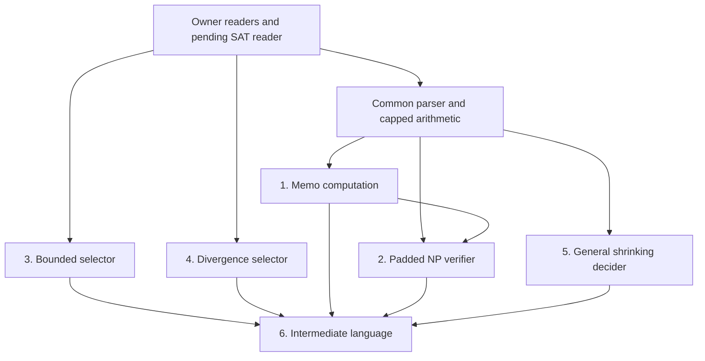

# Fill routes for the six Ladner targets

Route draft for Shilun-Allan-Li/tcslib, Arora–Barak chapters 3–4. No library source is changed, no theorem is filled, and no PR is opened. All new interfaces below are proposals unless explicitly identified as the already approved, pending SAT reader. These routes preserve all six audited target statements, all four definitions, and all six published Ladner readings.

## 1. Pins, evidence, and how to read this draft

| Input | Pin / result |
|---|---|
| Lean source | `5ab222167eb12664d97d255766c5def15b6d5d50` |
| Records | `624196fbcb402019e3762565b2964d0027ec8c51` |
| Dispatched exchange | `ccd0a51374631a8414ff233673ec71fc9c466058` |
| Bundle | `arora-barak-ch3-4/outbox/fills/ladner-fill-routes/ladner-fill-routes-bundle.md` |
| Bundle SHA-256 | `a9b368ac95570ce7137934445d30ab90d27c1ab5576effcb858a455802d7367b` — verified |
| Sections | 23 — verified |
| Source binding | The bundle at the exchange pin is byte-identical. All 23 payloads match their stated Lean/records pins after removing bundle framing; the Ladner source section also has an enclosing code fence. |

The campaign branch was fetched. Sources were read with `git show` and an unmodified `git archive` extraction of the Lean pin; a newer branch head was never substituted. Repository reports and scripts were inspected as data. The first section of the bundle supplies this task's standards; maintainer-only workflow actions were not treated as instructions to this worker.

Citation throughout: [AB09, Theorem 3.3 and its proof], S. Arora and B. Barak, *Computational Complexity: A Modern Approach*, Cambridge University Press, 2009. This is the approved fallback. The bundled source check distinguishes the January 2007 draft's Theorem 3.4 from the 2009 numbering. Direct web fetches of the [author-linked draft](https://theory.cs.princeton.edu/complexity/book.pdf) and [Barak's assignment](https://www.cs.princeton.edu/courses/archive/spring09/cos522/hw6.pdf) returned 403 on this run. I rely on the supplied source-check record for that edition mapping and do not claim to have verified Exercise 3.6(a)/(b).

The first section's LD9 approval supersedes the older proposal README's “UNAPPROVED” label. `Complexity.SAT_exists_linear_verifier` may be assumed for a route, but is absent at the Lean pin and must land separately before an unconditional consumer fill.

The code blocks below are exact proposed definitions and intermediate theorem types, with intentionally admitted bodies. They also appear in the standalone `Route-*.lean.txt` probes. Probe namespaces isolate candidate helper names; in production all consumer helpers belong **private inside namespace `Complexity` in the existing `TCSlib/Complexity/Diagonalization/Ladner.lean`**, with one shared parser/finite-table implementation. Standalone probes repeat that small parser specification so each can be checked without importing another scratch file; this is not a proposal to duplicate it in the library. No new file is proposed. Every public declaration listed in §3, including arithmetic leaves, requires the indicated separate scope decision. No probe admission is evidence that its mathematical statement has been proved.

Presentation order is 3, 4, 1, 2, 5, 6: the two qualitative selector arguments are independent of the memo implementation; NP membership waits for the memo result; the general padding theorem is independent of the special function; the final conjunction waits for all five.

## 2. Existing API checked at the Lean pin

`Route-API.lean.txt` checks the full names of the existing declarations used here and prints their axiom dependencies. The following table gives their homes. A declaration appearing in another table as **proposed** is deliberately not counted as existing API. Public structure fields may be applied as contracts without unfolding the structure-valued constant containing them.

| Home under `TCSlib/Complexity/` | Existing declarations used |
|---|---|
| `Diagonalization/Ladner.lean` | `Complexity.mem_padSAT_iff`, `padSAT_congr`, `ladnerMachine_eq`, `ladnerH_eq`, `ladnerH_le`, `SAT_H_eq`; the six target names are checked, not assumed proved. |
| `ClassP/P.lean` | `Complexity.mem_P_iff`. |
| `ClassP/ModelInvariance.lean` | `Complexity.mem_P_iff_one_work_tape`. |
| `ClassNP/NP.lean` | `Complexity.mem_NP_iff_exists_length_le`. This avoids unfolding `NP`. |
| `ClassNP/SAT.lean`; `CookLevin/Hardness.lean` | `Complexity.SAT_mem_NP`; `Complexity.SAT_NPHard`. No private SAT verifier is read by a consumer. |
| `ClassNP/Reductions.lean` | `Complexity.mem_P_of_polyTimeReducible`, `Complexity.P_eq_NP_of_NPHard_mem_P`. |
| `ClassNP/PolyTime.lean` | `Complexity.PolyTimeComputable.output_length_le`, `Complexity.PolyTimeComputable.comp`. |
| `ClassNP/PolyTimePairing.lean` | `Complexity.PolyTimeComputable.pairEncode`, `.append`; `polyTimeComputable_of_linear`, `polyTimeComputable_id`, `_const`, `_unary`, `_polyUnary`, `_pairFstD`, `_pairSndD`, `_ite`, `_and`; `pairFstD_pairEncode`, `pairSndD_pairEncode`, `length_pairFstD_le`. Each shortened entry here has the `Complexity.` prefix and the displayed common stem. |
| `ClassNP/PolyTimeBlockLoop.lean` | `Complexity.polyTimeComputable_or`, `_not`, `_tail`, `_headD`, `Complexity.length_pairSndD_le`. |
| `ClassNP/PolyTimePrefix.lean` | `Complexity.polyTimeComputable_takePrefixByLength`, `polyTimeComputable_dropPrefixByLength`. |
| `ClassNP/PClosure.lean` | `Complexity.mem_P_of_test`, `test_of_mem_P`, `mem_P_iff_polyTimeComputable`, `preimage_mem_P`, `inter_mem_P`. |
| `ClassNP/Transducer.lean` | `Complexity.transduce_nil`, `transduce_cons`, `polyTimeComputable_transduce`. |
| `ClassNP/EXP.lean` | `Complexity.exists_proj_decider`. Its private word-enumeration lemmas are not consumer API. |
| `Diagonalization/EXPCOM.lean` | `Complexity.expCode`; `Turing.UniformMachineCode.simulator_accepts`, `.simulator_rejects`. The proof uses their contracts and does not unfold `expCode` or read its choice witness. |
| `TuringMachine/Encoding.lean` | `Turing.MachineCode.decode_encode_pad` (structure field), `Turing.FinTM.toCodeTM_computesInTime_iff`, `Turing.length_pairEncode`, `Turing.pairEncode_injective`. |
| `TuringMachine/Finite.lean` | `Turing.FinTM.not_computesInTime_zero`, `ComputesInTime.mono`, `ComputesInTime.output_unique`, `computesFunInTime_iff`, `computesInTime_iff`. |
| `TuringMachine/Composition.lean` | `Turing.FinTM.exists_comp_on_image`. Its clock is exactly `2*T₁ n + T₂ n + 2`. |
| `TuringMachine/Build/Primitives.lean`; `Build/WordTests.lean` | `Turing.FinTM.computesFunInTime_lengthBits`, `computesFunInTime_polyBits`; `Turing.FinTM.computesFunInTime_decideEq`. |
| `TuringMachine/NatBits.lean` | `Turing.length_bits_le_self`. |
| `ClassP/BinaryArith/Iterate.lean` | `Complexity.BinArith.polyTimeComputable_iterate`, `iterate_invariant`, `iterate_measure_eq_zero`. These are the proposed memo, finite scan, saturated-power, and shrinking-loop hosts. |
| `ClassP/BinaryArith/Basic.lean` | `Complexity.BinArith.polyTimeComputable_normBits`, `polyTimeComputable_cons`, `bitsVal_eq_headD`, `bitsVal_drop_one`. |
| `ClassP/BinaryArith/AddSub.lean` | `Complexity.BinArith.polyTimeComputable_add`, `_sub`, `_lt`, `_le`, `_beq`; `add_pairEncode`, `sub_pairEncode`, `lt_pairEncode`, `le_pairEncode`, `beq_pairEncode`. |
| `ClassP/BinaryArith/Mul.lean` | `Complexity.BinArith.polyTimeComputable_reverse`, `polyTimeComputable_mul`, `mul_pairEncode`. |
| `ClassP/BinaryArith/Words.lean` | `Complexity.BinArith.encWords_nil`, `encWords_cons`, `encWords_append_singleton`, `length_encWords_le`, `length_decWords_le`, `decWords_encWords`, `polyTimeComputable_countW`, `countW_eq`, `polyTimeComputable_mapW`, `mapW_pairEncode`. |
| `ClassP/BinaryArith/Loops.lean` | `Complexity.BinArith.polyTimeComputable_forLoop`, `forLoop_pairEncode`, `polyTimeComputable_getW`, `getW_pairEncode_bits`, `polyTimeComputable_uRest`, `polyTimeComputable_hasFalse`, `uRest_nil`, `uRest_true_cons`, `uRest_false_cons`, `hasFalse_nil`, `hasFalse_cons`, `polyTimeComputable_eqW`, `eqW_pairEncode`, `polyTimeComputable_mulU`, `length_mulU`. |
| `SpaceComplexity/Machines/Bin.lean` | `Complexity.LogProg.bitsVal_bits`, `bits_injective`, `bitsVal_lt_two_pow`. |

Arithmetic on canonical numbers uses the existing `*_pairEncode` equations. There is no need to unfold `BinArith.add`, `mul`, `lt`, `le`, or `beq` or commission duplicate equations for those canonical inputs. Normalization already has a public FP theorem with an explicit lambda result. `bitsVal_eq_headD` and `bitsVal_drop_one` read arbitrary exponent words, so a missing `bitsVal` equation is not a blocker here.

The API probe also checks the Mathlib/core names explicitly used in the carried selector/numerical arguments: `Nat.find_spec`, `Nat.find_min'`, `Nat.log_lt_self`, `Nat.log_le_self`, `Nat.le_log_of_pow_le`, `Nat.pow_log_le_self`, `Nat.pow_le_of_le_log`, `Nat.lt_pow_succ_log_self`, `Nat.bits_append_bit`, `Nat.bit_val`, `Nat.one_bits`, `Nat.pow_le_pow_left`, `Nat.pow_le_pow_right`, `Function.iterate_succ_apply`, `Function.iterate_succ_apply'`, `Finset.le_sup`, and `Finset.mem_range`. Ordinary list length/append/map/getD equations are core/Mathlib equations; no core or Mathlib definition is proposed as an explicit `simp`, `rw`, or `unfold` argument.

## 3. Reader and import preparation

These are all foreign-definition reader gaps used by this route. Each statement is in `Route-Readers.lean.txt`. The homes are existing files. All proposed names below need Seyoon's public-API ruling; the SAT reader is already approved but pending. No definitions or target headers need to change.

| ID | Exact name(s) | Existing home | Consumers / reason |
|---|---|---|---|
| R0 | `Complexity.SAT_exists_linear_verifier` | `ClassNP/SAT.lean`, after `SAT_mem_NP` | Already approved LD9. Needed by short SAT search and the simple linear-certificate padded verifier. The owner may use its private SAT facts; consumers may not. |
| R1 | `Complexity.polyTimeComputable_iff` | `ClassNP/PolyTime.lean` | Extract/assemble an FP machine and its clock for simulator preparation. Existing closure results do not expose this existential by a published equation. |
| R2 | `Complexity.polyTimeReducible_iff` | `ClassNP/Reductions.lean` | Extract the reduction in target 5; assemble the bounded-padding reduction in target 6. |
| R3 | `Complexity.NPHard_iff` | `ClassNP/Reductions.lean` | Specialize hardness to `SAT_mem_NP` without applying the body of `NPHard`. |
| R4 | `Complexity.NPComplete_iff` | `ClassNP/Reductions.lean` | Extract hardness in the final contradiction. `NPComplete.mem_P_iff` alone does not supply it. |
| R5 | `Turing.FinTM.decidesInTime_iff` | `ClassP/DTIME.lean`, beside `DecidesInTime` | Relate a language decider to its indicator-valued function computation; use `computesFunInTime_iff` afterward. |
| R6a,b | `Turing.MultiTapeTM.indicator_of_mem`, `indicator_of_not_mem` | `TuringMachine/Deterministic.lean`, beside `indicator` | Interpret the decider's two outputs in targets 3 and 1. Similar `LogProg`/other-namespace indicator facts are not equations for this definition. |

These owner readings are definitional or immediate consequences of the owner definition, the two indicator cases, and published computation contracts. R5 reads the owner's own `DecidesInTime` and rewrites `Turing.FinTM.computesFunInTime_iff`; do not close it by definitional reduction of the foreign `ComputesFunInTime`. The readings introduce no machine, computational assumption, or new `simp` attribute.

```lean
namespace Complexity
-- Approved pending reader. It is absent at the import pin.
theorem SAT_exists_linear_verifier :
    ∃ V : Language Bool, V ∈ P ∧
      ∀ x : List Bool, x ∈ SAT ↔
        ∃ u : List Bool, u.length = x.length + 1 ∧ x ++ u ∈ V := by sorry

-- Proposed owner readers, not existing API at the import pin.
theorem polyTimeComputable_iff (f : List Bool → List Bool) :
    PolyTimeComputable f ↔ ∃ (M : FinTM Bool) (C d : ℕ),
      M.ComputesFunInTime f (fun n => C * (n + 1) ^ d) := by sorry

theorem polyTimeReducible_iff (L L' : Language Bool) :
    PolyTimeReducible L L' ↔ ∃ f : List Bool → List Bool,
      PolyTimeComputable f ∧ ∀ x, x ∈ L ↔ f x ∈ L' := by sorry

theorem NPHard_iff (L : Language Bool) :
    NPHard L ↔ ∀ L' : Language Bool, L' ∈ NP → PolyTimeReducible L' L := by sorry

theorem NPComplete_iff (L : Language Bool) :
    NPComplete L ↔ L ∈ NP ∧ NPHard L := by sorry
end Complexity

namespace Turing.FinTM
theorem decidesInTime_iff (M : FinTM Bool) (L : Language Bool) (T : ℕ → ℕ) :
    M.DecidesInTime L T ↔ M.ComputesFunInTime
      (fun x => [MultiTapeTM.indicator (L : Set (List Bool)) x]) T := by sorry
end Turing.FinTM

namespace Turing.MultiTapeTM
theorem indicator_of_mem {α : Type} {L : Set α} {x : α} (hx : x ∈ L) :
    indicator L x = true := by sorry
theorem indicator_of_not_mem {α : Type} {L : Set α} {x : α} (hx : x ∉ L) :
    indicator L x = false := by sorry
end Turing.MultiTapeTM
```

**Imports and host coverage.** The frozen Ladner imports are unchanged in this delivery. The implementation route proposes an explicit import of `ClassP.BinaryArith.Loops` (which already imports `Iterate`, `Words`, `AddSub`, `Mul`, and `Div`) and, if not retained transitively, `ClassP.ModelInvariance`. These are proof-route import decisions, not already authorized changes to the pinned source. All statement probes show their extended import context explicitly.

The existing `BinArith.polyTimeComputable_iterate` is the actual driver: it accepts an FP step/init and a polynomial orbit-length bound. `BinArith.polyTimeComputable_forLoop` is its existing counted variant; table access uses the existing `getW` host; exact SAT search uses the existing `exists_proj_decider`; uniform acceptance uses the existing simulator fields and `exists_comp_on_image`. No handwritten memo-table, search, recursion, or universal-machine host is proposed. The pin's §14 registry does not give `BinArith.polyTimeComputable_iterate` a named row or a gate receipt. The maintainer must bind these existing hosts to registry/statement-gate coverage before dispatch; publication of the theorem alone is not evidence of that process requirement. If that check requires a new contract, it is a separate decision/statement gate, not work hidden in a private Ladner helper.

**Common leaves.** The parser and finite table below are private consumer glue in `Ladner.lean`. `parse` is a mathematical specification. Its FP implementation is reverse the word, consume its initial true block and false delimiter with the existing `uRest`, reverse the remaining prefix, and obtain the suffix length by subtraction. `hasFalse` distinguishes all-true words from an empty recovered prefix. Thus `[false]` is distinguishable from “no separator.” Use the public reverse/transducer/pair/binary equations; do not copy a transition table.

The only proposed new shared computational API is the saturated binary power leaf: source names `Complexity.BinArith.powCap`, `powCap_eq`, `powCap_pairEncode`, and `polyTimeComputable_powCap` in the existing `ClassP/BinaryArith/Mul.lean`. The scratch names `powCap_pair` and `powCap_FP` below correspond to the last two production names. `powCap_eq` covers every input, including malformed pairs; the canonical equation alone would not cover the whole public definition. This is an arithmetic leaf, not a new loop host. It still needs a public-name/statement decision. All other helper labels in this section stay private in Ladner.

Compute `min(m^e,c+1)` by binary repeated squaring, consuming one exponent bit per round and saturating every multiplication at `c+1`. Handle `m=0`, `e=0`, and `0^0=1` explicitly. The exponent loop takes at most the input word length plus one iterations; register words have at most the combined input length plus a fixed constant, and a temporary product at most twice that many bits. Obtain the FP result by `BinArith.polyTimeComputable_iterate`, `polyTimeComputable_mul`, comparisons, and the published bit-tail readings. A full bit-size/iterate invariant is still proof work; this statement probe supplies no implementation proof. `syntax_FP` compares the saturated result with the available unary suffix length, so a huge binary exponent cannot force huge output allocation.

`finite_lookup_FP` is a static finite disjunction of fixed-word equality tests (`computesFunInTime_decideEq`, `polyTimeComputable_or`), not a runtime SAT search. `small_SAT_table` intersects the finite set of words shorter than a fixed bound with SAT by classical choice. Its code size may depend arbitrarily on that fixed bound; its runtime degree may not depend on the input.

```lean
namespace LadnerRouteShared

-- Mathematical parser specification; implement through reverse/uRest/hasFalse,
-- not by compiling a new private parser host.
def parse : List Bool → Option (List Bool × ℕ)
  | [] => none
  | b :: bs => match parse bs with
    | some (p, t) => some (b :: p, t)
    | none => if b then none else some ([], bs.length)

def padSyntax (h : ℕ → ℕ) (y : List Bool) : Bool :=
  match parse y with
  | none => false
  | some (p, t) => decide (t = p.length ^ h p.length)

def parseWord (y : List Bool) : List Bool :=
  match parse y with
  | none => []
  | some (p, t) => pairEncode [true] (pairEncode p (Nat.bits t))

theorem parse_some (y p : List Bool) (t : ℕ) :
    parse y = some (p, t) ↔ y = p ++ false :: List.replicate t true := by sorry

theorem parse_none (y : List Bool) :
    parse y = none ↔ ∀ b ∈ y, b = true := by sorry

theorem parsed_length {y p : List Bool} {t : ℕ} (hp : parse y = some (p, t)) :
    y.length = p.length + 1 + t ∧ p.length < y.length := by sorry

theorem parse_FP : PolyTimeComputable parseWord := by sorry

theorem syntax_FP {h : ℕ → ℕ}
    (hp : PolyTimeComputable (fun x : List Bool => Nat.bits (h x.length))) :
    PolyTimeComputable (fun y => [padSyntax h y]) := by sorry

theorem pad_membership {h : ℕ → ℕ} {y : List Bool} :
    y ∈ padSAT h ↔ ∃ p t, parse y = some (p, t) ∧
      t = p.length ^ h p.length ∧ p ∈ SAT := by sorry

theorem finite_lookup_FP (S : Finset (List Bool)) :
    PolyTimeComputable (fun x : List Bool => [decide (x ∈ S)]) := by sorry

theorem small_SAT_table (B : ℕ) :
    ∃ S : Finset (List Bool), ∀ x : List Bool,
      x ∈ S ↔ x.length < B ∧ x ∈ SAT := by sorry

-- Proposed shared arithmetic leaf in BinaryArith/Mul.lean (public decision).
def powCap (z : List Bool) : List Bool :=
  Nat.bits (min
    ((LogProg.bitsVal (pairFstD z)) ^ (LogProg.bitsVal (pairFstD (pairSndD z))))
    (LogProg.bitsVal (pairSndD (pairSndD z)) + 1))

theorem powCap_eq (z : List Bool) :
    powCap z = Nat.bits (min
      ((LogProg.bitsVal (pairFstD z)) ^ (LogProg.bitsVal (pairFstD (pairSndD z))))
      (LogProg.bitsVal (pairSndD (pairSndD z)) + 1)) := by sorry

theorem powCap_pair (m e c : ℕ) :
    powCap (pairEncode (Nat.bits m) (pairEncode (Nat.bits e) (Nat.bits c))) =
      Nat.bits (min (m ^ e) (c + 1)) := by sorry

theorem powCap_FP : PolyTimeComputable powCap := by sorry

end LadnerRouteShared
```

Common dependency ledger: `parse_some`/`parse_none` use the parser's own recursion equations and list equations; `parsed_length` uses `parse_some`; `parse_FP` uses the reverse/uRest/hasFalse and length/subtraction APIs; `powCap_FP` uses the existing iteration and arithmetic APIs; `syntax_FP` uses `parse_FP`, `powCap_FP`, the supplied `hp`, and canonical arithmetic equations; `pad_membership` uses `mem_padSAT_iff` and `parse_some`; `finite_lookup_FP` uses fixed equality and Boolean closure; `small_SAT_table` uses finite bounded-word enumeration, with no SAT decoder reading. `pad_membership`, `syntax_FP`, and `parse_some` are reused in all three computational consumers, not re-proved there.

Open common premises are R0's landing, R1–R6's reader decisions/proofs, the public saturated-power leaf, the proof-route import decision and host-coverage check, and all admitted common leaves above. Neither successful typing nor the historical conditional probes closes these premises. New source docstrings must cite mathematical sources, state their formulas in prose, and carry proof sketches for nontrivial proofs; scratch/campaign names and paths stay out of Lean docstrings.

## 4. Target 3 — `Complexity.ladnerH_bounded_of_mem_P`

### Mathematical route

Follow [AB09, Theorem 3.3 and its proof], with the approved timed-enumeration adaptation. From a P decider, use `mem_P_iff_one_work_tape`, then `FinTM.toCodeTM_computesInTime_iff`, to obtain a code-normal-form decider with a bound `a(m+1)^d`. Append sufficiently many true bits to `expCode.encode M`. The decode-padding field preserves the machine, while the resulting canonical binary index can exceed any chosen bound. Choose `i` above both `d` and `a*2^d`.

For nonempty inputs, `a(m+1)^d ≤ (a*2^d)*m^d ≤ i*m^i`. A rejecting computation cannot coexist with a completed true output at another time, by `ComputesInTime.output_unique`. At the empty word every indexed deadline is zero; `not_computesInTime_zero` and the separator's positive length make both acceptance and padded membership false. Thus this single `i` passes every word, not only an eventual tail of stages.

Apply `ladnerH_eq`: if the cap is at most `i`, it already supplies the bound; otherwise `i` is a valid candidate and `Nat.find_min'` bounds the minimum. This strengthens the existing sketch's finite-prefix bookkeeping without changing the statement or conventions. No change to that sketch is necessary for this route-drafting delivery.

### Exact intermediate statements, homes, and dependencies

All five helpers below are private in existing `Ladner.lean`. `pad_nil` uses `mem_padSAT_iff` and list lengths; `padded_index` ports the bundled scratch proof using `ladnerMachine_eq`, `MachineCode.decode_encode_pad`, `Nat.bits_append_bit`, and `Nat.bit_val`; `indexed_deadline` ports its numeric companion. `correct_index` uses those three helpers, `mem_P_iff_one_work_tape`, `FinTM.toCodeTM_computesInTime_iff`, R5/R6, and output uniqueness. `selector_bound` ports the bundled selector argument using only `ladnerH_eq`, `Nat.find_spec`, and `Nat.find_min'`. The target obtains `⟨i, selector_bound i good⟩` from `correct_index`.

```lean
namespace LadnerRouteBounded
theorem pad_nil (h : ℕ → ℕ) : ([] : List Bool) ∉ padSAT h := by sorry

theorem padded_index (M : CodeTM) (B : ℕ) :
    ∃ i, B < i ∧ ladnerMachine i = M.toFinTM := by sorry

theorem indexed_deadline (a d i m : ℕ)
    (hd : d ≤ i) (ha : a * 2 ^ d ≤ i) (hm : 1 ≤ m) :
    a * (m + 1) ^ d ≤ i * m ^ i := by sorry

theorem correct_index (hP : SAT_H ∈ P) :
    ∃ i, ∀ x : List Bool,
      (ladnerMachine i).ComputesInTime x [true] (i * x.length ^ i) ↔
        x ∈ padSAT ladnerH := by sorry

theorem selector_bound (i : ℕ)
    (good : ∀ x : List Bool,
      (ladnerMachine i).ComputesInTime x [true] (i * x.length ^ i) ↔
        x ∈ padSAT ladnerH) :
    ∀ n, ladnerH n ≤ i := by sorry
end LadnerRouteBounded
```

**Readers needed:** R5 and R6a,b. No unfolding of `PolyTimeComputable`, `NP`, `SAT`, the uniform-code choice, or `CodeTM.toFinTM` is needed. No assumption about whether `[] ∈ SAT` is needed.

**Open premises:** the five private helper proofs and the owner readers; no other Ladner target. The bundled index and selector proofs are prior scratch evidence, not installed API. The checked existing support dependencies are separately inventoried in `probe-validation.log`.

**Size/order:** about 150–300 new Lean lines, approximately 0.5–2 focused agent-days after reader/normalization preflight. It can be prepared independently of targets 1, 2, 4, and 5. Actual merges into the same owner file are serial.

**Risks:** encode indices canonically (an all-false suffix is insufficient); absorb the coefficient as well as degree; do not demand total Boolean output at a zero deadline; use the one-work-tape theorem before code conversion.

## 5. Target 4 — `Complexity.ladnerH_unbounded_of_not_mem_P`

### Mathematical route

The finite-counterexample argument is [AB09, Theorem 3.3 and its proof]. First show that each fixed indexed bounded-acceptance predicate is in P. Prepare the exact simulator layout `pairEncode (pairEncode (bits deadline) code) input`, use `expCode.simulator_accepts`/`simulator_rejects`, and compose only on that preparation function's image. An indexed machine may diverge on a rejected input: the bounded-acceptance simulator still returns a total negative answer. Do not infer a decider directly from the indexed machine.

If index `i` agreed with the padded language on every word, this total polynomial test would put `SAT_H` in P via `mem_P_of_test` and `SAT_H_eq`. Contraposition gives a finite failing word for every `i`. For a requested lower bound `C`, let `B` be the maximum length of the chosen witnesses for `i<C`, put `M=max B (2^C)`, and take `N=2^M`. At every `n≥N`, the query window contains those witnesses and the cap is at least `C`. None of those indices can be selected; the fallback is large enough too. No monotonicity of `ladnerH` is asserted.

### Exact intermediate statements, homes, and dependencies

All six helpers below are private in `Ladner.lean`. `fixed_clock_preparation` uses length bits, fixed-degree multiplication and pairing. Its FP proof must yield an actual preparation machine and polynomial clock through R1. `fixed_clock_budget` is the numeric majorant for the simulator's deadline-value clock, uniform in the input. `fixed_clock_FP` uses these two and `exists_comp_on_image`, not generic composition with a falsely polynomial-in-bit-length simulator. `all_tests_imply_P` uses `fixed_clock_FP` with `code=Nat.bits i`, `a=d=i`, `ladnerMachine_eq`, `mem_P_of_test`, and `SAT_H_eq`. `failing_words` is its classical contrapositive. `selector_threshold` is the bundled finite-sup argument with `ladnerH_eq` and `Nat.le_log_of_pow_le`. The target is `selector_threshold (failing_words hP)`.

```lean
namespace LadnerRouteUnbounded
theorem fixed_clock_preparation (code : List Bool) (a d : ℕ) :
    PolyTimeComputable (fun x : List Bool =>
      pairEncode (pairEncode (Nat.bits (a * x.length ^ d)) code) x) := by sorry

theorem fixed_clock_budget (D u a d n : ℕ) :
    D * (u + n + a * n ^ d + 1) ^ D ≤
      (D * (u + a + 2) ^ D) * (n + 1) ^ (max 1 d * D) := by sorry

theorem fixed_clock_FP (code : List Bool) (a d : ℕ) :
    PolyTimeComputable (fun x : List Bool =>
      [decide ((expCode.decode code).toFinTM.ComputesInTime
        x [true] (a * x.length ^ d))]) := by sorry

theorem all_tests_imply_P (i : ℕ)
    (good : ∀ x : List Bool,
      (ladnerMachine i).ComputesInTime x [true] (i * x.length ^ i) ↔
        x ∈ padSAT ladnerH) : SAT_H ∈ P := by sorry

theorem failing_words (hP : SAT_H ∉ P) :
    ∀ i : ℕ, ∃ x : List Bool,
      ¬ ((ladnerMachine i).ComputesInTime x [true] (i * x.length ^ i) ↔
        x ∈ padSAT ladnerH) := by sorry

theorem selector_threshold
    (bad : ∀ i : ℕ, ∃ x : List Bool,
      ¬ ((ladnerMachine i).ComputesInTime x [true] (i * x.length ^ i) ↔
        x ∈ padSAT ladnerH)) :
    ∀ C, ∃ N, ∀ n ≥ N, C ≤ ladnerH n := by sorry
end LadnerRouteUnbounded
```

**Readers needed:** R1; R5/R6 only when reading/assembling decider contracts in a lower-level implementation. The `mem_P_of_test` assembly itself avoids unfolding `P` or its indicator. Uniform-code fields and `ladnerMachine_eq` already cover the code boundary.

**Open premises:** preparation and its setup clock, the total fixed-clock FP theorem, and the finite-selector glue. No target 1 or 3 premise. There is no assumption of halting of `ladnerMachine i` on negative inputs.

**Size/order:** 200–400 lines, roughly 1–3 agent-days. Independent mathematical work can run alongside target 3 and the common arithmetic work; owner-file writes remain serial.

**Risks:** the simulator time is polynomial in the *numeric* deadline; binary encoding alone proves nothing about it. Fixed `a,d,code` allow the displayed polynomial envelope. Preserve the conclusion's `∀ n≥N`, not just “arbitrarily large values.”

## 6. Target 1 — `Complexity.ladnerH_polyTime`

### Mathematical route

Use the bottom-up evaluation behind [AB09, Theorem 3.3 and its proof], rather than recursively recomputing all smaller calls. The state is exactly `pairEncode J T`, where `J=1^|z|` is immutable and `T=encWords [bits H(0), …, bits H(j-1)]`. One outer step appends `bits (stage(values T))`. The driver runs `|z|+1` steps from the empty table; readout is the existing `getW` at unary index `J`. Thus there are no serialized simulator configurations or unbounded memo subcalls to hide in a state invariant.

At table length `j`, a padded query prefix has length strictly below its queried word, which has length at most `log₂ j`; for `j>0` this is below `j`. `padSAT_congr` therefore identifies lookup of the table's earlier values with global `ladnerH` on every queried word. At `j=0` the index cap is zero, so no query is needed. `ladnerH_eq` now proves that the finite minimum returned by `stage` is exactly `ladnerH j`.

The inner candidate test enumerates all words of length at most `a=log₂ j` as `(bits(r+1)).dropLast`, for `r<2^(a+1)-1`. This includes the empty word and every bit pattern with trailing zeros. There are at most `2(j+1)` queries per candidate and at most `j` candidates. Build each finite scan as an application of `BinArith.polyTimeComputable_iterate` (or its existing `forLoop` specialization) on a fixed context plus rank/candidate/success flag; use an absorbing completion flag. No private enumeration machine or generic memo host is added. The rank counter, selected index, and masks need only polynomially many bits/positions. The scans have at most `2(j+1)^2` test rounds plus polynomial initialization/finalization overhead, while the outer driver has exactly `|z|+1` **macro** steps. The inner costs are charged inside the FP proof of that macro step.

For candidate `i<log₂ log₂ j`, a short deadline satisfies `i*m^i≤j^3`. The uniform simulator cost is at most `(D*4^D)(j+1)^(3D)`, with `D=expCode.simDegree`. The supplied clock-envelope scratch proof already establishes the numerical leaf. It does not build the simulator input. The explicit guarded `queryPrep` below does so; a bad query maps to zero deadline, empty code and empty input. Test the guard before interpreting an enormous index as a loop count. On a good query compute the deadline with saturation at `j^3+1`, where the bound shows saturation is inert.

For SAT of a short prefix, use the approved R0 and `exists_proj_decider 1 1`. Its clock is `b*2^(m+1)*(a*(2m+2)^d+(2m+2)^2)`, bounded by `2b(a*2^d+4)(j+1)^(d+3)`. A generic NP certificate polynomial is insufficient here. The short SAT predicate is composed only on a guarded short-input image, with an explicit input-preparation clock. Invalid inputs may use an empty default SAT query and must have their final Boolean verdict masked; no assumption about SAT of the empty word is made.

The completed table has at most `|z|+1` entries, each with bit length at most `|z|`, by `ladnerH_le`, `Nat.log_le_self`, and `length_bits_le_self`. `length_encWords_le` and `length_pairEncode` give the explicit orbit bound `4(|z|+1)^2`. Apply the existing iterator with `(a,k,B,b)=(1,1,4,2)` and compose its output with `polyTimeComputable_getW`.

### Exact intermediate statements, homes, and dependencies

Every declaration below is private consumer material in existing `Ladner.lean`; no new public memo state/API is proposed. `values`, `shortWords`, `stage`, `candidate`, `memoInit`, `memoStep`, and the guarded query functions are semantic specifications, not claims that classical quantification executes. Their FP theorems are the construction obligations. The generic iterator, not evaluation of a classical `Nat.find`, implements the scans.

```lean
namespace LadnerRoutePoly
def values (T : List Bool) : List ℕ := (BinArith.decWords T).map LogProg.bitsVal

def shortWords (a : ℕ) : List (List Bool) :=
  (List.range (2 ^ (a + 1) - 1)).map (fun r => (Nat.bits (r + 1)).dropLast)

def stage (vs : List ℕ) : ℕ :=
  let n := vs.length
  if hex : ∃ i, i < Nat.log 2 (Nat.log 2 n) ∧
      ∀ x : List Bool, x.length ≤ Nat.log 2 n →
        ((ladnerMachine i).ComputesInTime x [true] (i * x.length ^ i) ↔
          x ∈ padSAT (fun m => vs.getD m 0)) then Nat.find hex
  else Nat.log 2 (Nat.log 2 n)

def candidate (S : List Bool) : Bool :=
  let n := (pairFstD S).length
  let i := LogProg.bitsVal (pairFstD (pairSndD S))
  let vs := values (pairSndD (pairSndD S))
  decide (n = vs.length ∧ i < Nat.log 2 (Nat.log 2 n) ∧
    ∀ x : List Bool, x.length ≤ Nat.log 2 n →
      ((ladnerMachine i).ComputesInTime x [true] (i * x.length ^ i) ↔
        x ∈ padSAT (fun m => vs.getD m 0)))

def memoInit (z : List Bool) : List Bool :=
  pairEncode (List.replicate z.length true) []

def memoStep (S : List Bool) : List Bool :=
  pairEncode (pairFstD S)
    (pairSndD S ++ pairEncode (Nat.bits (stage (values (pairSndD S)))) [])

theorem shortWords_complete (a : ℕ) (x : List Bool) :
    x ∈ shortWords a ↔ x.length ≤ a := by sorry

theorem shortWords_count (n : ℕ) :
    (shortWords (Nat.log 2 n)).length ≤ 2 * (n + 1) := by sorry

theorem short_deadline (n i m : ℕ)
    (hi : i < Nat.log 2 (Nat.log 2 n)) (hm : m ≤ Nat.log 2 n) :
    i * m ^ i ≤ n ^ 3 := by sorry

theorem numeric_envelope (D n i : ℕ) (x : List Bool)
    (hi : i < Nat.log 2 (Nat.log 2 n)) (hx : x.length ≤ Nat.log 2 n) :
    D * ((Nat.bits i).length + x.length + i * x.length ^ i + 1) ^ D ≤
      (D * 4 ^ D) * (n + 1) ^ (3 * D) := by sorry

theorem short_SAT_machine
    (linear : ∃ V : Language Bool, V ∈ P ∧ ∀ x : List Bool, x ∈ SAT ↔
      ∃ u : List Bool, u.length = x.length + 1 ∧ x ++ u ∈ V) :
    ∃ (a d b : ℕ) (E : FinTM Bool), E.DecidesInTime SAT
      (fun m => b * 2 ^ (m + 1) *
        (a * (2 * m + 2) ^ d + (2 * m + 2) ^ 2)) := by sorry

theorem short_SAT_envelope (a b d n m : ℕ) (hm : m ≤ Nat.log 2 n) :
    b * 2 ^ (m + 1) * (a * (2 * m + 2) ^ d + (2 * m + 2) ^ 2) ≤
      (2 * b * (a * 2 ^ d + 4)) * (n + 1) ^ (d + 3) := by sorry

-- Explicit preparation and envelope transfer: no preparation premise is implicit.
theorem simulation_on_image (code input : List Bool → List Bool)
    (deadline : List Bool → ℕ)
    (hprep : PolyTimeComputable (fun z =>
      pairEncode (pairEncode (Nat.bits (deadline z)) (code z)) (input z)))
    (hbudget : ∃ A e, ∀ z, expCode.simDegree *
      ((code z).length + (input z).length + deadline z + 1) ^ expCode.simDegree ≤
        A * (z.length + 1) ^ e) :
    PolyTimeComputable (fun z => [decide
      ((expCode.decode (code z)).toFinTM.ComputesInTime
        (input z) [true] (deadline z))]) := by sorry

def validQuery (S : List Bool) : Prop :=
  LogProg.bitsVal (pairFstD (pairSndD S)) <
      Nat.log 2 (Nat.log 2 (pairFstD S).length) ∧
    (pairSndD (pairSndD S)).length ≤ Nat.log 2 (pairFstD S).length

def queryCode (S : List Bool) : List Bool :=
  if validQuery S then Nat.bits (LogProg.bitsVal (pairFstD (pairSndD S))) else []
def queryInput (S : List Bool) : List Bool :=
  if validQuery S then pairSndD (pairSndD S) else []
def queryDeadline (S : List Bool) : ℕ :=
  if validQuery S then
    LogProg.bitsVal (pairFstD (pairSndD S)) *
      (pairSndD (pairSndD S)).length ^ LogProg.bitsVal (pairFstD (pairSndD S))
  else 0

def queryPrep (S : List Bool) : List Bool :=
  pairEncode (pairEncode (Nat.bits (queryDeadline S)) (queryCode S)) (queryInput S)

theorem query_preparation :
    ∃ (M : FinTM Bool) (C q : ℕ),
      M.ComputesFunInTime queryPrep (fun n => C * (n + 1) ^ q) := by sorry

theorem query_budget (S : List Bool) :
    expCode.simDegree *
      ((queryCode S).length + (queryInput S).length + queryDeadline S + 1) ^
        expCode.simDegree ≤
      (expCode.simDegree * 4 ^ expCode.simDegree) *
        (S.length + 1) ^ (3 * expCode.simDegree) := by sorry

theorem composition_clock (C q A e n : ℕ) :
    2 * (C * (n + 1) ^ q) + A * (n + 1) ^ e + 2 ≤
      (2 * C + A + 2) * (n + 1) ^ max q e := by sorry

theorem short_SAT_on_image (f : List Bool → List Bool)
    (hf : PolyTimeComputable f)
    (hshort : ∀ z, (f z).length ≤ Nat.log 2 z.length)
    (linear : ∃ V : Language Bool, V ∈ P ∧ ∀ x : List Bool, x ∈ SAT ↔
      ∃ u : List Bool, u.length = x.length + 1 ∧ x ++ u ∈ V) :
    PolyTimeComputable (fun z => [decide (f z ∈ SAT)]) := by sorry

theorem short_pad_FP
    (linear : ∃ V : Language Bool, V ∈ P ∧ ∀ x : List Bool, x ∈ SAT ↔
      ∃ u : List Bool, u.length = x.length + 1 ∧ x ++ u ∈ V) :
    PolyTimeComputable (fun S : List Bool => [decide
      ((pairFstD S).length ≤ Nat.log 2 (values (pairSndD S)).length ∧
        pairFstD S ∈ padSAT (fun m => (values (pairSndD S)).getD m 0))]) := by sorry

-- Concrete finite-scan states: no classical quantifier is executed by a host.
def ctxGuard (C : List Bool) : Prop :=
  (pairFstD C).length = (values (pairSndD (pairSndD C))).length ∧
    LogProg.bitsVal (pairFstD (pairSndD C)) <
      Nat.log 2 (Nat.log 2 (pairFstD C).length)

def wordVerdict (C : List Bool) (r : ℕ) : Bool :=
  let x := (Nat.bits (r + 1)).dropLast
  let i := LogProg.bitsVal (pairFstD (pairSndD C))
  decide (ctxGuard C ∧ x.length ≤ Nat.log 2 (pairFstD C).length ∧
    ((ladnerMachine i).ComputesInTime x [true] (i * x.length ^ i) ↔
      x ∈ padSAT (fun m => (values (pairSndD (pairSndD C))).getD m 0)))

def queryCount (C : List Bool) : ℕ := 2 ^ (Nat.log 2 (pairFstD C).length + 1) - 1

def testInit (C : List Bool) : List Bool :=
  pairEncode C (pairEncode (List.replicate (queryCount C) true) (pairEncode [] [true]))

def testStep (S : List Bool) : List Bool :=
  let C := pairFstD S
  let rem := pairFstD (pairSndD S)
  let rank := pairFstD (pairSndD (pairSndD S))
  let flag := pairSndD (pairSndD (pairSndD S))
  if rem = [] then S else
    pairEncode C (pairEncode (rem.drop 1)
      (pairEncode (rank ++ [true]) [flag.headD false && wordVerdict C rank.length]))

def testOut (S : List Bool) : List Bool := pairSndD (pairSndD (pairSndD S))

theorem log_eq_bits_length (n : ℕ) :
    Nat.log 2 n = (Nat.bits n).length - 1 := by sorry

theorem binary_log_FP : PolyTimeComputable
    (fun w : List Bool => Nat.bits (Nat.log 2 (LogProg.bitsVal w))) := by sorry

theorem wordVerdict_FP
    (linear : ∃ V : Language Bool, V ∈ P ∧ ∀ x : List Bool, x ∈ SAT ↔
      ∃ u : List Bool, u.length = x.length + 1 ∧ x ++ u ∈ V) :
    PolyTimeComputable (fun S : List Bool =>
      [wordVerdict (pairFstD S) (pairSndD S).length]) := by sorry

theorem testInit_FP : PolyTimeComputable testInit := by sorry

theorem testStep_FP
    (hw : PolyTimeComputable (fun S : List Bool =>
      [wordVerdict (pairFstD S) (pairSndD S).length])) :
    PolyTimeComputable testStep := by sorry

theorem test_orbit (C : List Bool) (j : ℕ) :
    testStep^[j] (testInit C) =
      pairEncode C (pairEncode (List.replicate (queryCount C - j) true)
        (pairEncode (List.replicate (min j (queryCount C)) true)
          [decide (∀ r < min j (queryCount C), wordVerdict C r = true)])) := by sorry

theorem test_size (C : List Bool) (j : ℕ) :
    (testStep^[j] (testInit C)).length ≤ 12 * (C.length + 1) ^ 1 := by sorry

theorem candidate_readout (C : List Bool) :
    [candidate C] = if ctxGuard C then
      testOut (testStep^[2 * (C.length + 1) ^ 1] (testInit C)) else [false] := by sorry

def selectCtx (T : List Bool) (i : ℕ) : List Bool :=
  pairEncode (List.replicate (values T).length true) (pairEncode (Nat.bits i) T)

def selectInit (T : List Bool) : List Bool := pairEncode T (pairEncode [] (pairEncode [] []))

def selectStep (S : List Bool) : List Bool :=
  let T := pairFstD S
  let rank := pairFstD (pairSndD S)
  let flag := pairFstD (pairSndD (pairSndD S))
  let cap := Nat.log 2 (Nat.log 2 (values T).length)
  if flag ≠ [] then S else
    if rank.length < cap then
      if candidate (selectCtx T rank.length) then
        pairEncode T (pairEncode rank (pairEncode [true] (Nat.bits rank.length)))
      else pairEncode T (pairEncode (rank ++ [true]) (pairEncode [] []))
    else pairEncode T (pairEncode rank (pairEncode [true] (Nat.bits cap)))

def selectOut (S : List Bool) : List Bool := pairSndD (pairSndD (pairSndD S))

def SelectInv (T S : List Bool) : Prop :=
  (∃ i, i ≤ Nat.log 2 (Nat.log 2 (values T).length) ∧
    S = pairEncode T (pairEncode (List.replicate i true) (pairEncode [] [])) ∧
    ∀ j < i, candidate (selectCtx T j) = false) ∨
  (∃ i, i ≤ Nat.log 2 (Nat.log 2 (values T).length) ∧
    S = pairEncode T (pairEncode (List.replicate i true)
      (pairEncode [true] (Nat.bits (stage (values T))))))

def selectMeasure (S : List Bool) : ℕ :=
  if pairFstD (pairSndD (pairSndD S)) = [] then
    Nat.log 2 (Nat.log 2 (values (pairFstD S)).length) - (pairFstD (pairSndD S)).length + 1
  else 0

theorem selectInit_FP : PolyTimeComputable selectInit := by sorry

theorem selectStep_FP (hc : PolyTimeComputable (fun C => [candidate C])) :
    PolyTimeComputable selectStep := by sorry

theorem select_progress (T S : List Bool) (hI : SelectInv T S) :
    SelectInv T (selectStep S) ∧
      (0 < selectMeasure S → selectMeasure (selectStep S) < selectMeasure S) ∧
      (selectMeasure S = 0 → selectStep S = S) := by sorry

theorem select_size (T : List Bool) (j : ℕ) :
    (selectStep^[j] (selectInit T)).length ≤ 12 * (T.length + 1) ^ 1 := by sorry

theorem select_readout (T : List Bool) :
    selectOut (selectStep^[1 * (T.length + 1) ^ 1] (selectInit T)) =
      Nat.bits (stage (values T)) := by sorry

theorem candidate_FP
    (linear : ∃ V : Language Bool, V ∈ P ∧ ∀ x : List Bool, x ∈ SAT ↔
      ∃ u : List Bool, u.length = x.length + 1 ∧ x ++ u ∈ V) :
    PolyTimeComputable (fun S => [candidate S]) := by sorry

theorem stage_FP
    (hcheck : PolyTimeComputable (fun S => [candidate S])) :
    PolyTimeComputable (fun T => Nat.bits (stage (values T))) := by sorry

theorem stage_correct (vs : List ℕ)
    (hvs : ∀ m < vs.length, vs.getD m 0 = ladnerH m) :
    stage vs = ladnerH vs.length := by sorry

theorem memoStep_FP
    (hstage : PolyTimeComputable (fun T => Nat.bits (stage (values T)))) :
    PolyTimeComputable memoStep := by sorry

theorem memoInit_FP : PolyTimeComputable memoInit := by sorry

theorem memo_orbit (z : List Bool) (j : ℕ) :
    memoStep^[j] (memoInit z) =
      pairEncode (List.replicate z.length true)
        (BinArith.encWords ((List.range j).map (fun m => Nat.bits (ladnerH m)))) := by sorry

theorem memo_size (z : List Bool) (j : ℕ) (hj : j ≤ z.length + 1) :
    (memoStep^[j] (memoInit z)).length ≤ 4 * (z.length + 1) ^ 2 := by sorry

theorem memo_readout (z : List Bool) :
    BinArith.getW (memoStep^[1 * (z.length + 1) ^ 1] (memoInit z)) =
      Nat.bits (ladnerH z.length) := by sorry

-- This is an assembly schema, not an admission of the library target.
theorem memo_transfer
    (hstep : PolyTimeComputable memoStep) (hinit : PolyTimeComputable memoInit)
    (hsize : ∀ z j, j ≤ 1 * (z.length + 1) ^ 1 →
      (memoStep^[j] (memoInit z)).length ≤ 4 * (z.length + 1) ^ 2)
    (hread : ∀ z, BinArith.getW (memoStep^[1 * (z.length + 1) ^ 1] (memoInit z)) =
      Nat.bits (ladnerH z.length)) :
    PolyTimeComputable (fun z => Nat.bits (ladnerH z.length)) := by sorry
end LadnerRoutePoly
```

| Intermediate cluster | Lemmas it uses / required proof content |
|---|---|
| `shortWords_complete`, `shortWords_count` | Canonical `Nat.bits`/bit arithmetic and list equations. Prove the sentinel-rank representation rather than relying on private `EXP.enumWord_*` lemmas. |
| `short_deadline`, `numeric_envelope`, `short_SAT_envelope` | Port the bundled standard-axiom scratch numerical arguments; handle zero and degree zero explicitly. These are private facts, not invented existing library names. |
| `short_SAT_machine` | R0 as its explicit `linear` hypothesis, `mem_P_iff`, `exists_proj_decider 1 1`; identify the language by set extensionality. |
| `simulation_on_image` | R1 to expose the preparation witness; simulator accept/reject fields, `ComputesInTime.mono`, `exists_comp_on_image`, `computesFunInTime_iff`, and `composition_clock`. This discharges the conditional simulator transfer only after **both** displayed premises are proved. |
| `query_preparation` | Guard/canonical arithmetic/length-bits/pair APIs and saturated power; the statement demands a concrete machine and its `C(n+1)^q` setup bound. |
| `query_budget` | `numeric_envelope` on good queries, empty/default case on bad queries, and the public projection-length bounds. |
| `composition_clock` | Pointwise polynomial majorization, including `q=0` and `e=0`; supplies the exact overhead from the image-composition theorem. |
| `short_SAT_on_image` | `short_SAT_machine`, its envelope, R1, R5/R6, and `exists_comp_on_image`; preserves the input preparation cost. |
| `short_pad_FP` | The common parser/syntax equations, saturated power, `getW_pairEncode_bits`, `polyTimeComputable_getW`, `countW_eq`, normalization/mapW, and guarded short-SAT image transfer. Exponents read from malformed tables may be huge; never expand them. |
| `candidate_FP` | Guarded simulation transfer above, `short_pad_FP`, `shortWords_complete/count`, and the existing iterator for the word sweep, with a Boolean conjunction flag. Prove a polynomial length invariant on **all** states reached by each initialized scan; bound scan scratch in serialized length. |
| `stage_FP` | `candidate_FP`, the existing iterator for candidates, and the first-success flag. Normalize returned table words; count table entries with `countW`, not byte length. A never-successful scan returns the exact cap. |
| `stage_correct` | Table hypothesis, `padSAT_congr`, `ladnerH_eq`, and logarithmic decrease; no computational premise. |
| `memoStep_FP`, `memoInit_FP` | `stage_FP`, projections, append and pair closure; `polyTimeComputable_unary` and a constant empty word. |
| `memo_orbit` | Induction using `stage_correct`, `encWords_append_singleton`, `decWords_encWords`, and canonical value readings. |
| `memo_size` | `memo_orbit`, `ladnerH_le`, `length_bits_le_self`, `length_encWords_le`, and pairing lengths. |
| `memo_readout` | `memo_orbit`, `getW_pairEncode_bits`, and the in-range list lookup at index `|z|`. |
| `memo_transfer` | Exactly `BinArith.polyTimeComputable_iterate hstep hinit 1 1 4 2 hsize`, then `polyTimeComputable_getW.comp`, then function extensionality with `hread`. |

The two finite scans also have concrete serialized transitions above. `testInit`/`testStep` keep an immutable context plus remaining-query unary counter, completed-rank unary counter and conjunction bit. `test_orbit` specifies the conjunction after every round; `test_size` supplies `12(|C|+1)` on the whole orbit. `candidate_readout` uses `2(|C|+1)` iterations and masks an invalid context. `wordVerdict_FP` is the guarded single-query leaf using the already displayed short-simulation and short-padding transfers. `log_eq_bits_length` and `binary_log_FP` supply floor-log arithmetic without opening a foreign definition. `testInit_FP` must construct the unary query budget within its proven linear value bound, using counted iteration and capped arithmetic rather than allocating an arbitrary binary value.

`selectInit`/`selectStep` keep the table, unary candidate rank, terminal flag and selected bits. `SelectInv` states that every earlier candidate failed, or that the terminal value is the exact stage minimum/fallback. `select_progress` gives invariant preservation, strict positive-measure decrease and a fixed terminal state. `select_size` gives `12(|T|+1)` uniformly; `select_readout` finishes after `|T|+1` rounds. `stage_FP` is precisely the existing iterator applied to these selection functions, followed by the projection readout. Both scan groups are private applications of the existing public iterator, not new private hosts. Their FP, semantic and size proofs remain fill obligations.

The `memo_orbit` equation specifies every entry at every stage, and `memo_size` is uniform over the required orbit. None of these admitted contracts has been pre-shipped as a proved implementation.

**Readers needed:** R0, R1, R5, R6a,b. All reads of `padSAT`/`ladnerH` are in their owner or through the six approved readings; table and arithmetic reads use §2. No public reader for SAT's private verifier representation or total CNF decoder is needed.

**Open premises:** all displayed helper proofs; especially the saturated-power implementation, input preparation/setup clock, both scan FP proofs with their actual orbit bounds, and exact memo semantics. The historically proved numerical envelopes retire only arithmetic leaves. They do not retire these constructions. Targets 3 and 4 are not prerequisites. The pending approved reader is an allowed route assumption, not a proved theorem at this pin.

**Size/order:** approximately 1,200–2,500 lines excluding shared owner APIs, 5–12 focused agent-days, likely multiple continuation briefs. First retire arithmetic/preparation, then candidate scan, then selection/memo/readout. Split by dispatch stages in the same owner file rather than creating new files solely for line count. Independent scratch proof development can overlap with targets 3/4/5; owner-file fills are serial.

**Risks:** a polynomial deadline value bound is essential; nested scans must be charged in the macro-step FP proof; table entry count differs from its encoded length; a malformed state cannot induce exponential iteration; a size bound on final states alone is insufficient; proving a classical equation is not proving an FP implementation. Preserve least success and fallback exactly. Never assume monotonicity of the selected function.

## 7. Target 2 — `Complexity.SAT_H_mem_NP`

### Mathematical route

Following [AB09, Theorem 3.3 and its proof], parse the final false separator and verify the prescribed unary suffix, then verify SAT of the recovered prefix with a certificate. The certificate contains only the SAT witness; the deterministic parser supplies the prefix, so guessing a split is unnecessary. For R0's verifier `V`, define the paired verifier below. Its certificate has length `|prefix|+1≤|input|+1`, since a parsed prefix is strictly shorter than the padded word.

`verifier_P` is the intersection of syntax/length tests and the polynomial preimage of `V` under the reconstruction `prefix ++ certificate`. `hp` is applied to the prefix word, not the padded word. Use capped exponentiation to compare the required power with the actual suffix length. Apply `mem_NP_iff_exists_length_le` with coefficient and degree both one, then specialize `h=ladnerH` using target 1 and rewrite `SAT_H_eq`. The public exact linear SAT reader makes this especially simple, although ordinary NP membership would also suffice for this target if one accepted a larger certificate polynomial.

### Exact intermediate statements, homes, and dependencies

`verifier`, `verifier_P`, `verifier_equiv`, and `padded_NP` are private in existing `Ladner.lean`. The standalone probe's `parse`, `syntax`, and `parseWord` repeat §3's specification only for independent typing; production reuses the single common implementation. `verifier_P` uses `parse_FP`, `syntax_FP`, FP reconstruction/length comparisons, `preimage_mem_P`, and `inter_mem_P`. `verifier_equiv` uses common parser membership, its strict-prefix length fact and the supplied certificate equivalence. `padded_NP` uses those two and `mem_NP_iff_exists_length_le`. No new public general padding theorem is proposed.

```lean
namespace LadnerRouteNP

-- Mathematical parser specification; implement through reverse/uRest/hasFalse,
-- not by compiling a new private parser host.
def parse : List Bool → Option (List Bool × ℕ)
  | [] => none
  | b :: bs => match parse bs with
    | some (p, t) => some (b :: p, t)
    | none => if b then none else some ([], bs.length)

def padSyntax (h : ℕ → ℕ) (y : List Bool) : Bool :=
  match parse y with
  | none => false
  | some (p, t) => decide (t = p.length ^ h p.length)

def parseWord (y : List Bool) : List Bool :=
  match parse y with
  | none => []
  | some (p, t) => pairEncode [true] (pairEncode p (Nat.bits t))

def verifier (h : ℕ → ℕ) (V : Language Bool) : Language Bool :=
  {S | match parse (pairFstD S) with
    | none => False
    | some (p, t) => t = p.length ^ h p.length ∧
      (pairSndD S).length = p.length + 1 ∧ p ++ pairSndD S ∈ V}

theorem verifier_P {h : ℕ → ℕ} {V : Language Bool}
    (hp : PolyTimeComputable (fun x : List Bool => Nat.bits (h x.length)))
    (hV : V ∈ P) : verifier h V ∈ P := by sorry

theorem verifier_equiv {h : ℕ → ℕ} {V : Language Bool}
    (hcert : ∀ x : List Bool, x ∈ SAT ↔
      ∃ u : List Bool, u.length = x.length + 1 ∧ x ++ u ∈ V) (y : List Bool) :
    y ∈ padSAT h ↔ ∃ u : List Bool,
      u.length ≤ y.length + 1 ∧ pairEncode y u ∈ verifier h V := by sorry

theorem padded_NP {h : ℕ → ℕ}
    (hp : PolyTimeComputable (fun x : List Bool => Nat.bits (h x.length)))
    (linear : ∃ V : Language Bool, V ∈ P ∧ ∀ x : List Bool, x ∈ SAT ↔
      ∃ u : List Bool, u.length = x.length + 1 ∧ x ++ u ∈ V) :
    padSAT h ∈ NP := by sorry
end LadnerRouteNP
```

**Readers needed:** R0; R1 is needed only in a machine-level realization of the common leaves, not to destruct `NP`. R5/R6 are needed if decider contracts are read directly; the closure route avoids that. The available paired-certificate characterization already supplies the NP boundary.

**Open premises:** target 1, R0's landing, common parser/saturated syntax and these three helper proofs. The target does not assume SAT is hard or P differs from NP.

**Size/order:** approximately 200–450 lines after common leaves, 1–3 agent-days. Wait for target 1 (or cite its frozen target only under a separately authorized proved-modulo fill regime). Can be developed in scratch alongside the general shrinking proof; cannot write Ladner simultaneously with another fill.

**Risks:** the SAT reader uses actual concatenation `prefix ++ u`, whereas the outer NP reader uses `pairEncode y u`; preserve both layouts. Check the last false, all-true rejection, empty prefix, exponent zero, and `0^0`. A polynomial bound on the exponent's **bit length** does not justify allocating the full power.

## 8. Target 5 — `Complexity.SAT_mem_P_of_padSAT_NPHard`

### Mathematical route

This is the shrinking part of [AB09, Theorem 3.3 and its proof], with the approved stronger `NPHard` premise. R3/R2 and `SAT_mem_NP` give a single polynomial reduction `f` from SAT; `PolyTimeComputable.output_length_le` gives `|f x|≤A(|x|+1)^d`. Choose `B` such that `h(m)≥2(d+1)` for every `m≥B`. This uses eventual divergence exactly; downward jumps before that threshold are harmless.

For a syntactically valid output with prefix length `m≥B`, `m^h(m)≤|f x|`. When `|x|≥A*2^d+2`, this implies `m²≤|x|`: otherwise `m^(2d+2)=(m²)^(d+1)>|x|^(d+1)>A(|x|+1)^d`, a contradiction. Taking `K=A*2^d+2` ensures `K≥2`, so `m²≤|x|` also gives `m<|x|`. This estimate applies to **every syntactically valid output**, including outputs on no-instances; it is not restricted to members of the padded language. Invalid padding is rejected using `hp` and the common capped syntax test.

The state is `pairEncode [] current` while live and `pairEncode [answer] []` when terminal. Terminal states are fixed. If `|current|<K`, answer with the finite SAT table for that threshold. Otherwise compute `f current`, reject bad syntax, answer from the finite table when its parsed prefix has length `<B`, and otherwise replace current by that prefix. The reduction equivalence and parser uniqueness preserve the SAT answer in the live case. Thus the measure `|current|+1` strictly decreases on live states and is zero on terminal states.

Run the existing generic iterator `|x|+1` times from `pairEncode [] x`, rather than compiling an unbounded recursive call. All live words are at most the original input length; state size is at most `4(|x|+1)`. `iterate_measure_eq_zero` proves termination within the allotted rounds, and the invariant identifies the terminal bit with SAT. Each step is FP, including the two finite tables; its reduction output and parser scratch costs are inside that step's polynomial time, not in the persistent state bound. The final result uses `mem_P_of_test`. No SAT self-reduction, sparse-language theorem, NP membership of `padSAT h`, or monotonicity of `h` is assumed.

### Exact intermediate statements, homes, and dependencies

All declarations below are private in existing `Ladner.lean`; use the common parser instead of a second production implementation. `step` is the pure transition of an application of the existing iterator, not a new recursion host. The FP theorem must implement its classical small SAT bits by the fixed finite tables, never by invoking a general SAT solver during a large-input round.

```lean
namespace LadnerRouteShrink

-- Mathematical parser specification; implement through reverse/uRest/hasFalse,
-- not by compiling a new private parser host.
def parse : List Bool → Option (List Bool × ℕ)
  | [] => none
  | b :: bs => match parse bs with
    | some (p, t) => some (b :: p, t)
    | none => if b then none else some ([], bs.length)

def padSyntax (h : ℕ → ℕ) (y : List Bool) : Bool :=
  match parse y with
  | none => false
  | some (p, t) => decide (t = p.length ^ h p.length)

def parseWord (y : List Bool) : List Bool :=
  match parse y with
  | none => []
  | some (p, t) => pairEncode [true] (pairEncode p (Nat.bits t))

def smallSAT (B : ℕ) (x : List Bool) : Bool := decide (x.length < B ∧ x ∈ SAT)

def step (h : ℕ → ℕ) (f : List Bool → List Bool) (B K : ℕ)
    (S : List Bool) : List Bool :=
  let x := pairSndD S
  if pairFstD S ≠ [] then S
  else if x.length < K then pairEncode [smallSAT K x] []
  else match parse (f x) with
    | none => pairEncode [false] []
    | some (p, t) =>
      if t ≠ p.length ^ h p.length then pairEncode [false] []
      else if p.length < B then pairEncode [smallSAT B p] []
      else pairEncode [] p

def Inv (x S : List Bool) : Prop :=
  (∃ y, S = pairEncode [] y ∧ y.length ≤ x.length ∧ (y ∈ SAT ↔ x ∈ SAT)) ∨
  (∃ b : Bool, S = pairEncode [b] [] ∧ (b = true ↔ x ∈ SAT))

def measure (S : List Bool) : ℕ :=
  if pairFstD S = [] then (pairSndD S).length + 1 else 0

theorem reduction_from_hardness {h : ℕ → ℕ} (hH : NPHard (padSAT h)) :
    ∃ f : List Bool → List Bool, PolyTimeComputable f ∧
      ∀ x, x ∈ SAT ↔ f x ∈ padSAT h := by sorry

theorem prefix_square_bound {h : ℕ → ℕ} (A d B n m : ℕ)
    (hh : ∀ r ≥ B, 2 * (d + 1) ≤ h r)
    (hn : A * 2 ^ d + 2 ≤ n) (hm : B ≤ m)
    (hsize : m ^ h m ≤ A * (n + 1) ^ d) : m ^ 2 ≤ n := by sorry

theorem reduction_shrinks {h : ℕ → ℕ} {f : List Bool → List Bool}
    (hf : PolyTimeComputable f)
    (hu : ∀ C, ∃ N, ∀ n ≥ N, C ≤ h n) :
    ∃ B K, 2 ≤ K ∧ ∀ x p t,
      K ≤ x.length → parse (f x) = some (p, t) →
      t = p.length ^ h p.length → B ≤ p.length →
        p.length ^ 2 ≤ x.length ∧ p.length < x.length := by sorry

theorem smallSAT_FP (B : ℕ) :
    PolyTimeComputable (fun x => [smallSAT B x]) := by sorry

theorem step_FP {h : ℕ → ℕ} {f : List Bool → List Bool}
    (hp : PolyTimeComputable (fun x : List Bool => Nat.bits (h x.length)))
    (hf : PolyTimeComputable f) (B K : ℕ) :
    PolyTimeComputable (step h f B K) := by sorry

theorem progress {h : ℕ → ℕ} {f : List Bool → List Bool} {B K : ℕ}
    (hK : 2 ≤ K)
    (hred : ∀ x, x ∈ SAT ↔ f x ∈ padSAT h)
    (hshrink : ∀ x p t, K ≤ x.length → parse (f x) = some (p, t) →
      t = p.length ^ h p.length → B ≤ p.length → p.length < x.length)
    (x S : List Bool) (hI : Inv x S) :
    Inv x (step h f B K S) ∧
      (0 < measure S → measure (step h f B K S) < measure S) ∧
      (measure S = 0 → step h f B K S = S) := by sorry

theorem orbit_size {h : ℕ → ℕ} {f : List Bool → List Bool} {B K : ℕ}
    (hinv : ∀ x S, Inv x S → Inv x (step h f B K S)) (x : List Bool) (j : ℕ) :
    ((step h f B K)^[j] (pairEncode [] x)).length ≤ 4 * (x.length + 1) ^ 1 := by sorry

theorem final_readout {h : ℕ → ℕ} {f : List Bool → List Bool} {B K : ℕ}
    (hprogress : ∀ x S, Inv x S →
      Inv x (step h f B K S) ∧
        (0 < measure S → measure (step h f B K S) < measure S) ∧
        (measure S = 0 → step h f B K S = S)) (x : List Bool) :
    pairFstD ((step h f B K)^[1 * (x.length + 1) ^ 1] (pairEncode [] x)) =
      [decide (x ∈ SAT)] := by sorry

theorem shrinking_transfer {h : ℕ → ℕ} {f : List Bool → List Bool} (B K : ℕ)
    (hstep : PolyTimeComputable (step h f B K))
    (hsize : ∀ x j, j ≤ 1 * (x.length + 1) ^ 1 →
      ((step h f B K)^[j] (pairEncode [] x)).length ≤ 4 * (x.length + 1) ^ 1)
    (hout : ∀ x, pairFstD ((step h f B K)^[1 * (x.length + 1) ^ 1]
      (pairEncode [] x)) = [decide (x ∈ SAT)]) : SAT ∈ P := by sorry
end LadnerRouteShrink
```

| Intermediate | Lemmas it uses |
|---|---|
| `reduction_from_hardness` | R3, R2, and `SAT_mem_NP`. |
| `prefix_square_bound` | Pointwise natural-power inequalities, with the explicit threshold `A*2^d+2`; no P/NP premise. |
| `reduction_shrinks` | `hf.output_length_le`, `hu` at `2(d+1)`, `prefix_square_bound`, `parse_some`/`parsed_length`. |
| `smallSAT_FP` | `small_SAT_table` and `finite_lookup_FP` from the single common implementation. |
| `step_FP` | `hp`, `hf`, parser FP and saturated syntax, the two finite tables, FP Boolean/conditional/pair/projection closure. It does not need hardness or divergence to be an FP function. |
| `progress` | `pad_membership`, parser uniqueness, `hred`, `hshrink`, exact branch equations of the owner's private step, and the finite-table specification. Covers live and both terminal bits. |
| `orbit_size` | Initial invariant and `BinArith.iterate_invariant` using `hinv`, pairing length equations. |
| `final_readout` | `progress`, `BinArith.iterate_measure_eq_zero`, the initialized measure `|x|+1`, and the terminal clause of `Inv`. |
| `shrinking_transfer` | `BinArith.polyTimeComputable_iterate` with `(1,1,4,1)`, FP init/projection, `hout`, then `mem_P_of_test` and set extensionality. |

**Readers needed:** R2/R3 for hardness and reduction extraction; R1 as needed by common arithmetic implementation. No NPComplete reader, no sharp SAT verifier, and no SAT decoder reader is required by this general theorem. The route uses the same registered iteration and finite-word access infrastructure as target 1, not a newly designed shrinking host.

**Open premises:** common parser/saturated power/finite table, the shrinking inequality and all displayed helper proofs, import/host coverage, and R2/R3. Target 1, target 2, and target 4 are not mathematical premises: `hp` and `hu` are already parameters of this target. R0 is also not a premise of this target.

**Size/order:** approximately 600–1,200 lines after common leaves, 3–7 agent-days, with numerical/semantic scratch work parallel to target 1. Dispatch the actual owner-file fill only once the shared leaves and reader contracts are available.

**Risks:** validity of padding is decidable independently of prefix SAT; check syntax before recursing. Prefix `<B` and input `<K` are distinct exceptional sets and both need finite tables. A terminal false flag is a **nonempty word** `[false]`, distinct from the live empty flag `[]`. `hp` has no numeric growth restriction on `h`; all powers must stay capped. One shrinking call per round is essential; do not accidentally branch recursively over possible separators. Never unfold `NPHard` or a reduction existential in a consumer.

## 9. Target 6 — `Complexity.SAT_H_intermediate`

### Mathematical route

As in [AB09, Theorem 3.3 and its proof], combine the two contradictions with NP membership. First suppose `SAT_H ∈ P`. Target 3 bounds `ladnerH` by some `C`; target 1 makes its bits FP. The literal padding map has length at most `2(n+1)^(C+1)` and is FP. It reduces SAT to `padSAT ladnerH`, because the final false separator gives a unique prefix. `mem_P_of_polyTimeReducible` and `P_eq_NP_of_NPHard_mem_P SAT_NPHard` contradict `P≠NP`.

For bounded padding one may select among the fixed finitely many exponent cases `0,…,C`; each unary power is built by finitely many applications of `polyTimeComputable_unary` and `polyTimeComputable_mulU`. Alternatively use saturated power and a proven unary output budget. A bit-length bound alone is not an emitter. The displayed `bounded_pad_FP` is the precise construction obligation; no public seventh target is introduced.

Now outside P, target 4 gives eventual divergence. If `SAT_H` were NP-complete, R4 would give hardness; rewrite `SAT_H_eq` and apply target 5 with target 1's computability. Again `SAT_NPHard` collapses P and NP. Combine with target 2. The existing `ladner` packaging theorem needs no proof change.

### Exact intermediate statements, homes, and dependencies

All six helpers below are private in existing `Ladner.lean`. `bounded_pad_length` uses the padding map's own equation and `hb`. `bounded_pad_FP` uses `hp`, finite selection by the canonical equality tests, unary multiplication, append/pair closure, and the length bound (or the shared saturated implementation). `padWord_membership` uses the common parser's unique final-false decomposition and `mem_padSAT_iff`. `bounded_pad_reduction` uses those two semantic/computational lemmas and R2. `outside_P` uses target 3 and the SAT collapse argument above; `not_complete` uses R4, target 4, target 5 and the same collapse. Their target premises are explicit in the probe. The library target itself assembles their results and target 2, under its unchanged hypothesis.

```lean
namespace LadnerRouteFinal
def padWord (h : ℕ → ℕ) (x : List Bool) : List Bool :=
  x ++ false :: List.replicate (x.length ^ h x.length) true

theorem bounded_pad_length {h : ℕ → ℕ} {C : ℕ} (hb : ∀ n, h n ≤ C)
    (x : List Bool) : (padWord h x).length ≤ 2 * (x.length + 1) ^ (C + 1) := by sorry

theorem bounded_pad_FP {h : ℕ → ℕ} {C : ℕ}
    (hp : PolyTimeComputable (fun x : List Bool => Nat.bits (h x.length)))
    (hb : ∀ n, h n ≤ C) : PolyTimeComputable (padWord h) := by sorry

theorem padWord_membership (h : ℕ → ℕ) (x : List Bool) :
    padWord h x ∈ padSAT h ↔ x ∈ SAT := by sorry

-- Private obligation, not a seventh public Ladner target.
theorem bounded_pad_reduction {h : ℕ → ℕ} {C : ℕ}
    (hp : PolyTimeComputable (fun x : List Bool => Nat.bits (h x.length)))
    (hb : ∀ n, h n ≤ C) : PolyTimeReducible SAT (padSAT h) := by sorry

theorem outside_P (hne : P ≠ NP)
    (hp : PolyTimeComputable (fun x : List Bool => Nat.bits (ladnerH x.length)))
    (hbounded : SAT_H ∈ P → ∃ C, ∀ n, ladnerH n ≤ C) : SAT_H ∉ P := by sorry

theorem not_complete (hne : P ≠ NP)
    (hp : PolyTimeComputable (fun x : List Bool => Nat.bits (ladnerH x.length)))
    (hout : SAT_H ∉ P)
    (hdiv : SAT_H ∉ P → ∀ C, ∃ N, ∀ n ≥ N, C ≤ ladnerH n)
    (hpadding : ∀ h : ℕ → ℕ,
      PolyTimeComputable (fun x : List Bool => Nat.bits (h x.length)) →
      (∀ C, ∃ N, ∀ n ≥ N, C ≤ h n) → NPHard (padSAT h) → SAT ∈ P) :
    ¬ NPComplete SAT_H := by sorry
end LadnerRouteFinal
```

**Readers needed:** R2 and R4; R1 only if a concrete machine is extracted in the bounded-padding implementation. `SAT_H_eq`, `mem_padSAT_iff`, and the existing P/reduction theorems cover the other boundaries. The helper is private: do not publish a new `SAT_reducible_padSAT_of_bounded` without a separate ruling.

**Open premises:** targets 1–5, the bounded-padding FP/semantic lemmas, common final-separator uniqueness, and R2/R4. The target is a small assembly only once these are proved; otherwise its short conjunction hides a substantial reduction-construction premise.

**Size/order:** 150–350 lines including bounded-padding construction, 1–3 agent-days; final logical assembly alone about 20–50 lines. Last owner-file fill. The bounded-padding scratch proof can be developed earlier, independently of the memo proof, using `hp` as a hypothesis.

**Risks:** boundedness is of the exponent's **value**, not its encoded length. Empty-prefix padding uses `0^0=1`. Recovering a prefix by an arbitrary first false instead of the final false would break the reduction. NPComplete's conjunction cannot be projected through a foreign definition without R4.

## 10. Dependency, scope, and risk assessment



The graph groups preparation for readability: target 5 needs R2/R3, **not** R0; target 3 needs R5/R6, **not** the parser/power construction; target 4 needs fixed-clock preparation, **not** the general memo implementation. The normalizing imports and host-coverage decision precede the affected machine fills.

| Work | Approximate new Lean lines | Focused agent-days | May develop independently of |
|---|---:|---:|---|
| Owner readers, common parser/finite tables and saturated arithmetic | 350–800 | 2–5 | Qualitative selector mathematics |
| Target 3 | 150–300 | 0.5–2 | Targets 1,2,4,5 |
| Target 4 | 200–400 | 1–3 | Targets 1,2,3,5 |
| Target 1 | 1,200–2,500 | 5–12 | Targets 3,4,5 |
| Target 2 | 200–450 | 1–3 | Target 5, once common leaves and target 1 are available |
| Target 5 | 600–1,200 | 3–7 | Special Ladner function targets |
| Target 6 | 150–350 | 1–3 | Bounded-padding subproof may be drafted early; final assembly waits |

These are engineering estimates, not budgets or guarantees. Serialization/guard proofs and Rule 10 seals can dominate the line count. All six targets share one owner file, so **none of their actual source-writing fills may overlap**. Independent scratch development, SAT-owner work, reader-owner work, and arithmetic-owner work have disjoint possible ownership. Work in `PolyTime.lean`, `Reductions.lean`, `DTIME.lean`, and `Deterministic.lean` also needs serial integration and downstream validation as appropriate; do not merge snapshots of separately replayed trees.

Before a brief is dispatched, the maintainer must replace the relevant `sorry` sketches here by a concrete contracted route preflight: identify each step/init/readout, discharge the iterator's actual size premise, check the row/word layout, obtain any public API/import decision, bind host registry coverage, seal foreign definitions with paired controls, and replay on the merged tree. No blanket fill-readiness claim follows from this draft. No change to LD1–LD7 or to the audited source statements was found necessary.

Carry the following adversarial cases into that preflight: `n=0,1,2,3` (zero cap), thresholds 4/16, `i=0`, empty input and empty prefix, exponent zero, `0^0`, all-true/no-separator strings, embedded false bits and final-false uniqueness, malformed SAT encodings (they retain their total-decoder semantics), fallback without any successful candidate, nonmonotone but eventually diverging `h`, overlarge binary exponents in malformed tables, and both Boolean terminal flags. No new well-formed-SAT restriction is introduced.

## 11. Execution evidence

Final statement checks (all exit 0; the counts are intentional **new probe admissions**, not imported target proofs):

| Probe | Exit | Errors | `sorry` warnings / bodies |
|---|---:|---:|---:|
| `Route-API.lean.txt` | 0 | 0 | 0 / 0 |
| `Route-Readers.lean.txt` | 0 | 0 | 8 / 8 |
| `Route-SAT_H_intermediate.lean.txt` | 0 | 0 | 6 / 6 |
| `Route-SAT_H_mem_NP.lean.txt` | 0 | 0 | 3 / 3 |
| `Route-SAT_mem_P_of_padSAT_NPHard.lean.txt` | 0 | 0 | 9 / 9 |
| `Route-Shared.lean.txt` | 0 | 0 | 11 / 11 |
| `Route-ladnerH_bounded_of_mem_P.lean.txt` | 0 | 0 | 5 / 5 |
| `Route-ladnerH_polyTime.lean.txt` | 0 | 0 | 34 / 34 |
| `Route-ladnerH_unbounded_of_not_mem_P.lean.txt` | 0 | 0 | 6 / 6 |

Total: 82 intentional admissions; 144 existing full-name checks. The API/axiom probe has no new admission.

See `probe-validation.log` for the exact toolchain, bootstrap/probe exit codes, error counts, intentional sorry counts, existing API checks, axiom inventory, and source hashes. The environment is macOS/APFS: the Linux `/proc`/cgroup fields in addendum v2.6 are not applicable, and native CPU/memory/filesystem readings are recorded instead. Dependencies are the main campaign checkout's `.lake/packages` symlink, permitted by the addendum, with every present package checked against this pin's manifest. No cache was fetched and no package tree was copied. No other session's TCSlib object/scratch tree was used: the import closure was bootstrapped afresh from the archived source pin into this task's own scratch olean tree, serially through the inspected throttled `leanelab-o.sh`. No `lake build` was run.

The macOS sandbox denies `nice`'s priority adjustment; the underlying Lean still runs with `-j4` and only one process started by this task at a time. An initial `/usr/bin/time -l` wrapper could not read `kern.clockrate` and returned 1 after producing a Configuration object. That resource-wrapper attempt was discarded and the serial bootstrap was restarted from the first module without that wrapper; subsequent child exit statuses are the actual script/Lean statuses. Cumulative child maximum RSS is reported as an upper bound, not falsely as each module's peak. These are disclosed environment deviations, not mathematical findings and not reasons to abandon the item. The process-executable shim was not needed.

All route theorem bodies intentionally use `sorry`. These checks establish import/name/type compatibility, not proof correctness, target completion, foreign-boundary seal success, or a merged-tree replay. The bootstrap's inherited warnings and the pin's six Ladner admissions are distinct from the probe admissions. The existing API axiom inventory in the log identifies any inherited `sorryAx` separately. This is a route-drafting delivery, not a zero-sorry certificate.

## 12. Summary — fill briefs to issue

1. **Reader preparation.** Land the already approved `SAT_exists_linear_verifier` in `ClassNP/SAT.lean`; obtain decisions for and prove R1–R6 in their existing owner files. Authorize the precise proof-route imports and bind existing iterator/search/simulator hosts to registry and gate coverage. No Ladner target is filled in this brief.
2. **Arithmetic and parser leaves.** After the public-API ruling, add `BinArith.powCap`, its full and canonical equations, and its FP theorem in `ClassP/BinaryArith/Mul.lean`; add only the private parser, padding-syntax, and finite-table helpers in `Diagonalization/Ladner.lean`. Keep separate file ownership for arithmetic and Ladner work.
3. **Bounded selector.** In `Ladner.lean`, prove only `ladnerH_bounded_of_mem_P` and the five private helpers in §4. This does not wait for the memo computation or parser.
4. **Divergence selector.** In `Ladner.lean`, prove only `ladnerH_unbounded_of_not_mem_P`, its fixed-clock preparation/FP helpers, and the finite-witness threshold in §5. This does not wait for `ladnerH_polyTime`.
5. **Memo computation, staged.** In `Ladner.lean`, first prove the short SAT/simulation preparation contracts, then the two bounded scans, then the table orbit/size/readout lemmas, and finally `ladnerH_polyTime`. Use the existing iterator; add no public memo host. Expect continuation briefs.
6. **Padded NP membership.** In `Ladner.lean`, prove the private paired verifier lemmas and `SAT_H_mem_NP`, after brief 5 and common leaves.
7. **General shrinking decider.** In `Ladner.lean`, prove the square-root bound, two finite exception tables, private iterator transition/invariant/readout, and `SAT_mem_P_of_padSAT_NPHard`. Its mathematical work can precede brief 5; its source fill is scheduled serially.
8. **Final assembly.** In `Ladner.lean`, prove the private bounded-padding reduction and `SAT_H_intermediate` after targets 1–5. Leave the four definitions, six readings, six target signatures, and existing `ladner` packaging unchanged. No public seventh target, new file, or new private host is in scope.
