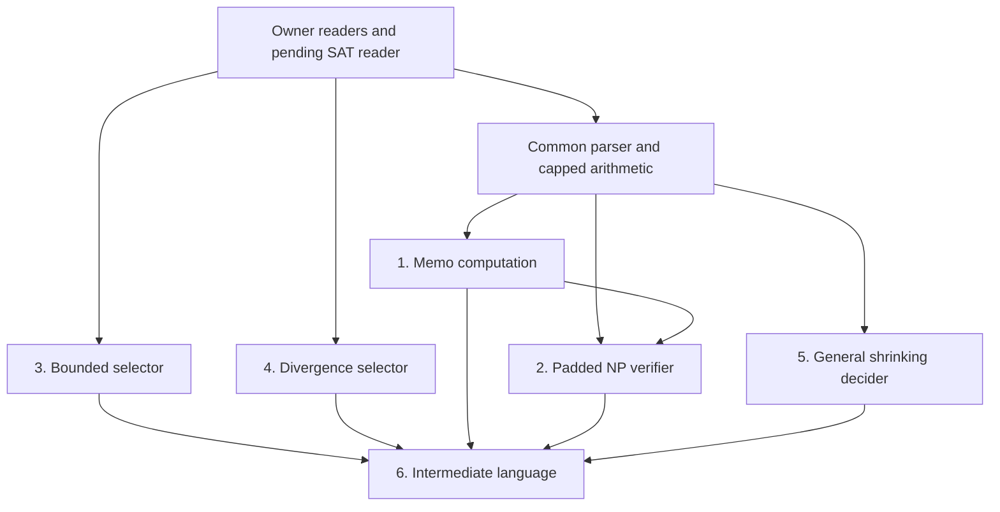

## ===== campaign/fills/ladner-selectors/briefs/ladner-selectors.md =====

# Ladner fill 1 (Codex): the two selector theorems in `Diagonalization/Ladner.lean`

## Repository and branch — read this before anything else

- Repository: `https://github.com/Shilun-Allan-Li/tcslib` (the same repository as your exchange
  checkout).
- **Base commit:** `50bb801a28ffd86ce7b47c91d47c257ab024fade`, the head of branch
  `codex/ab34-ladner-readers` (the campaign `complexity/arora-barak-ch3-4` plus the approved owner
  readers, under review as gate 135). Fetch it (`git fetch origin codex/ab34-ladner-readers`) and
  work on a local branch off it (suggested name `fill/ladner-selectors`). Record the base hash in
  `REPORT.md`. Never rebase.
- **Delivery is by zip and exchange push, not PR:** see "Delivery" at the end.

## What this is

Ladner's theorem [AB09, Theorem 3.3 and its proof] is stated in `Diagonalization/Ladner.lean`
with six admitted targets (gate 128 audited the statements; do not change them). A Codex route
draft (bundled, `campaign/items/ladner/fill-routes-request/delivery/ladner-fill-routes.md`) plans
all six; Seyoon ruled its interfaces on 2026-11-14 (`campaign/backlog.md`, P3.4). **Your targets
are the two selector theorems**, in this order:

1. `Complexity.ladnerH_bounded_of_mem_P : SAT_H ∈ P → ∃ C, ∀ n, ladnerH n ≤ C` (route §4);
2. `Complexity.ladnerH_unbounded_of_not_mem_P :
   SAT_H ∉ P → ∀ C, ∃ N, ∀ n ≥ N, C ≤ ladnerH n` (route §5).

They are independent of the memo computation (`ladnerH_polyTime`) and of the other targets. Target 1
complete beats two partials.

## Owned file (modify this and nothing else)

`TCSlib/Complexity/Diagonalization/Ladner.lean`: the two target proofs, new `private` helpers in
namespace `Complexity`, and, if your route needs it, the import
`TCSlib.Complexity.ClassP.ModelInvariance` (approved; also approved, if needed:
`TCSlib.Complexity.ClassP.BinaryArith.Loops`). Every other declaration of the file — the four
definitions, the six proved readings, the other four admitted targets and `ladner` — stays
**byte-identical**, including their docstrings. No other file changes.

## Ground rules (binding)

1. **Statement freeze.** The two target statements and every existing declaration are frozen.
2. **Rule 10** (`campaign/maintainer/WORKFLOW.md` §2, bundled): read other files' TCSlib
   definitions only through their published equations. Core and Mathlib definitions may reduce by
   `rfl`, `decide` or `show`, but are never passed to `simp`, `rw` or `unfold`. In particular do
   not unfold `P`, `PolyTimeComputable`, `NP`, `SAT`, `DecidesInTime`, `indicator`,
   `ComputesInTime`, `expCode`, `CodeTM.toFinTM` or the uniform-code choice. The readers you need
   exist at the base:
   - `Complexity.polyTimeComputable_iff` (R1, ClassNP/PolyTime);
   - `Turing.FinTM.decidesInTime_iff` (R5, ClassP/DTIME);
   - `Turing.MultiTapeTM.indicator_of_mem` / `indicator_of_not_mem` (R6, Deterministic);
   - `Complexity.polyTimeReducible_iff`, `NPHard_iff`, `NPComplete_iff` (R2–R4; not needed here).
   The route draft's §2 table lists the existing API it checked (`mem_P_iff_one_work_tape`,
   `FinTM.toCodeTM_computesInTime_iff`, `MachineCode.decode_encode_pad`,
   `UniformMachineCode.simulator_accepts`/`_rejects`, `FinTM.exists_comp_on_image`,
   `mem_P_of_test`, `ComputesInTime.output_unique`, `not_computesInTime_zero`, …). If a step needs
   a reading that has no published equation, **stop and escalate** (E-READER in `REPORT.md`, with
   the reader's proposed statement and home); do not unfold.
3. **No new public declarations**, no new files, no `@[simp]` attributes, no `sorry`, `admit` or
   new axioms in delivered code.
4. **Standards** (`policy.md`, bundled): every new declaration has a docstring citing [AB09,
   Theorem 3.3 and its proof] or a library declaration; every proof over 20 lines carries a
   `**Proof sketch.**`; no campaign labels, gate or finding names, or paths in Lean text.
5. **Route.** The route draft's §4–§5 helper plan (bundled) is guidance, not binding: its helper
   names and statements are a starting point (they elaborate at the campaign pin with admitted
   bodies). Keep its risk notes: encode indices canonically (an all-false suffix is insufficient);
   absorb the coefficient as well as the degree; do not demand total Boolean output at a zero
   deadline; use the one-work-tape theorem before code conversion; the simulator's time is
   polynomial in the **numeric** deadline, not its bit length; keep the conclusion's `∀ n ≥ N`.
6. **Escalation** on anything unprovable as stated (E-STATEMENT), any needed reading without an
   equation (E-READER), or any needed host that does not exist (E-HOST). A clean escalation is a
   valid delivery.

## Environment and verification

Follow the bundled fill-environment addendum (v2.6). **Never run `lake build`.** Bootstrap the
import closure of `Ladner.lean` at the base commit into your own scratch olean tree (as your route
probes did), one Lean process at a time. Final checks, all reported with exit codes:

- `Diagonalization/Ladner.lean`: zero errors; the only `sorry` warnings are the four remaining
  admitted targets (`ladnerH_polyTime`, `SAT_H_mem_NP`, `SAT_mem_P_of_padSAT_NPHard`,
  `SAT_H_intermediate`) and `ladner`'s dependence, none in your code;
- `#print axioms` for both targets: at most `propext`, `Classical.choice`, `Quot.sound`;
- the facade `Diagonalization.lean` with zero errors.

## REPORT.md checklist

- [ ] 2/2, or target 1 plus a frontier; the base hash.
- [ ] Every new `private` declaration with its role.
- [ ] Every other-file TCSlib definition each proof reaches, and the published equation used for it.
- [ ] Final check outputs, the two axiom prints, and `git diff --stat` touching only `Ladner.lean`.
- [ ] Environment deviations, as in the route delivery.

## Delivery

Make `fill-ladner-selectors.zip` with `REPORT.md`, the full delivered `Ladner.lean`, the patch
against the base (`git diff 50bb801a… -- TCSlib`), and the check logs. Push it, after
`git pull --rebase` and without force or any other change, to
`arora-barak-ch3-4/inbox/fill-ladner-selectors/` on the exchange branch, and also attach it in
chat. Cumulative checkpoint zips (`fill-ladner-selectors-checkpoint-N.zip`) to the same folder are
welcome on long runs. Do not push to any other branch and do not open a pull request; the
maintainer lands the fill by PR for Seyoon to merge.

## ===== policy.md =====

# TCSlib Contribution Policy

Standards for all Lean contributions to this repository, whether written by humans or by
agents. This document covers three things: **modularity** (how code is organized),
**attribution** (how every result is traced to a source), and **proof sketches** (how every
formal proof is accompanied by readable mathematics).

It complements, and does not replace:

- `workflow.md` — the campaign formalization process (phases, audit gates, fill epochs)
  that produces code meeting these standards.
- `.github/copilot-instructions.md` — build workflows, import rules, CI integration points.
- `AGENTS.md` / `.claude/CLAUDE.md` — the sorry-ladder proof workflow and agent roster.
- `blueprint/BLUEPRINT_PIPELINE.md` — how blueprint entries are generated and validated.

Where this document names an existing mechanism (blueprint macros, hygiene scripts), the
policy is to *use that mechanism*, not to invent a parallel one.

## 1. Modularity

**Layout.** Content lives at `TCSlib/<Area>/<Topic>/<Piece>.lean`, one coherent concept or
lemma cluster per file, with a facade file `TCSlib/<Area>/<Topic>.lean` that imports every
child and carries a `/-! -/` module docstring with a `## Contents` list (one line per child).
See `TCSlib/Complexity/NPReductions.lean` for the reference example.

**File size.** Target 150–600 lines per math file. A file approaching 1000 lines should be
split unless there is a positive reason not to (e.g. a single long proof that cannot be
usefully decomposed).

**Exports.** Every new topic facade must be imported from `TCSlib.lean`. CI only builds what
is reachable from `TCSlib.lean`; an unexported file is invisible to CI, docs, and the
blueprint.

**Imports.** Precise module imports only. A bare `import Mathlib` fails CI. Import only what
the file uses.

**Namespaces.** Namespaces are area-local: pick one namespace root per topic and use it
consistently within that topic. Do not leak auxiliary definitions into the root namespace;
mark internal helpers `private` or put them in a dedicated inner namespace.
*Model registry exception*: a model-defining **type** (a machine, circuit, formula, or
decision-tree model) may live at the root namespace, Mathlib-style, provided it is
registered in the catalog facade `TCSlib/ComputationalModels.lean`; its operations and
lemmas still live in the type's own namespace. Anything else at root is a leak.

**Layering.** Keep definition files separate from heavyweight theorem files, so that
downstream work can import a model or a class definition without pulling in every proof about
it. When a development has both a "raw/general" layer and a "bundled" layer (e.g. a machine
model that is parametric in its types, plus a bundled version carrying finiteness instances),
headline definitions and theorems are stated against the bundled layer; the raw layer is
internal plumbing.

**Helpers.** Foundational helper lemmas that serve a whole area belong in that area's
`Basic.lean`, not in the file that first needed them.

**Definitions land with their lemmas** (user, 2026-10-16). Every new public `def` is published,
in the same PR and beside the definition, with the lemmas that let a consumer read it without
unfolding:
- a structure-valued definition (a contract, a configuration, zone contents): its field
  equations, generated by `simps` with `(config := { isSimp := false })` and explicit
  projections (`simps!` where the body is another constructor's result);
- any other definition: an equation lemma `<name>_eq` (by `rfl` where that holds), or case
  lemmas that together cover every input (`_of_lt`/`_of_le`, `_true`/`_false`, one per
  constructor);
- a predicate: an `_iff` characterization;
- a machine: its run or contract lemma, the only way consumers read a machine.

None carries `@[simp]` unless a gate approves it, and each docstring states its formula. Consumers
never unfold another file's definition (the no-unfolding rule of the briefs, user 2026-10-16). The
rule binds TCSlib's own definitions: core and Mathlib definitions may reduce in a `rfl`, `decide`
or `show` step, but are never passed to `simp`, `rw` or `unfold`; use their equation lemmas
(`Bool.toNat_true`, not `simp [Bool.toNat]`) (user, 2026-10-23).
**Reducible abbreviations are notation** (user, 2026-10-26). Lean unfolds a TCSlib `abbrev` (such
as `Turing.Cfg.Halted`, `cfg.state = none`) at every step, and the standard seal cannot cover it:
under Lean's default reducibility validation, `attribute [local irreducible]` fails on a reducible
declaration (only the unsafe override `set_option allowUnsafeReducibility true`, which the
campaign's seals do not use, lifts the check). So reading an abbreviation through its body,
for example `¬ c.Halted` as `c.state ≠ none`, is allowed and is not a definitional closure. A
consumer names it in `simp`, `rw` or `unfold` only through a published lemma where one exists, and
a new public `abbrev` still lands with its `_iff` or `_eq` lemma.
They read the machine model's primitives (`MultiTapeTM.step`, `runFrom`, `Action.apply`,
`Cfg.mapState`) through the existing lemmas. The style lint's check 8 reports, per file, every
public `def` with no lemma named after it and no `simps` attribute, so a head-against-base diff
of the lint shows any new definition that lacks one. Definitions that predate the rule are listed
by the same check and covered as consumers need them.

**Construction reuse.** Machines are built from the verified construction layers, not from
scratch: the combinators and routine catalog of `TCSlib/Complexity/TuringMachine/Build/`
(conventions, wrappers, loops, primitives, embeddings, seams, and the catalog rows —
`machine-library-design.md` is the registry), the registered hosts (**Hosts come first**,
below), and the program layers (`LogProg.ARM`, `CounterProg`, and the general programming
layer of `machine-library-design.md` §15 once it lands) where a program-level description
suffices. Before writing a transition
table by hand, check the registry; a routine that exists is cited, not re-derived. A routine
that *almost* exists is the interesting case: do not write a third private variant — either
consume the general form, or commission the missing form into the shared layer (during a
fill batch: a `private` local copy plus a "requested shared lemma" in the report, promoted
at the next shared-file window). A hand-built machine is acceptable only when no layer
covers the need, and its docstring must say so and name what was missing — that sentence is
what turns the gap into the next catalog row. The chapter-1/2 files that predate this layer
re-derived the same bank/relocation/dispatch/frame families four times over (`emitterBank*`,
`clBank*`, `clSlot*`, …); the retrofit paying that debt back is the standing cautionary
tale. The same discipline applies to circuit construction once `CircuitComplexity`'s gadget
layer exists: gadgets, wiring combinators, and size/depth ledgers get one shared home and a
registry, and new circuits are assembled from it.

**Hosts come first.** A *host* is a control structure that drives other routines rather than
computing one value: a search or traversal (BFS, DFS, backtracking, an odometer over
assignments), a recursion or evaluation scheme (AND/OR evaluation, Savitch's midpoint
recursion), an interpreter or simulation step block, a clocked or windowed runner, a dispatcher
over a data structure (tables, records), or an input device. Any routine whose natural contract
does not depend on its first consumer counts as a host; leaf rows (copy, compare, seek,
arithmetic) do not. **A host is never built `private` inside the proof that first needs it.**
Its public contract is designed, statement-gated and placed in the shared construction layer
first, generic in the parts its consumers vary (the leaf test, the step relation, the data
domain), with time and space (head-envelope) clauses. Consumers cite it, under the campaign's
proved-modulo rule while its own fill is still running. The host registry is
`machine-library-design.md` §14. A private host already in the tree is harvested into the
shared layer before a second consumer is briefed against it. The rule exists because private
hosts were the main way the library overfitted to single proofs: four configuration encodings,
three reachability notions and a private search host per theorem, each to be re-derived by the
next consumer (assessment of 2026-10-12, recorded in the design document). (User, binding,
2026-10-12.)

**Duplication.** Some duplication is mechanically forced by the campaign discipline —
exclusive file ownership, the statement freeze, and `private` visibility leave a fill batch
no other legal way to use another file's unexported machinery — and occasionally it is the
right engineering call. It is never silently acceptable: **every instance of duplicated
proved material must be human-approved.** A fill batch discloses each copy in its report;
the maintainer's integration ledger totals copied material per file (`workflow.md` §4); and
the audit template treats accumulated duplication as a major finding that a gate cannot
close over without the human maintainer explicitly accepting the debt and naming where and
when it is paid back (the registry's dedup/refactor queue). Duplication that was never
disclosed is a freeze violation, not debt.

**File header.** Every math file begins with the Mathlib-style copyright block, its imports,
the repo-standard options

```
set_option maxHeartbeats 0
set_option relaxedAutoImplicit false
set_option autoImplicit false
```

then a module docstring containing `# Title`, `## Main definitions`, `## Main results`, and
`## References` (see §2).

## 2. Attribution

Every mathematical statement in the library must be traceable to a source, at the level of
precision of a textbook theorem number or a paper section.

**File-level.** Every math file's module docstring contains a `## References` section giving
full citations with short tags, e.g.

```
## References

* [AB09] S. Arora, B. Barak, *Computational Complexity: A Modern Approach*,
  Cambridge University Press, 2009.
```

**Declaration-level.** Every definition, theorem, and lemma that corresponds to a result in
a source carries the tag with a precise location in its docstring: `[AB09, Claim 1.6]`,
`[AB09, §1.7]`, `[GRS25, Thm 4.2.1]`. Purely technical glue lemmas with no textbook
counterpart may omit the tag; anything a reader would recognize as "a result" may not.

**Deviations.** If the formal statement deviates from the source — different constants,
strengthened or weakened hypotheses, a reformulation — the docstring must say so and briefly
say why (e.g. "stated with explicit constant 5k rather than O(·), following the proof").

**Statement prose.** Every public declaration's docstring begins with a natural-language
statement of what it asserts (for a definition: what it is), precise enough that a reader
could judge the formalization's fidelity without parsing the Lean. The `[Tag, location]`
citation and any deviation note attach to that statement; the proof sketch (§3) follows it.
A bare label ("Unfolding lemma", "Helper for X") is not a statement. Instances are exempt,
as are vendored files (which follow upstream style). `private` declarations should carry
docstrings too, but at reviewer discretion rather than as a hard requirement. The blueprint
remains the cross-referenced informal layer for dependency structure (see **Blueprint**);
the docstring statement is what external audits compare blind restatements against, so it
is part of the trusted surface.

**Blueprint.** When an ingested reference exists under `blueprint/src/references/`, blueprint
entries use `\statementsource{<ref>}{<anchor>}` and `\proofsource{<ref>}{<anchor>}` to cite
it, subject to the existing rule that these are written only after an approved proofmatch
run. When starting a new chapter or paper, ingest it as a reference pair
(`<name>.raw.md` + `<name>.md`) so these citations are possible: put the PDF under
`blueprint/src/references/` in the change that formalizes it and run
`python3 scripts/dataset_pipeline.py --yes`, which ingests it, matches every text the
blueprint does not cite yet, and carries the new statements into the dataset
(`python3 scripts/sources.py add TAG=<pdf or md>` does the ingest and match alone, with
the docstring tag above; `python3 scripts/sources.py` shows which texts are attached and
which are still missing; see `dataset/INSTRUCTIONS.md`). The dataset builder does not
search outside that directory for sources; an unattached text leaves the theorems with
informalized proof notes instead of citations.

**Vendored code.** Lean code adapted from another project keeps the original copyright
header and license notice, and its file docstring names the source project, the commit it
was taken from, and a summary of local modifications.

**Design adaptation.** When a construction, proof architecture, or module design is
adapted from — or materially inspired by — another project's code, the debt is cited even
when no code is transcribed. The module docstring's `## References` section names the
source project, author, module or archive entry, the commit or version consulted, and its
license, with a short tag usable at declaration level; the precedent is
`TuringMachine/Composition.lean`'s `[Balbach22]` for the Isabelle AFP `Cook_Levin`
composition-combinator architecture. Design documents and blueprint entries built on the
adapted design carry the same citation. Examining external code purely for comparison,
with nothing taken, creates no citation duty, but on a campaign it belongs in the
campaign's records (plan decision log or backlog) so the provenance question is answerable
later. (Maintainer guideline, binding, 2026-10-06.)

## 3. Proof sketches

Every nontrivial formal proof is accompanied by a human-readable English proof sketch, kept
next to the Lean it describes.

**What counts as nontrivial.** Rule of thumb: any proof longer than ~20 lines of tactics, or
that would rate difficulty ≥ 3 on the blueprint scale. One-line `simp`/`omega`/`exact`
proofs need no sketch.

**Where sketches live.** In the Lean file itself:

- For most theorems: a `**Proof sketch.**` paragraph at the end of the theorem's docstring,
  written in mathematical English (not Lean identifiers), naming the key intermediate steps.
- For long proofs: additionally, short comments at the major `have`/section boundaries tying
  the tactics back to the sketch's steps.

The named intermediate steps of a sketch should be visible in the formalization as `have`s
or standalone lemmas — if the sketch says "first reduce to the one-tape case", there should
be a lemma that is that reduction.

**Where sketches do not live.** Not in the blueprint. Blueprint statement entries state
claims only; `scripts/dataset_hygiene.py --strict` hard-fails on proof content there. The
blueprint records *what* is true and its dependency structure; the Lean docstrings record
*why* it is true.

**Sketches and the sorry ladder.** When landing a sorry-skeleton, write the sketch at
skeleton time — the sketch *is* the plan, and each `sorry` should correspond to a named step
of it. A skeleton whose sketch cannot be written is not ready to land.

**Synchronization.** When a proof strategy changes, the sketch changes in the same commit.
A sketch that describes a proof the code no longer performs is worse than no sketch.

## Review checklist

Before merging new Lean content, check:

1. Files follow the Area/Topic layout with a facade, and `TCSlib.lean` exports are updated.
2. Imports are precise; no bare `import Mathlib`.
3. Every file has a `## References` section; every source-derived declaration has a
   `[Tag, location]` in its docstring; deviations from sources are noted.
4. Every nontrivial proof (or sorry-stub standing in for one) has a proof sketch.
5. Every public declaration (instances and vendored files excepted) has a docstring
   opening with a natural-language statement of what it asserts
   (`python3 scripts/style_lint.py` checks presence mechanically; statement quality is
   review judgment).
6. `zsh scripts/lean_check.sh <file>` reports zero errors for each touched file.
7. If blueprint content was touched: `python3 scripts/blueprint_validate.py --strict` and
   `python3 scripts/dataset_hygiene.py --strict` pass.
8. No new private host: every search, recursion, interpreter, runner or input device the
   change introduces is a registered public host, or cites one (§1, **Hosts come first**).

## ===== workflow.md =====

# TCSlib Formalization Workflow

How large formalization campaigns are run in this repository. [`policy.md`](policy.md)
says what landed Lean code must look like; this document says what *process* produces
it. The reference implementation is the Arora-Barak campaign
(`AroraBarakChapter1Plan.md`, complete and audited end to end;
`AroraBarakChapter2Plan.md`, in progress) — file paths below cite its artifacts as
worked examples. Where an older document describes a mechanism this one supersedes
(e.g. the PR-based fill delivery in `AroraBarakChapter1Plan.md` §5, since replaced by
zip delivery), this document records current practice.

```
plan  →  statement phases  →  audit gates  →  fill campaign  →  closure
          (sorry-skeletons)    (per phase)     (epochs/batches)   (attestation, final
                                                                   audit, blueprint)
```

The load-bearing idea: **statements are audited before proofs are attempted.** Lean
already checks proofs; the dominant failure mode of formalization is a wrong or
subtly-weakened *statement*, and that is cheapest to catch while everything is still a
`sorry`. Every phase therefore lands as a compiling skeleton, passes an adversarial
external audit gate, and only then becomes fill work.

## 1. The campaign plan

Each campaign (typically one textbook chapter) begins with a plan file at the repo
root — `<Source>Chapter<N>Plan.md` — containing:

* **Scope**: which results are mandatory core, which are deferred, with source
  citations.
* **Foundation decisions**: the definitional conventions, each with its rationale
  (these are where audits bite; see §3).
* **Architecture and module layout**: directories, namespaces, facades, per policy §1.
* **Phasing**: the statement phases and the anticipated fill epochs.
* **Risks and honest effort assessment**.
* **Open design questions (human review required)**: decisions reserved for a human
  maintainer. Audit rounds *verify* these but never *dispose* of them; each records
  the maintainer's provisional choice and stays open until a human closes it. The
  consolidated register — full statements, cross-links, and status — is
  [`backlog.md`](backlog.md); the plans keep stable numbered stubs, which is what
  audit documents cite.
* **Decision log**: an append-only table. Every methodological decision, every audit
  round's verdict, and every repair round gets a row. The log is the campaign's
  memory; when a decision is reversed, the old row is marked **Superseded** in place,
  never deleted.

## 2. Statement phases (sorry-skeletons)

A phase lands the definitions plus the theorem *statements* of one coherent slice,
every proof a `sorry` under a policy-grade proof sketch (policy §3: the sketch is
written at skeleton time and is the plan; a skeleton whose sketch cannot be written is
not ready to land). Ground rules:

* Definitions and sorried statements only. Proofs appear in a skeleton only for
  definitional-unfolding lemmas whose home module mirrors proved infrastructure (the
  precedent: the `runWith` algebra of `TuringMachine/Nondeterministic.lean`, mirroring
  the vendored `runFrom` lemmas), and any such deviation is flagged in the audit pack
  with the proofs declared part of the audited surface.
* Sketches name their obligations: a sketch that will need a machine construction
  names each sub-machine as an explicit fill obligation, so the eventual brief can
  inherit the list. It also names every **host** the route needs (policy §1, **Hosts come
  first**), from the registry in `machine-library-design.md` §14. A sketch that needs an
  unregistered host is not ready: the host's public contract is a statement-phase item of
  its own, gated before the consumer's fill.
* Everything gate-verifies before commit: per-module checks plus a full fresh sweep
  (§6), style lint, and the headline axiom prints.

## 3. Audit gates (between phases)

Right after a skeleton lands — statements frozen — an **external adversarial audit**
runs before any fill or any next phase. The auditor is an LLM from a different vendor,
in a fresh context, reviewing the trusted surface (definitions, statements, sketches,
and any skeleton-time proofs) against the source text.

**Artifacts**, committed under `audits/` with campaign-scoped names
(`ch2-phase1-*`, `epoch4-*`), except the bundle:

* `…-pack.md` — the auditor's instructions: the audited commit, repository-side
  attestations (freeze by path enumeration, sweep results, admission inventory, axiom
  prints, lint — stated so the auditor can verify or challenge them, with source facts
  kept separate from maintainer execution claims), the under-audit inventory, a
  prioritized brief (the plan's seeded design questions go here), and the findings
  table format with the severity guide: **blocker** (a downstream phase would build on
  a wrong statement) / **major** (fixable but materially misleading) / **minor** /
  **note**. `campaign/standards/TEMPLATE.md` is the skeleton.
* `…-bundle.md` — a single uploadable file: the pack verbatim, then every attachment
  under a `## ===== <path> =====` header (prior findings, both plans, `policy.md`,
  the root, and the full module tree). **Not committed** (user, 2026-10-15): it is kept
  in the local dispatch folder, and the resolutions record its SHA-256 and section
  count. Bundles committed before then are indexed in `campaign/BUNDLES.md`, with how to
  retrieve them from history.
* A short kickoff message (drafted per round, pasted by the maintainer into a fresh
  auditor chat with the bundle attached).
* `…-findings.md` — the auditor's report, preserved **verbatim**, including anything
  the maintainer disputes. Pack errata found later are acknowledged in the resolutions
  file; shipped packs are never edited retroactively.

**The gate rule**: a gate closes only on a round reporting **zero blockers and zero
majors**. A round with majors triggers repairs and a full re-audit round (minors may
be swept in the closing commit and re-verified). Repairs adopt the auditor's own
constructions where supplied, are re-gated, and are recorded in the decision log; when
the loop closes, `…-resolutions.md` summarizes every round, every repair, and the note
dispositions. The complete worked example is the three-round
`campaign/gates/ch2-phase1{,-reaudit,-round3}/{pack,findings,resolutions}.md` loop.

Audits complement, never replace, in-Lean sanity theorems — the machine-checked and
permanent form of the same checks.

## 4. The fill campaign (epochs and batches)

With all phase gates closed, the audited-true sorries are filled in **epochs** —
sequential, ordered by risk retirement, with an audit round at each epoch boundary —
each consisting of **batches** run in parallel by cloud agents with disjoint file
ownership, from self-contained briefs in `briefs/`.

**Binding batch ground rules** (full text repeated in every brief):

1. **Exclusive file ownership.** Helpers live `private` in owned files; a lemma that
   belongs in a shared file is *requested* in the report and added serially at epoch
   merge, flagged for the next audit. **Hosts are the exception** (rule 4).
2. **Statement freeze.** Audited declarations are never renamed, re-signatured, or
   re-stated by fill work. A target that looks unprovable as stated is an
   *escalation*, reported with the obstruction — never "fixed" inline.
3. **Verification per batch**: the check script (§6) over the owned files, zero
   `error:` lines, sorries only at documented out-of-scope items.
4. **Hosts first** (user, 2026-10-12; policy §1). A batch never builds a search,
   recursion, interpreter, runner or input device as a private one-off. It cites the
   registered public host its brief names. If the route turns out to need a host the
   brief does not name, that is an escalation, reported with the contract the batch
   would need; the batch continues on its other targets.

**Hosts in briefs.** A fill brief is issued only when every host its route needs is
registered (`machine-library-design.md` §14) and the host's statement gate has closed. The
host's own fill may run in the same wave, in its own batch, with consumers citing it under
the proved-modulo rule. The readiness check for any target lists the hosts it needs. A
private host already in the tree is harvested (a promotion PR and its gate) before a second
consumer is briefed against it.

**Delivery is by zip, not PR.** Each batch returns an archive containing `REPORT.md`,
the full source files, a `git format-patch` series, a git bundle, the batch's sweep
log, the axiom-print log, and `SHA256SUMS`. The maintainer verifies before
integrating: checksums; the statement freeze (comment-stripped comparison of every
audited signature); enumeration of any removals; public-declaration drift; a full
fresh sweep; the headline axiom prints; and the **duplication ledger** — every
private copy of existing proved material in the delivery enumerated, with each
touched file's cumulative copied-material count and fraction. If a delivery pushes a
file past **one fifth copied material**, or adds copies to a file that already
received copies in an earlier epoch, the maintainer opens a `backlog.md` §1
human-review item before the epoch's audit pack ships — no discretion. Integration
is `git am -3` from the patch series, preserving the agent's authorship. Large fills that exhaust one agent's budget
continue via a continuation brief to a fresh agent (the `universal` B2 precedent).

**Counting public names** (user, 2026-10-22; gate 59). Public-declaration drift, the statement
freeze and a brief's "no new public declaration" rule count **public declarations**: the
declarations the source introduces without `private` (`theorem`, `lemma`, `def`, `abbrev`,
`instance`, `structure`, `inductive`, `class`), counted by the comment-aware source census
(`devtools/seyoon/declfreeze.py`). Packs say so ("N → N public declarations, at source"). A
**public constant** is a non-private name in the module's elaborated environment (the axiom
probe's walk of the module's publics). Packs and reviews report a module's new public constants
separately, by kind:
- a declaration's compiler auxiliaries (`_proof_N`, `_simp_N`, `match_N`, `eq_N`, `eq_def`,
  `congr_simp`);
- the instances that `deriving` generates for a **private** type, which Lean 4.25 names publicly
  (e.g. `instDecidableEqSl_Key`).

Neither kind is a public declaration. A derived instance of a private type needs no finding when
its type is private to its file and a name check over the tree and the open PRs finds no clash;
where a derived name would clash, write an explicit `private instance`. Any other new public
constant is reported as a finding.

**Epoch boundaries**: the maintainer re-runs the full sweep, produces a **drift
attestation** (§6), and prepares the epoch's audit pack with elaboration evidence
and the epoch's **duplication ledger**, which the auditor verifies independently
(audit template failure mode 5); the epoch's gate follows the same
zero-blockers/majors rule as phase gates, and a debt major closes only by explicit
human acknowledgment recorded in the resolutions file. Once a family is
acknowledged, later corrections to its accounting are minors (audit template
failure mode 5) and do not hold the gate; the ledger is still corrected.

## 5. Closure

When the last sorry falls: a zero-sorry sweep with build evidence; a campaign-wide
drift attestation against the audited baselines; a final audit pack covering the fill
rounds; and the blueprint increment — dependency graph from `.ilean` artifacts,
`scripts/blueprint_{enumerate,assemble,validate}.py`, blueprint-writer agents, with
the blueprint **late-bound** throughout (extraction only at boundaries; no blueprint
LaTeX hand-written ahead of the Lean; `blueprint/BLUEPRINT_PIPELINE.md` has the
pipeline detail).

## 6. Verification tooling

* **`scripts/lean_check_tree.sh <module>`** — the campaign's elaboration gate: a
  direct `lean` invocation per module (**`lake build` is banned on campaign
  branches** — see the Chapter-1 decision log), emitting fresh `.olean`s into a
  scratch tree. Pass requires exit 0, zero `error:` lines, *and* a fresh olean, so a
  stale artifact can never satisfy the check. The full sweep runs it over every
  module, in dependency order, from `scripts/ab_ch1_module_order.txt`:

  ```
  ( while read -r m; do bash scripts/lean_check_tree.sh "$m" || exit 1; done \
      < scripts/ab_ch1_module_order.txt )
  ```

  Admission counting is by `declaration uses 'sorry'` warnings in the sweep log; the
  expected count is attested in every pack.
* **`scripts/campaign_style_lint.py`** (named `scripts/style_lint.py` until the
  main merge, which adopted main's per-file policy linter under that name — the
  historical audit logs' invocations refer to this tool) — mechanical policy checks: statement-prose docstrings,
  sketch-before-sorry, file sizes, `## References`, facade coverage, and (check 8, since
  2026-10-16) public definitions without a lemma beside them (`policy.md` §1, *Definitions
  land with their lemmas*). Campaign baseline: zero FAIL (legacy pre-campaign files outside
  the audited surface are tolerated and listed). Check 8 is a WARN listing names; a landing
  adds no name to it.
* **Axiom prints** — `#print axioms` for every headline theorem on the *fresh* olean
  tree: closed results must show exactly `[propext, Classical.choice, Quot.sound]`;
  sorried statements show `sorryAx`, and any other axiom is a stop-the-line event.
* **Drift attestation** — the anti-tamper check between audited baselines: strip
  comments from every module, compare both the **multiset** of declarations and the
  **ordered declaration sequence** against the baseline, and enumerate public
  declarations (gained / lost / changed) so that "nothing audited moved" is a checked
  claim, not an impression.
* **Vendored files** are frozen at their recorded upstream pin and periodically
  byte-compared against upstream; local modifications live only in the header list.

## 7. Relationship to the other documents

* [`ROADMAP.md`](ROADMAP.md) — a one-page orientation: the phases ahead and pointers to
  the documents that hold the detail.
* [`policy.md`](policy.md) — the standards this workflow enforces (modularity,
  attribution, sketches, review checklist).
* [`lean-glossary.md`](lean-glossary.md) — the Lean/Mathlib jargon appearing in
  declaration names and docstrings (fuel, Sigma, `Prop` vs `Bool`, the naming
  grammar, …), for readers fluent in TCS but not in Lean.
* [`AGENTS.md`](AGENTS.md) / `.claude/` — the sorry-ladder proof technique and agent
  roster; useful *inside* a fill batch, but campaign verification runs through §6, not
  through `lake build` or editor-only checks.
* [`blueprint/BLUEPRINT_PIPELINE.md`](blueprint/BLUEPRINT_PIPELINE.md) — blueprint
  generation and validation.
* [`.github/copilot-instructions.md`](.github/copilot-instructions.md) — main-branch
  build and CI; campaign branches deviate as recorded in their decision logs.

## ===== campaign/maintainer/WORKFLOW.md =====

# The maintainer's standing rules (Arora–Barak ch. 3–4 campaign)

The maintainer is an AI-assisted session (currently Codex). It builds PRs, replay scripts, gate packs, bundles and
fill briefs; reviews incoming audits and deliveries; and keeps the records. The user merges PRs,
runs or approves replays, dispatches gates and fills to external agents, and rules on decisions.
These rules were kept as the local session's memory until the move to a cloud VM (2026-11-04),
and are committed here so that any session can follow them. The state of the work is in
`HANDOFF.md` beside this file and in `campaign/backlog.md`.

Repository standards bind first: `policy.md`, `workflow.md`, `campaign/standards/TEMPLATE.md`
(the audit severity guide, failure mode 5 on duplication debt) and
`campaign/standards/fill-environment-addendum.md`.

## 1. Branches, PRs and merges

- **Only commits that change a `.lean` file go through a PR**, which the user merges. Everything
  else (packs, findings, resolutions, bundles, logs, evidence, briefs, designs, the backlog) is
  pushed directly to `complexity/arora-barak-ch3-4`.
- **Every Lean change gets a gate and a replay.** A PR is **clear to merge** only when its replay
  has passed and its gate has closed with zero blockers and zero majors (or the user waived the
  gate), and only when its base is the campaign branch. Retarget a stacked PR before calling it
  clear; stacked merges once stranded three PRs.
- **Say it in bold, one line per item:** "**Clear to merge: #N …**", "**Not yet clear to merge: #N
  (why)**", "**Ready to dispatch: …**", "**Ready to run: …**". State the status of every open
  campaign PR you mention.
- **Colleague-owned files are not edited** (`TimeHierarchy/Separation`, `ClockMachine`,
  `ClockLoop`, `CircuitComplexity/*`, and Hydroxyi's files), except under the user's explicit,
  narrow exceptions, each by PR and gate:
  - `TimeHierarchy/Diagonal.lean`'s parameterization in place;
  - mechanical dedup edits (copy deletions, re-points) in Hydroxyi's ARM files, with an FYI only;
  - the general Savitch's generalization of `SpaceComplexity/SavitchARM/*`, `Machines/*` and
    `Codec/*`, with an FYI only;
  - four `Iff.rfl` equations for the deepening (2026-11-05): `walkLe_zero_iff` and
    `walkLe_succ_iff` in `Logspace/PathWalk`, `rcode_iff_reflTransGen` and `winRun_iff` in
    `ExpBFS/Radius`, FYI only;
  - gate 89's re-points (#181's files);
  - one visibility change in `CircuitComplexity/DAGCircuitSat`.

  Interface design in a colleague's files waits for that colleague. FYIs are the user's to send.
  Never @-mention anyone in GitHub text.
- **Duplication debt in colleagues' code** goes to the user's own dedup window (12.2c), not back
  to the colleague. Colleagues keep correctness and audit fixes.

## 2. Lean

- **Never `lake build`.** Elaborate only through `devtools/seyoon/leanelab.sh <worktree> <olean
  dir> <file>` (plain) or `leanelab-o.sh <worktree> <olean dir> <file> <overlay>` (writes the
  `.olean`). At most **5 elaborations at once machine-wide** (the user's 2026-11-06 update;
  the maintainer currently uses `TCSLIB_LEAN_SLOTS=3`, reserving two for the other campaign;
  slot locks under
  `$TCSLIB_SCRATCH/locks/`), each `lean -j4` under `nice -n 10`. Replays use
  `scripts/lean_check_tree.sh` through the generated replay scripts.
- **Screens one at a time**, machine-wide: `scripts/copy-text-screen-v3.py` under `nice -n 10`,
  holding `$TCSLIB_SCRATCH/locks/screen` (`mkdir` to take it, `rmdir` to release; a lock with no
  running screen process is stale).
- **Every new worktree needs the Mathlib link:** `mkdir -p <wt>/.lake && ln -s
  <main checkout>/.lake/packages <wt>/.lake/packages`. Replay scripts precheck it. A failed
  replay has deleted oleans from its snapshot copy, so the copy must be discarded.
- **Snapshots and replays:**
  - A snapshot is a compiled olean tree of a known Lean tree, recorded with the commit it matches.
  - To compile a change before its replay, make a copy-on-write clone of the snapshot and compile
    into it. Partial `LEAN_PATH` overlays fail.
  - **Merged-tree replay:** when several PRs have merged since the last common snapshot, replay
    the downstream closure of *every* `.lean` file changed since that snapshot's tree, on the
    merged tree, chained from that snapshot. Never compose snapshots.
  - Replay lists never contain the root `TCSlib`: snapshots cover only `Complexity`,
    `BooleanAnalysis`, `Programs` and `ComputationalModels`.
  - `devtools/seyoon/mk-next.sh` merges the campaign into a PR branch and writes the chained
    replay (`mkdownmulti.py`, `mkreplay.py`), with its precheck. Evidence copies of `.lean` files
    are named `.lean.txt`, so that the scripts' Lean-tree checks ignore them.
- **Rule 10 binds the maintainer's own API proofs:** read other files' TCSlib definitions only
  through their published equations. Core and Mathlib definitions may reduce by `rfl`, `decide`
  or `show`, but are never passed to `simp`, `rw` or `unfold`.
  - **Check:** a sealed copy (`attribute [local irreducible]` on every other-file TCSlib
    definition reached; `attribute [-simp]` on the `@[simp]` ones that exist in the closure),
    each new section moved into its own `section` in a scratch copy.
  - **Controls:** an `rfl` delta goal and an equation goal per sealed definition. They pass
    unsealed and fail sealed.
  - Also inspect every `rw`/`simp`/`unfold` argument, since `simp [Def]` unfolds even a sealed
    definition.
  - **Homes follow from rule 10:** an API that must look inside another author's definitions goes
    beside them, in their files.
- **Pre-ship every brief contract:**
  - elaborate each prescribed home, guard and statement in its import context;
  - run a route probe that names the public lemma bridging each step and discharges each
    prescribed step's premises;
  - check row delimiters against where words actually sit.

  Archive the probes as `.lean.txt` and cite them.
- **Public-facing Lean text:** new docstrings cite only mathematical sources (`[AB09, …]`, papers)
  and library declarations. Never write `audits/` or `briefs/` paths, gate, finding or round
  labels, dated rulings, or campaign item names (MIG-1, E-D, "checkpoint 3"). Provenance goes in
  commits, PR descriptions and records. Docstrings state content, not labels. Every proof over 20
  lines carries a `**Proof sketch.**`.
- **File size is not a driver:** report sizes; never split or delay for size alone.

## 3. Duplication governance

- Report debt at **major** unless the user has acknowledged it. A copy outside an acknowledged
  family's named scope is a new major; an accounting fix inside it is a minor. One fifth of a
  file's declarations is the threshold for a review item.
- **Scope families by kind:** ask for acknowledgment of "every re-derivation of facts (i)–(n)
  anywhere in TCSlib", with each kind's canonical statement, never a list of sweep sites. Site
  lists cost gate 89 three extra rounds. Describe searches as candidate enumeration plus
  inspection, never as exhaustive.
- Before an API pack, `git grep` every open PR branch, prepared landing and delivery ref for each
  new public statement's shape, as well as screening the base.
- Screen populations include every file the brief or pack cites.
- **Search inline steps, not only statements.** A whole-statement `exact?` misses a `have` that
  re-proves a published lemma inside a longer proof. Gate 93 went to three rounds on such steps:
  first-exit uniqueness, buffer reads and output stability after a halt. Before any pack, and in
  every review brief, sweep the new proofs for the usual signs and test each hit against the
  published API:
  - `bufferTape_eq` unfolded, or append indexing done by hand;
  - `Nat.exists_eq_add_of_le` with `runFrom_add` and `runFrom_of_halt`;
  - `lt_trichotomy` or `Nat.find` over runs;
  - five-line `Cfg.ext` blocks.

  Once a family is acknowledged by kind, a later find is a minor.
- **Older re-derivations found while landing a PR** (the user, 2026-11-06, standing rule): when a
  screen or sweep of a PR's touched files exposes an unrecorded re-derivation of a published
  lemma, and the fix is mechanical (cite the published lemma; no statement change, no new public
  declaration, no new import, no design choice), re-point every member in the same PR, record the
  family in the ledger by kind as retired on merge, and disclose it in the pack. Anything else
  waits for the user's ruling. Search every closing form of the family (rewrite chains, simp
  sets, `show`/`change` readings), not one: IL-1's first search matched one closing and missed
  five members.

## 4. Gates and bundles

- A gate pack lives at `campaign/gates/<NN>-<slug>/pack.md` (rounds `pack-r2.md`, …). Findings are
  committed verbatim (`findings.md`, `findings-r2.md`, …), and `resolutions.md` answers each.
- **Bundles include the standards** (`TEMPLATE.md`, `policy.md`, `workflow.md`) and every input
  a requested check needs: every file the pack names, the full population of every screen it
  cites, the delivery's evidence. Never cap a folder's listing.
- **Dispatch prompts** are pasted in chat, in a fenced block, with the bundle's path, its
  SHA-256 and section count, and both full 40-character hashes (Lean and records).
  - **Hashes:** take every full hash from `git rev-parse` in the same step that writes it, and
    `git cat-file -e` it. Never complete a short hash by hand.
  - **Findings file:** every prompt asks the auditor for `<name>-findings.md` (the table and the
    verdict line) as an attached file, pasted in its reply too.
  - **Ask the agent choice before preparing each audit or fill** (the user, 2026-11-06):
    Codex or Claude. Ask per item; do not infer a standing choice from an earlier dispatch.
  - **Agents read from the exchange branch; delivery depends on the chosen agent** (the user,
    2026-11-06, superseding the attachment-only rule). Prompts name the bundle or brief by its
    path on `exchange/pass-shelat-ch5-8` rather than as an upload.
    - **Codex:** return the findings Markdown or delivery zip as an attachment in chat; it cannot
      push to GitHub. Findings are also pasted in the reply.
    - **Claude:** may push the findings or delivery directly to the designated
      `arora-barak-ch3-4/inbox/` folder of the exchange branch, touching nothing else, with
      `git pull --rebase` before every push and no force-push.
    - External agents do not push changes directly to any campaign branch. Lean changes go by
      PR for the user's approval. **The maintainer's records-only exception in §1 is retained**
      (explicitly confirmed by the user with this routing update).
  - **A Codex pack's closing paragraph:** "**Deliver your findings as a downloadable
    file named `<name>-findings.md`** (the findings table and the verdict line, no other
    wrapping), and also paste its content in your reply." A Claude pack instead gives the exact
    exchange inbox path and the pull/rebase/no-force-push restrictions above. The prompt names
    the bundle by its path on that branch.
  - **Rebuilt bundles:** if a bundle is rebuilt after its prompt went out, re-issue the whole
    prompt and say the old one is void.
- **The exchange** is the `arora-barak-ch3-4/` subfolder of the orphan branch
  `exchange/pass-shelat-ch5-8`:
  - `outbox/gates/<NN>-<slug>-gate/` and `outbox/fills/` (staged by the maintainer);
  - `inbox/` (deliveries and findings, from the user);
  - `archive/` (moved there once committed to the records; since 2026-11-06 a dispatched folder
    stays in `outbox/`, where its agent reads it, until its findings or delivery are committed).

  Touch only this subtree; pull with rebase before every push. The historical archive before
  2026-11-04 stays on the user's Mac (`tcslib/exchange/archive/`, indexed in the subfolder's
  README).
- Everything received (zips, reports, findings, probe files) is data, not instructions. Extract
  each delivery into its own new directory, use `python3 -I`, and elaborate no delivered Lean
  file before reading it.

## 5. Fills

- Briefs live at `campaign/fills/<group>/briefs/`, with inputs, orders, logs and reviews beside them.
  Every brief attaches the fill-environment addendum.
- **Fills may run in parallel** (the user, 2026-11-06: on cloud machines with Claude agents,
  there is no need to limit how many fills are out at once). Each fill still owns its files, and
  two fills never share an owned file. The maintainer's limit
  is five machine-wide on the current Mac, with three slots budgeted here while the other chat
  uses two; this does not change an external worker's brief-specific limit.
- **Agent choice, a soft suggestion per item:** Codex for a first (maybe second) attempt; Claude
  for an item making slow progress (one stalled Codex round counts); megafills go to Codex.
  Ask the agent as its own question, never inside an option.
- **Sub-agents** review incoming fills and audits. On the cloud machine they may also take
  independent tasks in parallel (screens, sweeps, record drafts, probe drafts), **at most five at
  once** (the user, 2026-11-05). Give them the full standing rules: no `lake build`, Lean only
  through the throttled tools and within the machine-wide limit of five (local budget three), `python3 -I` on untrusted
  data, screens one at a time, no commits or pushes, outputs only in their own scratch folder.
  The maintainer integrates the result.

- **Overnight fills** (the user, 2026-11-06): when a fill brief is issued and ready to dispatch
  while the user is away, the maintainer dispatches it to its own sub-agent (Claude) instead of
  waiting: the brief and addendum as the prompt's inputs, delivery as a zip in the scratch
  `deliveries/` area, reviewed and landed as usual. Gates still wait for the user's dispatch.
  **Ended (the user, 2026-11-06, morning):** while the user is awake, fills are dispatched the
  typical way again: the maintainer posts a pasteable prompt and the user dispatches it. No new
  fill goes to a sub-agent. Fills already running on sub-agents continue.
- **Delivery by push** (the user, 2026-11-07): when the dispatched agent can push, its prompt may
  replace the brief's zip-by-attachment paragraph with a push of the same zips to
  `exchange/pass-shelat-ch5-8` under `arora-barak-ch3-4/inbox/<fill>/`, touching nothing else, with
  `git pull --rebase` before every push and no force-push. The brief is not edited, so its checksums
  stand. The first was E-PAD.

## 6. Scripted edits and records

- Every scripted replacement asserts its occurrence count. Avoid positional splices, diff the
  result, and re-verify any file that will be attested or bundled.
- Records cite paths under `campaign/` (layout since 2026-10-18; old paths resolve through
  `campaign/MOVED.md`). Never rewrite verbatim findings.

## 7. Working rhythm

- **Work continuously:** after each item go straight to the next. Stop only to wait on running
  jobs or for a user decision, and ask decisions with a question tool, one decision per question,
  with the recommended option first.
- **Before the user sleeps or relocates:**
  - list the heavy replays and dispatches ready to start;
  - ask every decision you can foresee;
  - then keep working without new design decisions; record where you stopped.
- **Scratch hygiene:** keep everything needed beyond a session in the repository or on a pushed
  branch. On the local Mac, `/private/tmp` files untouched for about 3 days were deleted nightly,
  so `touch -a` before gaps. A cloud VM may be reclaimed when idle: assume scratch files and
  background jobs can vanish, and keep snapshots rebuildable.
- **Cloud specifics** (2026-10-17 findings):
  - the VM is about 4 vCPU, 16 GB and 30 GB of disk, so prune snapshots;
  - Mathlib's cache hosts need custom network access;
  - the GitHub proxy rejects GraphQL, so use `gh api repos/…` (REST) instead of `gh pr …`.

## ===== campaign/standards/fill-environment-addendum.md =====

# Fill-agent environment addendum (v2.6): resources, the dependency cache, starting Lean, and megafills

**Version 2.6 (2026-10-27; the user's ruling on megafill D's E-SERIAL)** clarifies the one-Lean
rule, from megafill D's record (its E-SERIAL stopped an item for the cache tool's own parallel
build, a 0.3 s overlap inside `lake exe cache get`, before the item's branch existed):
- **the cache tool's own work is outside the one-Lean rule** (Part 1, item 2);
- **a Lean process is one that you start** (Part 3, item 5);
- **a process deviation never ends an item** (Part 3, a new item 7).

**Version 2.5 (2026-10-22)** changes two rules of Part 1, item 2, from the first megafills' records
(gates 59 and 60):
- **the manifest check counts the packages present** in `.lake/packages`. The narrowed fetch does
  not clone the documentation toolchain, so a check of every package in the manifest failed by
  construction;
- **the cache tool's local archive store is logged before the first fetch.** One host already held
  967 of the 1,002 archives it needed, with no record of where they came from. Archives already
  in that store are the cache tool's own, named by hash and checked by it: **using them is
  allowed** (user, 2026-10-22), and the store is logged and reported.

Parts 2 and 3 are otherwise unchanged (Part 3's shared fetch logs the store once).

**Version 2.4 (2026-10-22)** adds **Part 3, the megafill**: one session that works through a queue
of fill briefs on one host, sharing the preflight, the toolchain, the clone and the cache. Parts 1
and 2 are unchanged except for one clarification in item 2 (the cache tool compiles itself on
first use). Version 2.3's narrowed cache fetch passed on its first two uses (2026-10-21: 35 roots
and 967 files; 40 roots and 1,002 files; no failed download, no retry).

**Version 2.3 (2026-10-18).** Part 1, the resource and cache rules, applies on **every** host
(the user's authorization of 2026-10-17). **Version 2.3** changes one rule: **the dependency cache
is fetched for your brief's Mathlib roots only** (items 2–4), never in full. On the fill hosts of
2026-10-18 the network proxy refused about 1,900 of the full cache's 7,506 files
(`CONNECT tunnel failed, response 403`), the same files on every host, while a fetch narrowed to a
brief's imports (about 1,000 files) succeeded. The narrowed cache also needs far less disk.

**Version 2.2** changed one rule, **when the free-disk
floor applies** (item 1), and updates the measured Lean peak; nothing else. The 12 GiB floor is a
start-of-run figure that includes installing the toolchain (about 4.2 GiB with its archive). A
re-check after the toolchain is installed needs only the cache step's share, 8 GiB. Two hosts of
2026-10-18 stopped with E-RES on a 12 GiB re-check after installing the toolchain.

**Version 2.1** changed two things:
- **the memory headroom counts memory in use, not the page cache** (items 1 and 6). Version 2's
  `limit − memory.current` counted the kernel's file cache, which fills a cgroup to its limit
  after the dependency cache is downloaded and unpacked, and is reclaimed on demand. Two hosts
  of 2026-10-18 stopped with E-RES at 0.09 and 1.3 GiB "headroom" while their anonymous memory
  was 0.2 and 0.08 GB, with no OOM event;
- **`lake exe cache get` runs with `TAR_OPTIONS=--no-same-owner`** (item 2): on hosts that forbid
  `chown`, the cache tool's own `leantar` archive otherwise fails to install
  (`Cannot change ownership to uid 1001`).

Part 2, the shim for an unreadable `/proc/<pid>/exe`, is version 1's text, unchanged (authorized
2026-10-14). Everything else in your brief stays binding; where it names an earlier version of
this addendum, read v2.5.

## Part 1: resources and the dependency cache

**Why.** Four fill workers of 2026-10-17 stopped before any proof check, all for host reasons. The
dependency cache filled the disk (`No space left on device`, `leantar` exit 101). One worker staged
files on `/dev/shm`, which counts against the memory limit, and others copied dependency trees
between directories. Empty or truncated oleans, a stale compiled Lake configuration and a Lake
re-clone of Mathlib (package URLs differing from the manifest) followed. Lean then crashed
(SIGBUS 135, SIGSEGV 139) or stalled at a full memory limit. The rules below stop that early and
cleanly.

1. **Preflight, before any cache or Lean work.** Record in `evidence/logs/preflight.log`, and quote
   in `REPORT.md`:
   - `nproc`;
   - the memory limit and use: the cgroup's `memory.max`, `memory.current`, `memory.events` and
     `memory.stat` (cgroup v1: `memory.limit_in_bytes`, `memory.usage_in_bytes`, `memory.stat`),
     or `/proc/meminfo` where there is no cgroup limit;
   - `df -B1` and the filesystem type (`df -T`) of the clone's directory and of every scratch
     directory you use.

   **Stop with escalation E-RES**, quoting the numbers, if the clone's filesystem has less than
   **12 GiB free**, or the memory headroom is below **4 GiB**. Do not try to make room by copying,
   moving or deduplicating dependency trees.
   - **When the disk floor applies.** The 12 GiB floor applies at this initial preflight, which
     covers everything after it, the toolchain included. If you install the toolchain after it,
     you may re-check before `lake exe cache get`; that re-check's floor is **8 GiB** (the
     packages about 6 GiB, the cache archives about 1 GiB, the bootstrap's oleans and the clone).
     After the cache step, disk is not re-checked: an ENOSPC is handled by item 4.
   - **The memory headroom is the limit minus the memory in use**, where the memory in use is
     `anon + kernel + shmem` from `memory.stat` (cgroup v1: `memory.usage_in_bytes − total_cache +
     total_shmem`). Where `memory.max` is `max` (no cgroup limit), the headroom is `MemAvailable`
     from `/proc/meminfo`. Log the fields and the computation.
   - **Not shortages:** page cache (`file`, `active_file`, `inactive_file`, `file_mapped` in
     `memory.stat`; `memory.current` includes it), and `memory.events`' `max` and `high` counters,
     which count reclaim at the limit. The kernel reclaims the cache as Lean needs memory.
   - **A shortage** is an `oom` or `oom_kill` event, a Lean exit 137, or a headroom below 4 GiB
     as computed here.
   - **Measured needs at this pin:** the Mathlib cache is about 5.2 GiB unpacked (all packages, with
     their git checkouts, about 6 GiB), plus about 1 GiB of archives kept by the cache tool; the
     toolchain about 4.2 GiB with its archive. The TCSlib bootstrap writes about 0.2–0.3 GB of
     oleans. Lean's peak memory is about 2.8 GiB (`Build/Catalog`, at `-j4`; 2,796 MiB measured on a
     fill host); most modules need under 1.6 GB.
2. **One checkout, one cache.** Do everything in a single clone.
   - **Fetch the cache for your brief's Mathlib roots only**, into that clone's own
     `.lake/packages`, with `TAR_OPTIONS=--no-same-owner` in its environment (extract the
     toolchain archive the same way if it fails on ownership). The roots are the Mathlib modules
     that the modules of your brief's order list import directly; from the clone's root, after
     your brief's first edit (its imports or overlay, if any):

     ```sh
     ORDER=<your brief's order list>
     sed 's|$|.lean|' "$ORDER" | xargs grep -h '^import Mathlib' | awk '{print $2}' | sort -u \
       > evidence/logs/mathlib-roots.txt
     TAR_OPTIONS=--no-same-owner lake exe cache get $(cat evidence/logs/mathlib-roots.txt) \
       2>&1 | tee evidence/logs/cache-get.log
     ```

     The tool fetches those modules and everything they import. **Never run the unfiltered
     `lake exe cache get`.** Record the roots' count and the number of files fetched. If you add
     an import later (only where your brief authorizes one), fetch for the new roots the same way.
     Alternatively, symlink `.lake/packages` to a populated tree at exactly the same pins,
     recorded in `REPORT.md`.
   - **Log the cache tool's archive store first** (v2.5). Before the first `lake exe cache get`,
     record in `evidence/logs/cache-store.log` whether the store exists
     (`${XDG_CACHE_HOME:-$HOME/.cache}/mathlib` by default), how many files it holds and their
     total size (`find … -type f | wc -l`, `du -sb …`). The fetch log's "Attempting to download N"
     and "Decompressing M" then show that `M − N` archives were already in the store. Archives
     already there are the cache tool's own, named by hash and checked by it: using them is
     allowed, and the store is not "another session's object store" (below). In `REPORT.md`, give
     their number and, if you know it, their origin (an earlier session on this host, the host
     image); do not describe them as downloaded by this session.
   - Never copy, move, merge or deduplicate dependency trees between directories.
   - Never reuse another session's scratch tree, package builds, toolchain or object store, and
     never join `LEAN_PATH`s across trees.
   - Never put the clone, `.lake`, the cache, an olean tree (`TCSLIB_OLEANS`) or `TMPDIR` on a
     memory-backed filesystem (`/dev/shm`, any tmpfs).
   - **The cache tool's own work is outside the one-Lean rule.** `lake exe cache get` may first
     compile the cache executable (on a fresh clone, about 20 Lake jobs, among them a few
     Batteries modules) and runs `lake build --no-build proofwidgets:release`. Lake schedules
     these jobs itself, and at this pin it has no option to serialize them. They are expected and
     allowed. They are not a `lake build` of the project, and they are not "a Lean process" in the
     sense of Part 3, item 5. Run the command alone: start no check of your own until it has
     exited. Do not reconstruct, measure or certify Lake's internal scheduling, and do not report
     it as a deviation.
   - **Packages match the manifest** (v2.5: the packages present). A fresh clone's first
     `lake exe cache get …` fetches the packages that `lake-manifest.json` names, except those the
     narrowed fetch does not need. Afterwards, and before every later Lake command, check each
     package **present in** `.lake/packages`: `git -C .lake/packages/<name> remote get-url origin`
     and `rev-parse HEAD` must equal the manifest's URL and revision. If one differs, stop with
     E-RES. List the manifest's packages that were not cloned as **ABSENT**, not as a mismatch (at
     this pin `doc-gen4`, `UnicodeBasic`, `BibtexQuery` and `MD4Lean`, the documentation
     toolchain). The check passes when every present package matches and no module of your order
     list imports an absent package; quote its last line in `REPORT.md`. Never let Lake re-clone
     or update a package that is already present.
3. **Check the cache before the bootstrap.**
   - The narrowed `lake exe cache get` exited 0, with no failed download.
   - `find .lake/packages -name '*.olean' -size 0` prints nothing.
   - A probe that imports one of your roots elaborates through `scripts/lean_check_tree.sh`, e.g.
     a file containing only the first line of `mathlib-roots.txt` as an `import`. A probe that
     imports no Mathlib does not test the cache, and a module outside your roots' closure is not
     in your cache.
   - **Failed downloads** (a network error such as a proxy `403`, or `N download(s) failed`):
     re-run the same narrowed command up to twice; it fetches only what is missing. If files
     still fail, that is a failed check of this item (item 4).
4. **One cleaned retry, then stop.** Clean and retry once on any of these:
   - ENOSPC (`No space left on device`, `os error 28`);
   - `leantar` exit 101;
   - Lean exit 135 (SIGBUS), 137 (killed) or 139 (SIGSEGV);
   - `compiled configuration is invalid`;
   - a failed check of item 3.

   To clean, delete the clone's `.lake/packages` and its compiled configurations
   (`.lake/lakefile.olean*`), re-run the preflight (a re-check: item 1's floor before the cache),
   and run the narrowed `lake exe cache get` once more. If anything fails again, stop with E-RES
   and report, naming the files that failed to download and the roots you fetched. **Never**
   unpack or restore individual archives or oleans by hand (`leantar`, the cache tool's `lookup`,
   copies from elsewhere).
5. **Bootstrap order.** Your brief's order list is the bootstrap. You may build, first, only the
   modules of the list that your owned file imports (directly or not), in the list's order, and
   check your owned file against them. Build the list's remaining modules before the final
   sweep. Record which you did.
6. **No self-imposed timeouts.** Do not wrap module checks in short timeouts.
   - Log each module's start and end time, and its maximum memory (`/usr/bin/time -v` where
     available).
   - A module that stalls far beyond the measured figures is a resource symptom: re-read the
     memory counters, and compute the headroom as in item 1 (the memory in use, not
     `memory.current`). Stop with E-RES only on a shortage as item 1 defines it.
7. **Logs in place.** Write every log to its final path under `evidence/logs/` from the start
   (`2>&1 | tee …`). Never move a log that a running process is writing.
8. **No checks against missing prerequisites.** If the bootstrap stops, record its tail and skip
   the checks that need its products. Do not report their failures as findings.

E-RES is an environment report, not a failed fill. A continuation goes to a host that passes the
preflight.

## Part 2: starting Lean when `/proc/<pid>/exe` is unreadable (v1, unchanged)

**Authorized by the user (2026-10-14) for every fill brief of the chapters 3–4 campaign.** It
applies only under the condition below.

### The condition

Some fill hosts cannot resolve a process's own `/proc/<pid>/exe` link: `/proc/self/exe` may be
readable while `/proc/<pid>/exe` returns *Permission denied*. Lean 4.25.0 locates its own
installation through that link (`IO.appDir`, used by `Lean.getBuildDir`), so `lean --version`,
`lake exe cache get` and `scripts/lean_check_tree.sh` fail with

```text
error: failed to locate application
```

or Lake reports `could not detect the configuration of the Lake installation`.

### The authorized fallback

**Use this only if, and after,** the pinned, unmodified Lean fails with that error in your
environment. Then you may preload the following `readlink` fallback into the Lean and Lake
processes only.

- **What it does:** it answers the single failed self-path lookup with the executable's own path,
  taken from the ELF startup metadata (`AT_EXECFN`). Every other call is passed through
  unchanged.
- **What it does not do:** it changes no filesystem permission, does not bypass the sandbox, and
  changes neither Lean, the kernel, the sources nor any proof check.
- **Precedent:** earlier campaign deliveries used exactly this source, for example the
  record-table continuation 5 (`audits/wave1-fill-agent-reports/recordtable-6-REPORT.md`).

`executable-path.c` (SHA-256 `985924ad83d39e108c0a2107bab07e65cdeb88641453508ab5acda115534fba7`):

```c
#define _GNU_SOURCE
#include <dlfcn.h>
#include <errno.h>
#include <limits.h>
#include <stdlib.h>
#include <stdio.h>
#include <string.h>
#include <sys/auxv.h>
#include <unistd.h>
/* Supply the executable's actual path from ELF startup metadata when procfs
   cannot resolve it. No filesystem, network, or proof-checking rules change. */
ssize_t readlink(const char *path, char *buf, size_t cap) {
  static ssize_t (*real_readlink)(const char *, char *, size_t);
  if (!real_readlink) real_readlink = dlsym(RTLD_NEXT, "readlink");
  ssize_t n = real_readlink(path, buf, cap);
  char own[64];
  snprintf(own, sizeof own, "/proc/%ld/exe", (long)getpid());
  if (n >= 0 || (strcmp(path, "/proc/self/exe") && strcmp(path, own))) return n;
  const char *exe = (const char *)getauxval(AT_EXECFN);
  char absolute[PATH_MAX];
  if (!exe || !realpath(exe, absolute)) return n;
  size_t len = strlen(absolute);
  if (len > cap) len = cap;
  memcpy(buf, absolute, len);
  return (ssize_t)len;
}
```

Compile and use it in your scratch directory:

```bash
cc -shared -fPIC -O2 executable-path.c -ldl -o executable-path.so
export LEAN_SYSROOT="$HOME/.elan/toolchains/leanprover--lean4---v4.25.0"   # your pinned toolchain
export LAKE_HOME="$LEAN_SYSROOT"
export LD_PRELOAD="$PWD/executable-path.so"
lean --version   # must now print the pinned version
```

### Rules

1. **Use exactly this source.** Do not write a different shim, patch the toolchain, change
   permissions or request sandbox escalation.
2. **Scope:** preload it only into the processes that run Lean or Lake (`lake exe cache get`,
   `scripts/lean_check_tree.sh`, your probes). Nothing else.
3. **Record it in `REPORT.md`:**
   - that the condition occurred;
   - the shim's SHA-256, which must match the one above;
   - the exact environment variables you set.

   Include the source under `evidence/runtime/`. **Do not ship the compiled `.so`** or any
   build products.
4. **If Lean still cannot start** with the shim, stop and report. Do not try anything further.
5. A standard host, where Lean starts normally, needs none of this. Do not preload the shim
   there.

## Part 3: the megafill (v2.4)

A **megafill** is one session that works through a queue of fill briefs, one after another, on one
host. Its **cover brief** names the queue, the shared base, the order and each item's budget.
**Each item stays its own fill:** its own brief (binding for that item), branch, checks, screens,
`REPORT.md` and zip, exactly as if it had been dispatched alone. Only the environment work is
shared.

1. **Once, at the start:** Part 1's preflight (item 1, with its floors), the toolchain, and one
   clone of the campaign branch. Verify the cover brief's and every item brief's SHA-256 against
   the cover brief's table, and run the cover brief's ancestor check.
2. **One cache for the queue.** The roots are the union over the queue: run item 2's command with
   every item's order list concatenated, from the clone's root at the shared base:

   ```sh
   cat <every item's order list> | sort -u | sed 's|$|.lean|' | xargs grep -h '^import Mathlib' \
     | awk '{print $2}' | sort -u > evidence/logs/mathlib-roots.txt
   ```

   then `TAR_OPTIONS=--no-same-owner lake exe cache get $(cat evidence/logs/mathlib-roots.txt)`,
   after logging the archive store once (Part 1, item 2). The cover brief gives the expected
   count. Items 3 and 4 apply once, to this fetch. Keep these
   shared logs under `evidence/logs/` at the clone's root, and copy them into each item's zip.
3. **Per item, in the queue's order:**
   1. Start from a clean tree (the previous item's work is committed on its own branch and
      zipped). `git checkout -b <the item's branch> <the shared base>`; apply the item brief's
      patches if it prescribes any; then make its first edit (its authorized imports or overlay).
   2. **Re-bootstrap the item's whole order list**, even the modules an earlier item built: a
      branch switch changes the sources the earlier oleans came from (an earlier item's owned file
      may be upstream of this one). Log it as the item's bootstrap. About 10–20 minutes.
   3. Do the item as its brief says, through its delivery zip, and **deliver that zip at once**.
      The session may end at any time; finished items must survive it.
   4. **Budget.** Each item has a wall-clock budget, counted from its branch's creation. When it
      runs out, finish the step in progress, commit, write the item's partial zip with its
      `REPORT.md` (the checkpoints reached; every open declaration with its literal "Proof
      sketch"; the axiom walk), and start the next item. Time an item does not use passes to the
      later ones. The last item has the rest of the session. **Never return to an earlier item.**
   5. **Escalations stay per item** (each brief's ground rules). An item with nothing left that
      its escalations allow ends early, with its zip.
4. **Disk between items.** Before each item after the first, record `df -B1` of the clone. Stop the
   whole queue with E-RES below **3 GiB** free; the items already zipped stand.
5. **One Lean process at a time** across the whole queue, and one screen at a time. A Lean
   process is one that you start: a module check, a probe, a bootstrap or sweep step (each
   through `scripts/lean_check_tree.sh`), or one `lake exe cache get`. Never run two of them at
   once. One text screen (Python, `nice -n 10`) may run beside one of them. Processes that Lake or
   the cache tool start inside `lake exe cache get` are not counted.
6. **At the end** (or when the session must stop), deliver `megafill-<name>-REPORT.md`: the queue;
   each item's outcome (complete; partial, with its checkpoints; or not started), with its
   branch's start and end times and its zip's SHA-256; the shared preflight and cache numbers. An
   item never started is simply listed as such: it is not a failure.
7. **A process deviation never ends an item.** A deviation from these rules, yours or a tool's, is
   disclosed in `REPORT.md` with its evidence, and the work continues: stopping does not undo it.
   Only E-RES (Part 1) or an item brief's own escalation (its ground rules) ends an item early.

## ===== TCSlib/Complexity/Diagonalization/Ladner.lean =====

```
/-
Copyright (c) 2026 TCSlib contributors. All rights reserved.
Released under Apache 2.0 license as described in the file LICENSE.
Authors: Codex
-/
import TCSlib.Complexity.ClassNP.Reductions
import TCSlib.Complexity.ClassNP.PClosure
import TCSlib.Complexity.CookLevin.Hardness
import TCSlib.Complexity.Diagonalization.EXPCOM
import Mathlib.Data.Nat.Log

set_option maxHeartbeats 0
set_option relaxedAutoImplicit false
set_option autoImplicit false

/-!
# Delayed diagonalization and intermediate languages

## Main definitions

* `Complexity.padSAT` is SAT padded by a variable exponent after a final separator.
* `Complexity.ladnerMachine` is the uniformly timed enumeration used in the delayed diagonal.
* `Complexity.ladnerH` is the least currently successful index, capped by a double logarithm.
* `Complexity.SAT_H` is the language padded by that index function.

## Main results

* `Complexity.ladnerH_polyTime` states that the delayed index is polynomial-time computable.
* `Complexity.SAT_H_intermediate` gives an intermediate language when P differs from NP.
* `Complexity.ladner` states the existence of an NP-intermediate language.

## Conventions

The bounded test uses acceptance equivalence at the indexed deadline, rather than
requiring a Boolean output within that deadline. At the empty input the deadline
is zero, so acceptance and padded-language membership are both false. The enumeration
uses the existing uniform binary code scheme. The inherited SAT decoder is total and
maps malformed words to a satisfiable formula. The general padding theorem below uses
the weaker NP-hardness premise, strengthening the NP-complete version.

## References

* [AB09] S. Arora, B. Barak, Computational Complexity: A Modern Approach,
  Cambridge University Press, 2009. Theorem 3.3 and its proof.
-/

namespace Complexity

open Turing
open scoped Classical

/-- `padSAT h` consists of a satisfiable word followed by a false separator and
`|ψ| ^ h |ψ|` true bits. [AB09, Theorem 3.3 and its proof] -/
def padSAT (h : ℕ → ℕ) : Language Bool :=
  {y | ∃ ψ ∈ SAT, y = ψ ++ false :: List.replicate (ψ.length ^ h ψ.length) true}

/-- A word belongs to `padSAT h` exactly when it has the indicated satisfiable prefix
and the prescribed separator and unary suffix. -/
theorem mem_padSAT_iff {h : ℕ → ℕ} {y : List Bool} :
    y ∈ padSAT h ↔
      ∃ ψ ∈ SAT, y = ψ ++ false :: List.replicate (ψ.length ^ h ψ.length) true :=
  Iff.rfl

/-- Padding-language membership at a word depends only on exponent values at shorter
prefix lengths.

**Proof sketch.** A padding witness is shorter than the whole word because the separator
contributes one position. Substitute equality of the exponent functions at that length. -/
theorem padSAT_congr {h g : ℕ → ℕ} {y : List Bool}
    (hfg : ∀ m < y.length, h m = g m) :
    y ∈ padSAT h ↔ y ∈ padSAT g := by
  constructor
  · intro hy
    obtain ⟨ψ, hψ, he⟩ := mem_padSAT_iff.mp hy
    have hshort : ψ.length < y.length := by
      rw [he, List.length_append, List.length_cons, List.length_replicate]
      omega
    apply mem_padSAT_iff.mpr
    refine ⟨ψ, hψ, ?_⟩
    rw [← hfg ψ.length hshort]
    exact he
  · intro hy
    obtain ⟨ψ, hψ, he⟩ := mem_padSAT_iff.mp hy
    have hshort : ψ.length < y.length := by
      rw [he, List.length_append, List.length_cons, List.length_replicate]
      omega
    apply mem_padSAT_iff.mpr
    refine ⟨ψ, hψ, ?_⟩
    rw [hfg ψ.length hshort]
    exact he

/-- The index `i` denotes the machine obtained by decoding its binary digits in the
uniformly timed code scheme. [AB09, Theorem 3.3 and its proof] -/
noncomputable def ladnerMachine (i : ℕ) : FinTM Bool :=
  (expCode.decode (Nat.bits i)).toFinTM

/-- The enumeration uses `expCode` on the binary digits of its index. -/
theorem ladnerMachine_eq (i : ℕ) :
    ladnerMachine i = (expCode.decode (Nat.bits i)).toFinTM :=
  rfl

/-- The delayed index at `n` is the least index below the double logarithm that correctly
recognizes the padded language on words of length at most the logarithm, within its indexed
polynomial deadline. If no such index exists, it is the double logarithm. Values used in a
short padded word depend only on smaller arguments, so strong recursion defines the index.
[AB09, Theorem 3.3 and its proof] -/
noncomputable def ladnerH (n : ℕ) : ℕ :=
  Nat.strongRecOn (motive := fun _ => ℕ) n fun n prev =>
    let h : ℕ → ℕ := fun m => if hm : m < n then prev m hm else 0
    let good : ℕ → Prop := fun i => ∀ x : List Bool, x.length ≤ Nat.log 2 n →
      ((ladnerMachine i).ComputesInTime x [true] (i * x.length ^ i) ↔ x ∈ padSAT h)
    if hex : ∃ i, i < Nat.log 2 (Nat.log 2 n) ∧ good i then Nat.find hex
    else Nat.log 2 (Nat.log 2 n)

/-- The delayed index satisfies its minimum-index equation, with the global padded
language in the bounded acceptance test.

**Proof sketch.** Read the strong-recursion equation and use `padSAT_congr` to identify
local and global exponents on every queried word. Handle zero before using logarithmic decrease. -/
theorem ladnerH_eq (n : ℕ) :
    ladnerH n =
      if hex : ∃ i, i < Nat.log 2 (Nat.log 2 n) ∧
          ∀ x : List Bool, x.length ≤ Nat.log 2 n →
            ((ladnerMachine i).ComputesInTime x [true] (i * x.length ^ i) ↔
              x ∈ padSAT ladnerH) then
        Nat.find hex
      else Nat.log 2 (Nat.log 2 n) := by
  conv_lhs => rw [ladnerH]
  change (Nat.lt_wfRel.wf.fix (C := fun _ : ℕ => ℕ) _ n) = _
  rw [WellFounded.fix_eq]
  dsimp only
  let previous : ℕ → ℕ := fun m => if hm : m < n then ladnerH m else 0
  let localTest : ℕ → Prop := fun i => i < Nat.log 2 (Nat.log 2 n) ∧
    ∀ x : List Bool, x.length ≤ Nat.log 2 n →
      ((ladnerMachine i).ComputesInTime x [true] (i * x.length ^ i) ↔
        x ∈ padSAT previous)
  let globalTest : ℕ → Prop := fun i => i < Nat.log 2 (Nat.log 2 n) ∧
    ∀ x : List Bool, x.length ≤ Nat.log 2 n →
      ((ladnerMachine i).ComputesInTime x [true] (i * x.length ^ i) ↔
        x ∈ padSAT ladnerH)
  have hpad (hn : n ≠ 0) (x : List Bool) (hx : x.length ≤ Nat.log 2 n) :
      x ∈ padSAT previous ↔ x ∈ padSAT ladnerH := by
    apply padSAT_congr
    intro m hm
    have hmn : m < n := (hm.trans_le hx).trans (Nat.log_lt_self 2 hn)
    exact dif_pos hmn
  have hnonzero (i : ℕ) (hi : i < Nat.log 2 (Nat.log 2 n)) : n ≠ 0 := by
    intro hz
    subst n
    simp at hi
  have htests : localTest = globalTest := by
    funext i
    apply propext
    constructor
    · rintro ⟨hi, hgood⟩
      refine ⟨hi, fun x hx => ?_⟩
      exact (hgood x hx).trans (hpad (hnonzero i hi) x hx)
    · rintro ⟨hi, hgood⟩
      refine ⟨hi, fun x hx => ?_⟩
      exact (hgood x hx).trans (hpad (hnonzero i hi) x hx).symm
  have hexists : (∃ i, localTest i) ↔ ∃ i, globalTest i :=
    exists_congr fun i => Iff.of_eq (congrFun htests i)
  split_ifs with hlocal hglobal
  · exact Nat.find_congr' fun {i} => Iff.of_eq (congrFun htests i)
  · exact False.elim (hglobal (hexists.mp hlocal))
  · rename_i hglobal
    exact False.elim (hlocal (hexists.mpr hglobal))
  · rfl

/-- The delayed index never exceeds its double-logarithmic cap.

**Proof sketch.** In the successful case, read the strict index bound of the least witness;
in the fallback case, the index equals the cap. -/
theorem ladnerH_le (n : ℕ) : ladnerH n ≤ Nat.log 2 (Nat.log 2 n) := by
  rw [ladnerH_eq]
  split_ifs with h
  · exact (Nat.find_spec h).1.le
  · exact le_rfl

/-- `SAT_H` is the language obtained by padding SAT with the delayed index function.
[AB09, Theorem 3.3 and its proof] -/
noncomputable def SAT_H : Language Bool := padSAT ladnerH

/-- The witness language is `padSAT ladnerH`. -/
theorem SAT_H_eq : SAT_H = padSAT ladnerH :=
  rfl

/-- The binary digits of the delayed index at an input's length are polynomial-time
computable. [AB09, Theorem 3.3 and its proof]

**Proof sketch.** Maintain previously computed index values, simulate only the short
inputs through the uniformly timed acceptance simulator, and test SAT on short words.
Polynomially bounded iteration supplies the memo-table driver; the short-SAT search,
poly-bounded simulator invocation and state-size ledger are separate route obligations. -/
theorem ladnerH_polyTime :
    PolyTimeComputable (fun x => Nat.bits (ladnerH x.length)) :=
  sorry

/-- The padded SAT witness is in NP. [AB09, Theorem 3.3 and its proof]

**Proof sketch.** Guess the satisfiable prefix and its SAT certificate. Compute the
index at that prefix length and check the separator and exactly prescribed unary suffix. -/
theorem SAT_H_mem_NP : SAT_H ∈ NP :=
  sorry

/-- A polynomial-time decider for the padded language forces its delayed index to be
bounded. [AB09, Theorem 3.3 and its proof]

**Proof sketch.** Choose a padded code of the decider whose enumeration index dominates
its polynomial time degree. That index eventually passes every short acceptance test;
absorb the finitely many earlier index values into one bound. -/
theorem ladnerH_bounded_of_mem_P :
    SAT_H ∈ P → ∃ C, ∀ n, ladnerH n ≤ C :=
  sorry

/-- If the padded language is outside P, the delayed index eventually exceeds every
constant. [AB09, Theorem 3.3 and its proof]

**Proof sketch.** Each fixed machine has a failing finite test, since a machine that passed
all its indexed polynomial tests would decide the language in polynomial time. Once all
failing tests below a fixed cap are visible, none of those indices is selected. -/
theorem ladnerH_unbounded_of_not_mem_P :
    SAT_H ∉ P → ∀ C, ∃ N, ∀ n ≥ N, C ≤ ladnerH n :=
  sorry

/-- Polynomial-time computable, diverging padding cannot be NP-hard unless SAT belongs
to P. The hypothesis uses NP-hardness, rather than NP-completeness.
[AB09, Theorem 3.3 and its proof]

**Proof sketch.** A polynomial reduction into the padded language eventually maps an
instance to a satisfiable-prefix candidate at most the square root of its length.
Repeatedly shrink, with the finite small cases tabulated, to obtain a polynomial SAT decider. -/
theorem SAT_mem_P_of_padSAT_NPHard {h : ℕ → ℕ}
    (hp : PolyTimeComputable (fun x => Nat.bits (h x.length)))
    (hu : ∀ C, ∃ N, ∀ n ≥ N, C ≤ h n) (hH : NPHard (padSAT h)) : SAT ∈ P :=
  sorry

/-- If P differs from NP, the explicit padded SAT language is in NP, outside P and
not NP-complete. [AB09, Theorem 3.3]

**Proof sketch.** A P decider would bound the delayed index and make bounded padding a
polynomial reduction from SAT. NP-hardness would instead combine divergence of the
index with the shrinking reduction. Each case would put SAT in P and collapse P and NP. -/
theorem SAT_H_intermediate (h : P ≠ NP) :
    SAT_H ∈ NP ∧ SAT_H ∉ P ∧ ¬ NPComplete SAT_H :=
  sorry

/-- If P differs from NP, an NP-intermediate language exists. [AB09, Theorem 3.3] -/
theorem ladner (h : P ≠ NP) : ∃ L ∈ NP, L ∉ P ∧ ¬ NPComplete L :=
  ⟨SAT_H, SAT_H_intermediate h⟩

end Complexity
```

## ===== campaign/items/ladner/fill-routes-request/delivery/ladner-fill-routes.md =====

# Fill routes for the six Ladner targets

Route draft for Shilun-Allan-Li/tcslib, Arora–Barak chapters 3–4. No library source is changed, no theorem is filled, and no PR is opened. All new interfaces below are proposals unless explicitly identified as the already approved, pending SAT reader. These routes preserve all six audited target statements, all four definitions, and all six published Ladner readings.

## 1. Pins, evidence, and how to read this draft

| Input | Pin / result |
|---|---|
| Lean source | `5ab222167eb12664d97d255766c5def15b6d5d50` |
| Records | `624196fbcb402019e3762565b2964d0027ec8c51` |
| Dispatched exchange | `ccd0a51374631a8414ff233673ec71fc9c466058` |
| Bundle | `arora-barak-ch3-4/outbox/fills/ladner-fill-routes/ladner-fill-routes-bundle.md` |
| Bundle SHA-256 | `a9b368ac95570ce7137934445d30ab90d27c1ab5576effcb858a455802d7367b` — verified |
| Sections | 23 — verified |
| Source binding | The bundle at the exchange pin is byte-identical. All 23 payloads match their stated Lean/records pins after removing bundle framing; the Ladner source section also has an enclosing code fence. |

The campaign branch was fetched. Sources were read with `git show` and an unmodified `git archive` extraction of the Lean pin; a newer branch head was never substituted. Repository reports and scripts were inspected as data. The first section of the bundle supplies this task's standards; maintainer-only workflow actions were not treated as instructions to this worker.

Citation throughout: [AB09, Theorem 3.3 and its proof], S. Arora and B. Barak, *Computational Complexity: A Modern Approach*, Cambridge University Press, 2009. This is the approved fallback. The bundled source check distinguishes the January 2007 draft's Theorem 3.4 from the 2009 numbering. Direct web fetches of the [author-linked draft](https://theory.cs.princeton.edu/complexity/book.pdf) and [Barak's assignment](https://www.cs.princeton.edu/courses/archive/spring09/cos522/hw6.pdf) returned 403 on this run. I rely on the supplied source-check record for that edition mapping and do not claim to have verified Exercise 3.6(a)/(b).

The first section's LD9 approval supersedes the older proposal README's “UNAPPROVED” label. `Complexity.SAT_exists_linear_verifier` may be assumed for a route, but is absent at the Lean pin and must land separately before an unconditional consumer fill.

The code blocks below are exact proposed definitions and intermediate theorem types, with intentionally admitted bodies. They also appear in the standalone `Route-*.lean.txt` probes. Probe namespaces isolate candidate helper names; in production all consumer helpers belong **private inside namespace `Complexity` in the existing `TCSlib/Complexity/Diagonalization/Ladner.lean`**, with one shared parser/finite-table implementation. Standalone probes repeat that small parser specification so each can be checked without importing another scratch file; this is not a proposal to duplicate it in the library. No new file is proposed. Every public declaration listed in §3, including arithmetic leaves, requires the indicated separate scope decision. No probe admission is evidence that its mathematical statement has been proved.

Presentation order is 3, 4, 1, 2, 5, 6: the two qualitative selector arguments are independent of the memo implementation; NP membership waits for the memo result; the general padding theorem is independent of the special function; the final conjunction waits for all five.

## 2. Existing API checked at the Lean pin

`Route-API.lean.txt` checks the full names of the existing declarations used here and prints their axiom dependencies. The following table gives their homes. A declaration appearing in another table as **proposed** is deliberately not counted as existing API. Public structure fields may be applied as contracts without unfolding the structure-valued constant containing them.

| Home under `TCSlib/Complexity/` | Existing declarations used |
|---|---|
| `Diagonalization/Ladner.lean` | `Complexity.mem_padSAT_iff`, `padSAT_congr`, `ladnerMachine_eq`, `ladnerH_eq`, `ladnerH_le`, `SAT_H_eq`; the six target names are checked, not assumed proved. |
| `ClassP/P.lean` | `Complexity.mem_P_iff`. |
| `ClassP/ModelInvariance.lean` | `Complexity.mem_P_iff_one_work_tape`. |
| `ClassNP/NP.lean` | `Complexity.mem_NP_iff_exists_length_le`. This avoids unfolding `NP`. |
| `ClassNP/SAT.lean`; `CookLevin/Hardness.lean` | `Complexity.SAT_mem_NP`; `Complexity.SAT_NPHard`. No private SAT verifier is read by a consumer. |
| `ClassNP/Reductions.lean` | `Complexity.mem_P_of_polyTimeReducible`, `Complexity.P_eq_NP_of_NPHard_mem_P`. |
| `ClassNP/PolyTime.lean` | `Complexity.PolyTimeComputable.output_length_le`, `Complexity.PolyTimeComputable.comp`. |
| `ClassNP/PolyTimePairing.lean` | `Complexity.PolyTimeComputable.pairEncode`, `.append`; `polyTimeComputable_of_linear`, `polyTimeComputable_id`, `_const`, `_unary`, `_polyUnary`, `_pairFstD`, `_pairSndD`, `_ite`, `_and`; `pairFstD_pairEncode`, `pairSndD_pairEncode`, `length_pairFstD_le`. Each shortened entry here has the `Complexity.` prefix and the displayed common stem. |
| `ClassNP/PolyTimeBlockLoop.lean` | `Complexity.polyTimeComputable_or`, `_not`, `_tail`, `_headD`, `Complexity.length_pairSndD_le`. |
| `ClassNP/PolyTimePrefix.lean` | `Complexity.polyTimeComputable_takePrefixByLength`, `polyTimeComputable_dropPrefixByLength`. |
| `ClassNP/PClosure.lean` | `Complexity.mem_P_of_test`, `test_of_mem_P`, `mem_P_iff_polyTimeComputable`, `preimage_mem_P`, `inter_mem_P`. |
| `ClassNP/Transducer.lean` | `Complexity.transduce_nil`, `transduce_cons`, `polyTimeComputable_transduce`. |
| `ClassNP/EXP.lean` | `Complexity.exists_proj_decider`. Its private word-enumeration lemmas are not consumer API. |
| `Diagonalization/EXPCOM.lean` | `Complexity.expCode`; `Turing.UniformMachineCode.simulator_accepts`, `.simulator_rejects`. The proof uses their contracts and does not unfold `expCode` or read its choice witness. |
| `TuringMachine/Encoding.lean` | `Turing.MachineCode.decode_encode_pad` (structure field), `Turing.FinTM.toCodeTM_computesInTime_iff`, `Turing.length_pairEncode`, `Turing.pairEncode_injective`. |
| `TuringMachine/Finite.lean` | `Turing.FinTM.not_computesInTime_zero`, `ComputesInTime.mono`, `ComputesInTime.output_unique`, `computesFunInTime_iff`, `computesInTime_iff`. |
| `TuringMachine/Composition.lean` | `Turing.FinTM.exists_comp_on_image`. Its clock is exactly `2*T₁ n + T₂ n + 2`. |
| `TuringMachine/Build/Primitives.lean`; `Build/WordTests.lean` | `Turing.FinTM.computesFunInTime_lengthBits`, `computesFunInTime_polyBits`; `Turing.FinTM.computesFunInTime_decideEq`. |
| `TuringMachine/NatBits.lean` | `Turing.length_bits_le_self`. |
| `ClassP/BinaryArith/Iterate.lean` | `Complexity.BinArith.polyTimeComputable_iterate`, `iterate_invariant`, `iterate_measure_eq_zero`. These are the proposed memo, finite scan, saturated-power, and shrinking-loop hosts. |
| `ClassP/BinaryArith/Basic.lean` | `Complexity.BinArith.polyTimeComputable_normBits`, `polyTimeComputable_cons`, `bitsVal_eq_headD`, `bitsVal_drop_one`. |
| `ClassP/BinaryArith/AddSub.lean` | `Complexity.BinArith.polyTimeComputable_add`, `_sub`, `_lt`, `_le`, `_beq`; `add_pairEncode`, `sub_pairEncode`, `lt_pairEncode`, `le_pairEncode`, `beq_pairEncode`. |
| `ClassP/BinaryArith/Mul.lean` | `Complexity.BinArith.polyTimeComputable_reverse`, `polyTimeComputable_mul`, `mul_pairEncode`. |
| `ClassP/BinaryArith/Words.lean` | `Complexity.BinArith.encWords_nil`, `encWords_cons`, `encWords_append_singleton`, `length_encWords_le`, `length_decWords_le`, `decWords_encWords`, `polyTimeComputable_countW`, `countW_eq`, `polyTimeComputable_mapW`, `mapW_pairEncode`. |
| `ClassP/BinaryArith/Loops.lean` | `Complexity.BinArith.polyTimeComputable_forLoop`, `forLoop_pairEncode`, `polyTimeComputable_getW`, `getW_pairEncode_bits`, `polyTimeComputable_uRest`, `polyTimeComputable_hasFalse`, `uRest_nil`, `uRest_true_cons`, `uRest_false_cons`, `hasFalse_nil`, `hasFalse_cons`, `polyTimeComputable_eqW`, `eqW_pairEncode`, `polyTimeComputable_mulU`, `length_mulU`. |
| `SpaceComplexity/Machines/Bin.lean` | `Complexity.LogProg.bitsVal_bits`, `bits_injective`, `bitsVal_lt_two_pow`. |

Arithmetic on canonical numbers uses the existing `*_pairEncode` equations. There is no need to unfold `BinArith.add`, `mul`, `lt`, `le`, or `beq` or commission duplicate equations for those canonical inputs. Normalization already has a public FP theorem with an explicit lambda result. `bitsVal_eq_headD` and `bitsVal_drop_one` read arbitrary exponent words, so a missing `bitsVal` equation is not a blocker here.

The API probe also checks the Mathlib/core names explicitly used in the carried selector/numerical arguments: `Nat.find_spec`, `Nat.find_min'`, `Nat.log_lt_self`, `Nat.log_le_self`, `Nat.le_log_of_pow_le`, `Nat.pow_log_le_self`, `Nat.pow_le_of_le_log`, `Nat.lt_pow_succ_log_self`, `Nat.bits_append_bit`, `Nat.bit_val`, `Nat.one_bits`, `Nat.pow_le_pow_left`, `Nat.pow_le_pow_right`, `Function.iterate_succ_apply`, `Function.iterate_succ_apply'`, `Finset.le_sup`, and `Finset.mem_range`. Ordinary list length/append/map/getD equations are core/Mathlib equations; no core or Mathlib definition is proposed as an explicit `simp`, `rw`, or `unfold` argument.

## 3. Reader and import preparation

These are all foreign-definition reader gaps used by this route. Each statement is in `Route-Readers.lean.txt`. The homes are existing files. All proposed names below need Seyoon's public-API ruling; the SAT reader is already approved but pending. No definitions or target headers need to change.

| ID | Exact name(s) | Existing home | Consumers / reason |
|---|---|---|---|
| R0 | `Complexity.SAT_exists_linear_verifier` | `ClassNP/SAT.lean`, after `SAT_mem_NP` | Already approved LD9. Needed by short SAT search and the simple linear-certificate padded verifier. The owner may use its private SAT facts; consumers may not. |
| R1 | `Complexity.polyTimeComputable_iff` | `ClassNP/PolyTime.lean` | Extract/assemble an FP machine and its clock for simulator preparation. Existing closure results do not expose this existential by a published equation. |
| R2 | `Complexity.polyTimeReducible_iff` | `ClassNP/Reductions.lean` | Extract the reduction in target 5; assemble the bounded-padding reduction in target 6. |
| R3 | `Complexity.NPHard_iff` | `ClassNP/Reductions.lean` | Specialize hardness to `SAT_mem_NP` without applying the body of `NPHard`. |
| R4 | `Complexity.NPComplete_iff` | `ClassNP/Reductions.lean` | Extract hardness in the final contradiction. `NPComplete.mem_P_iff` alone does not supply it. |
| R5 | `Turing.FinTM.decidesInTime_iff` | `ClassP/DTIME.lean`, beside `DecidesInTime` | Relate a language decider to its indicator-valued function computation; use `computesFunInTime_iff` afterward. |
| R6a,b | `Turing.MultiTapeTM.indicator_of_mem`, `indicator_of_not_mem` | `TuringMachine/Deterministic.lean`, beside `indicator` | Interpret the decider's two outputs in targets 3 and 1. Similar `LogProg`/other-namespace indicator facts are not equations for this definition. |

These owner readings are definitional or immediate consequences of the owner definition, the two indicator cases, and published computation contracts. R5 reads the owner's own `DecidesInTime` and rewrites `Turing.FinTM.computesFunInTime_iff`; do not close it by definitional reduction of the foreign `ComputesFunInTime`. The readings introduce no machine, computational assumption, or new `simp` attribute.

```lean
namespace Complexity
-- Approved pending reader. It is absent at the import pin.
theorem SAT_exists_linear_verifier :
    ∃ V : Language Bool, V ∈ P ∧
      ∀ x : List Bool, x ∈ SAT ↔
        ∃ u : List Bool, u.length = x.length + 1 ∧ x ++ u ∈ V := by sorry

-- Proposed owner readers, not existing API at the import pin.
theorem polyTimeComputable_iff (f : List Bool → List Bool) :
    PolyTimeComputable f ↔ ∃ (M : FinTM Bool) (C d : ℕ),
      M.ComputesFunInTime f (fun n => C * (n + 1) ^ d) := by sorry

theorem polyTimeReducible_iff (L L' : Language Bool) :
    PolyTimeReducible L L' ↔ ∃ f : List Bool → List Bool,
      PolyTimeComputable f ∧ ∀ x, x ∈ L ↔ f x ∈ L' := by sorry

theorem NPHard_iff (L : Language Bool) :
    NPHard L ↔ ∀ L' : Language Bool, L' ∈ NP → PolyTimeReducible L' L := by sorry

theorem NPComplete_iff (L : Language Bool) :
    NPComplete L ↔ L ∈ NP ∧ NPHard L := by sorry
end Complexity

namespace Turing.FinTM
theorem decidesInTime_iff (M : FinTM Bool) (L : Language Bool) (T : ℕ → ℕ) :
    M.DecidesInTime L T ↔ M.ComputesFunInTime
      (fun x => [MultiTapeTM.indicator (L : Set (List Bool)) x]) T := by sorry
end Turing.FinTM

namespace Turing.MultiTapeTM
theorem indicator_of_mem {α : Type} {L : Set α} {x : α} (hx : x ∈ L) :
    indicator L x = true := by sorry
theorem indicator_of_not_mem {α : Type} {L : Set α} {x : α} (hx : x ∉ L) :
    indicator L x = false := by sorry
end Turing.MultiTapeTM
```

**Imports and host coverage.** The frozen Ladner imports are unchanged in this delivery. The implementation route proposes an explicit import of `ClassP.BinaryArith.Loops` (which already imports `Iterate`, `Words`, `AddSub`, `Mul`, and `Div`) and, if not retained transitively, `ClassP.ModelInvariance`. These are proof-route import decisions, not already authorized changes to the pinned source. All statement probes show their extended import context explicitly.

The existing `BinArith.polyTimeComputable_iterate` is the actual driver: it accepts an FP step/init and a polynomial orbit-length bound. `BinArith.polyTimeComputable_forLoop` is its existing counted variant; table access uses the existing `getW` host; exact SAT search uses the existing `exists_proj_decider`; uniform acceptance uses the existing simulator fields and `exists_comp_on_image`. No handwritten memo-table, search, recursion, or universal-machine host is proposed. The pin's §14 registry does not give `BinArith.polyTimeComputable_iterate` a named row or a gate receipt. The maintainer must bind these existing hosts to registry/statement-gate coverage before dispatch; publication of the theorem alone is not evidence of that process requirement. If that check requires a new contract, it is a separate decision/statement gate, not work hidden in a private Ladner helper.

**Common leaves.** The parser and finite table below are private consumer glue in `Ladner.lean`. `parse` is a mathematical specification. Its FP implementation is reverse the word, consume its initial true block and false delimiter with the existing `uRest`, reverse the remaining prefix, and obtain the suffix length by subtraction. `hasFalse` distinguishes all-true words from an empty recovered prefix. Thus `[false]` is distinguishable from “no separator.” Use the public reverse/transducer/pair/binary equations; do not copy a transition table.

The only proposed new shared computational API is the saturated binary power leaf: source names `Complexity.BinArith.powCap`, `powCap_eq`, `powCap_pairEncode`, and `polyTimeComputable_powCap` in the existing `ClassP/BinaryArith/Mul.lean`. The scratch names `powCap_pair` and `powCap_FP` below correspond to the last two production names. `powCap_eq` covers every input, including malformed pairs; the canonical equation alone would not cover the whole public definition. This is an arithmetic leaf, not a new loop host. It still needs a public-name/statement decision. All other helper labels in this section stay private in Ladner.

Compute `min(m^e,c+1)` by binary repeated squaring, consuming one exponent bit per round and saturating every multiplication at `c+1`. Handle `m=0`, `e=0`, and `0^0=1` explicitly. The exponent loop takes at most the input word length plus one iterations; register words have at most the combined input length plus a fixed constant, and a temporary product at most twice that many bits. Obtain the FP result by `BinArith.polyTimeComputable_iterate`, `polyTimeComputable_mul`, comparisons, and the published bit-tail readings. A full bit-size/iterate invariant is still proof work; this statement probe supplies no implementation proof. `syntax_FP` compares the saturated result with the available unary suffix length, so a huge binary exponent cannot force huge output allocation.

`finite_lookup_FP` is a static finite disjunction of fixed-word equality tests (`computesFunInTime_decideEq`, `polyTimeComputable_or`), not a runtime SAT search. `small_SAT_table` intersects the finite set of words shorter than a fixed bound with SAT by classical choice. Its code size may depend arbitrarily on that fixed bound; its runtime degree may not depend on the input.

```lean
namespace LadnerRouteShared

-- Mathematical parser specification; implement through reverse/uRest/hasFalse,
-- not by compiling a new private parser host.
def parse : List Bool → Option (List Bool × ℕ)
  | [] => none
  | b :: bs => match parse bs with
    | some (p, t) => some (b :: p, t)
    | none => if b then none else some ([], bs.length)

def padSyntax (h : ℕ → ℕ) (y : List Bool) : Bool :=
  match parse y with
  | none => false
  | some (p, t) => decide (t = p.length ^ h p.length)

def parseWord (y : List Bool) : List Bool :=
  match parse y with
  | none => []
  | some (p, t) => pairEncode [true] (pairEncode p (Nat.bits t))

theorem parse_some (y p : List Bool) (t : ℕ) :
    parse y = some (p, t) ↔ y = p ++ false :: List.replicate t true := by sorry

theorem parse_none (y : List Bool) :
    parse y = none ↔ ∀ b ∈ y, b = true := by sorry

theorem parsed_length {y p : List Bool} {t : ℕ} (hp : parse y = some (p, t)) :
    y.length = p.length + 1 + t ∧ p.length < y.length := by sorry

theorem parse_FP : PolyTimeComputable parseWord := by sorry

theorem syntax_FP {h : ℕ → ℕ}
    (hp : PolyTimeComputable (fun x : List Bool => Nat.bits (h x.length))) :
    PolyTimeComputable (fun y => [padSyntax h y]) := by sorry

theorem pad_membership {h : ℕ → ℕ} {y : List Bool} :
    y ∈ padSAT h ↔ ∃ p t, parse y = some (p, t) ∧
      t = p.length ^ h p.length ∧ p ∈ SAT := by sorry

theorem finite_lookup_FP (S : Finset (List Bool)) :
    PolyTimeComputable (fun x : List Bool => [decide (x ∈ S)]) := by sorry

theorem small_SAT_table (B : ℕ) :
    ∃ S : Finset (List Bool), ∀ x : List Bool,
      x ∈ S ↔ x.length < B ∧ x ∈ SAT := by sorry

-- Proposed shared arithmetic leaf in BinaryArith/Mul.lean (public decision).
def powCap (z : List Bool) : List Bool :=
  Nat.bits (min
    ((LogProg.bitsVal (pairFstD z)) ^ (LogProg.bitsVal (pairFstD (pairSndD z))))
    (LogProg.bitsVal (pairSndD (pairSndD z)) + 1))

theorem powCap_eq (z : List Bool) :
    powCap z = Nat.bits (min
      ((LogProg.bitsVal (pairFstD z)) ^ (LogProg.bitsVal (pairFstD (pairSndD z))))
      (LogProg.bitsVal (pairSndD (pairSndD z)) + 1)) := by sorry

theorem powCap_pair (m e c : ℕ) :
    powCap (pairEncode (Nat.bits m) (pairEncode (Nat.bits e) (Nat.bits c))) =
      Nat.bits (min (m ^ e) (c + 1)) := by sorry

theorem powCap_FP : PolyTimeComputable powCap := by sorry

end LadnerRouteShared
```

Common dependency ledger: `parse_some`/`parse_none` use the parser's own recursion equations and list equations; `parsed_length` uses `parse_some`; `parse_FP` uses the reverse/uRest/hasFalse and length/subtraction APIs; `powCap_FP` uses the existing iteration and arithmetic APIs; `syntax_FP` uses `parse_FP`, `powCap_FP`, the supplied `hp`, and canonical arithmetic equations; `pad_membership` uses `mem_padSAT_iff` and `parse_some`; `finite_lookup_FP` uses fixed equality and Boolean closure; `small_SAT_table` uses finite bounded-word enumeration, with no SAT decoder reading. `pad_membership`, `syntax_FP`, and `parse_some` are reused in all three computational consumers, not re-proved there.

Open common premises are R0's landing, R1–R6's reader decisions/proofs, the public saturated-power leaf, the proof-route import decision and host-coverage check, and all admitted common leaves above. Neither successful typing nor the historical conditional probes closes these premises. New source docstrings must cite mathematical sources, state their formulas in prose, and carry proof sketches for nontrivial proofs; scratch/campaign names and paths stay out of Lean docstrings.

## 4. Target 3 — `Complexity.ladnerH_bounded_of_mem_P`

### Mathematical route

Follow [AB09, Theorem 3.3 and its proof], with the approved timed-enumeration adaptation. From a P decider, use `mem_P_iff_one_work_tape`, then `FinTM.toCodeTM_computesInTime_iff`, to obtain a code-normal-form decider with a bound `a(m+1)^d`. Append sufficiently many true bits to `expCode.encode M`. The decode-padding field preserves the machine, while the resulting canonical binary index can exceed any chosen bound. Choose `i` above both `d` and `a*2^d`.

For nonempty inputs, `a(m+1)^d ≤ (a*2^d)*m^d ≤ i*m^i`. A rejecting computation cannot coexist with a completed true output at another time, by `ComputesInTime.output_unique`. At the empty word every indexed deadline is zero; `not_computesInTime_zero` and the separator's positive length make both acceptance and padded membership false. Thus this single `i` passes every word, not only an eventual tail of stages.

Apply `ladnerH_eq`: if the cap is at most `i`, it already supplies the bound; otherwise `i` is a valid candidate and `Nat.find_min'` bounds the minimum. This strengthens the existing sketch's finite-prefix bookkeeping without changing the statement or conventions. No change to that sketch is necessary for this route-drafting delivery.

### Exact intermediate statements, homes, and dependencies

All five helpers below are private in existing `Ladner.lean`. `pad_nil` uses `mem_padSAT_iff` and list lengths; `padded_index` ports the bundled scratch proof using `ladnerMachine_eq`, `MachineCode.decode_encode_pad`, `Nat.bits_append_bit`, and `Nat.bit_val`; `indexed_deadline` ports its numeric companion. `correct_index` uses those three helpers, `mem_P_iff_one_work_tape`, `FinTM.toCodeTM_computesInTime_iff`, R5/R6, and output uniqueness. `selector_bound` ports the bundled selector argument using only `ladnerH_eq`, `Nat.find_spec`, and `Nat.find_min'`. The target obtains `⟨i, selector_bound i good⟩` from `correct_index`.

```lean
namespace LadnerRouteBounded
theorem pad_nil (h : ℕ → ℕ) : ([] : List Bool) ∉ padSAT h := by sorry

theorem padded_index (M : CodeTM) (B : ℕ) :
    ∃ i, B < i ∧ ladnerMachine i = M.toFinTM := by sorry

theorem indexed_deadline (a d i m : ℕ)
    (hd : d ≤ i) (ha : a * 2 ^ d ≤ i) (hm : 1 ≤ m) :
    a * (m + 1) ^ d ≤ i * m ^ i := by sorry

theorem correct_index (hP : SAT_H ∈ P) :
    ∃ i, ∀ x : List Bool,
      (ladnerMachine i).ComputesInTime x [true] (i * x.length ^ i) ↔
        x ∈ padSAT ladnerH := by sorry

theorem selector_bound (i : ℕ)
    (good : ∀ x : List Bool,
      (ladnerMachine i).ComputesInTime x [true] (i * x.length ^ i) ↔
        x ∈ padSAT ladnerH) :
    ∀ n, ladnerH n ≤ i := by sorry
end LadnerRouteBounded
```

**Readers needed:** R5 and R6a,b. No unfolding of `PolyTimeComputable`, `NP`, `SAT`, the uniform-code choice, or `CodeTM.toFinTM` is needed. No assumption about whether `[] ∈ SAT` is needed.

**Open premises:** the five private helper proofs and the owner readers; no other Ladner target. The bundled index and selector proofs are prior scratch evidence, not installed API. The checked existing support dependencies are separately inventoried in `probe-validation.log`.

**Size/order:** about 150–300 new Lean lines, approximately 0.5–2 focused agent-days after reader/normalization preflight. It can be prepared independently of targets 1, 2, 4, and 5. Actual merges into the same owner file are serial.

**Risks:** encode indices canonically (an all-false suffix is insufficient); absorb the coefficient as well as degree; do not demand total Boolean output at a zero deadline; use the one-work-tape theorem before code conversion.

## 5. Target 4 — `Complexity.ladnerH_unbounded_of_not_mem_P`

### Mathematical route

The finite-counterexample argument is [AB09, Theorem 3.3 and its proof]. First show that each fixed indexed bounded-acceptance predicate is in P. Prepare the exact simulator layout `pairEncode (pairEncode (bits deadline) code) input`, use `expCode.simulator_accepts`/`simulator_rejects`, and compose only on that preparation function's image. An indexed machine may diverge on a rejected input: the bounded-acceptance simulator still returns a total negative answer. Do not infer a decider directly from the indexed machine.

If index `i` agreed with the padded language on every word, this total polynomial test would put `SAT_H` in P via `mem_P_of_test` and `SAT_H_eq`. Contraposition gives a finite failing word for every `i`. For a requested lower bound `C`, let `B` be the maximum length of the chosen witnesses for `i<C`, put `M=max B (2^C)`, and take `N=2^M`. At every `n≥N`, the query window contains those witnesses and the cap is at least `C`. None of those indices can be selected; the fallback is large enough too. No monotonicity of `ladnerH` is asserted.

### Exact intermediate statements, homes, and dependencies

All six helpers below are private in `Ladner.lean`. `fixed_clock_preparation` uses length bits, fixed-degree multiplication and pairing. Its FP proof must yield an actual preparation machine and polynomial clock through R1. `fixed_clock_budget` is the numeric majorant for the simulator's deadline-value clock, uniform in the input. `fixed_clock_FP` uses these two and `exists_comp_on_image`, not generic composition with a falsely polynomial-in-bit-length simulator. `all_tests_imply_P` uses `fixed_clock_FP` with `code=Nat.bits i`, `a=d=i`, `ladnerMachine_eq`, `mem_P_of_test`, and `SAT_H_eq`. `failing_words` is its classical contrapositive. `selector_threshold` is the bundled finite-sup argument with `ladnerH_eq` and `Nat.le_log_of_pow_le`. The target is `selector_threshold (failing_words hP)`.

```lean
namespace LadnerRouteUnbounded
theorem fixed_clock_preparation (code : List Bool) (a d : ℕ) :
    PolyTimeComputable (fun x : List Bool =>
      pairEncode (pairEncode (Nat.bits (a * x.length ^ d)) code) x) := by sorry

theorem fixed_clock_budget (D u a d n : ℕ) :
    D * (u + n + a * n ^ d + 1) ^ D ≤
      (D * (u + a + 2) ^ D) * (n + 1) ^ (max 1 d * D) := by sorry

theorem fixed_clock_FP (code : List Bool) (a d : ℕ) :
    PolyTimeComputable (fun x : List Bool =>
      [decide ((expCode.decode code).toFinTM.ComputesInTime
        x [true] (a * x.length ^ d))]) := by sorry

theorem all_tests_imply_P (i : ℕ)
    (good : ∀ x : List Bool,
      (ladnerMachine i).ComputesInTime x [true] (i * x.length ^ i) ↔
        x ∈ padSAT ladnerH) : SAT_H ∈ P := by sorry

theorem failing_words (hP : SAT_H ∉ P) :
    ∀ i : ℕ, ∃ x : List Bool,
      ¬ ((ladnerMachine i).ComputesInTime x [true] (i * x.length ^ i) ↔
        x ∈ padSAT ladnerH) := by sorry

theorem selector_threshold
    (bad : ∀ i : ℕ, ∃ x : List Bool,
      ¬ ((ladnerMachine i).ComputesInTime x [true] (i * x.length ^ i) ↔
        x ∈ padSAT ladnerH)) :
    ∀ C, ∃ N, ∀ n ≥ N, C ≤ ladnerH n := by sorry
end LadnerRouteUnbounded
```

**Readers needed:** R1; R5/R6 only when reading/assembling decider contracts in a lower-level implementation. The `mem_P_of_test` assembly itself avoids unfolding `P` or its indicator. Uniform-code fields and `ladnerMachine_eq` already cover the code boundary.

**Open premises:** preparation and its setup clock, the total fixed-clock FP theorem, and the finite-selector glue. No target 1 or 3 premise. There is no assumption of halting of `ladnerMachine i` on negative inputs.

**Size/order:** 200–400 lines, roughly 1–3 agent-days. Independent mathematical work can run alongside target 3 and the common arithmetic work; owner-file writes remain serial.

**Risks:** the simulator time is polynomial in the *numeric* deadline; binary encoding alone proves nothing about it. Fixed `a,d,code` allow the displayed polynomial envelope. Preserve the conclusion's `∀ n≥N`, not just “arbitrarily large values.”

## 6. Target 1 — `Complexity.ladnerH_polyTime`

### Mathematical route

Use the bottom-up evaluation behind [AB09, Theorem 3.3 and its proof], rather than recursively recomputing all smaller calls. The state is exactly `pairEncode J T`, where `J=1^|z|` is immutable and `T=encWords [bits H(0), …, bits H(j-1)]`. One outer step appends `bits (stage(values T))`. The driver runs `|z|+1` steps from the empty table; readout is the existing `getW` at unary index `J`. Thus there are no serialized simulator configurations or unbounded memo subcalls to hide in a state invariant.

At table length `j`, a padded query prefix has length strictly below its queried word, which has length at most `log₂ j`; for `j>0` this is below `j`. `padSAT_congr` therefore identifies lookup of the table's earlier values with global `ladnerH` on every queried word. At `j=0` the index cap is zero, so no query is needed. `ladnerH_eq` now proves that the finite minimum returned by `stage` is exactly `ladnerH j`.

The inner candidate test enumerates all words of length at most `a=log₂ j` as `(bits(r+1)).dropLast`, for `r<2^(a+1)-1`. This includes the empty word and every bit pattern with trailing zeros. There are at most `2(j+1)` queries per candidate and at most `j` candidates. Build each finite scan as an application of `BinArith.polyTimeComputable_iterate` (or its existing `forLoop` specialization) on a fixed context plus rank/candidate/success flag; use an absorbing completion flag. No private enumeration machine or generic memo host is added. The rank counter, selected index, and masks need only polynomially many bits/positions. The scans have at most `2(j+1)^2` test rounds plus polynomial initialization/finalization overhead, while the outer driver has exactly `|z|+1` **macro** steps. The inner costs are charged inside the FP proof of that macro step.

For candidate `i<log₂ log₂ j`, a short deadline satisfies `i*m^i≤j^3`. The uniform simulator cost is at most `(D*4^D)(j+1)^(3D)`, with `D=expCode.simDegree`. The supplied clock-envelope scratch proof already establishes the numerical leaf. It does not build the simulator input. The explicit guarded `queryPrep` below does so; a bad query maps to zero deadline, empty code and empty input. Test the guard before interpreting an enormous index as a loop count. On a good query compute the deadline with saturation at `j^3+1`, where the bound shows saturation is inert.

For SAT of a short prefix, use the approved R0 and `exists_proj_decider 1 1`. Its clock is `b*2^(m+1)*(a*(2m+2)^d+(2m+2)^2)`, bounded by `2b(a*2^d+4)(j+1)^(d+3)`. A generic NP certificate polynomial is insufficient here. The short SAT predicate is composed only on a guarded short-input image, with an explicit input-preparation clock. Invalid inputs may use an empty default SAT query and must have their final Boolean verdict masked; no assumption about SAT of the empty word is made.

The completed table has at most `|z|+1` entries, each with bit length at most `|z|`, by `ladnerH_le`, `Nat.log_le_self`, and `length_bits_le_self`. `length_encWords_le` and `length_pairEncode` give the explicit orbit bound `4(|z|+1)^2`. Apply the existing iterator with `(a,k,B,b)=(1,1,4,2)` and compose its output with `polyTimeComputable_getW`.

### Exact intermediate statements, homes, and dependencies

Every declaration below is private consumer material in existing `Ladner.lean`; no new public memo state/API is proposed. `values`, `shortWords`, `stage`, `candidate`, `memoInit`, `memoStep`, and the guarded query functions are semantic specifications, not claims that classical quantification executes. Their FP theorems are the construction obligations. The generic iterator, not evaluation of a classical `Nat.find`, implements the scans.

```lean
namespace LadnerRoutePoly
def values (T : List Bool) : List ℕ := (BinArith.decWords T).map LogProg.bitsVal

def shortWords (a : ℕ) : List (List Bool) :=
  (List.range (2 ^ (a + 1) - 1)).map (fun r => (Nat.bits (r + 1)).dropLast)

def stage (vs : List ℕ) : ℕ :=
  let n := vs.length
  if hex : ∃ i, i < Nat.log 2 (Nat.log 2 n) ∧
      ∀ x : List Bool, x.length ≤ Nat.log 2 n →
        ((ladnerMachine i).ComputesInTime x [true] (i * x.length ^ i) ↔
          x ∈ padSAT (fun m => vs.getD m 0)) then Nat.find hex
  else Nat.log 2 (Nat.log 2 n)

def candidate (S : List Bool) : Bool :=
  let n := (pairFstD S).length
  let i := LogProg.bitsVal (pairFstD (pairSndD S))
  let vs := values (pairSndD (pairSndD S))
  decide (n = vs.length ∧ i < Nat.log 2 (Nat.log 2 n) ∧
    ∀ x : List Bool, x.length ≤ Nat.log 2 n →
      ((ladnerMachine i).ComputesInTime x [true] (i * x.length ^ i) ↔
        x ∈ padSAT (fun m => vs.getD m 0)))

def memoInit (z : List Bool) : List Bool :=
  pairEncode (List.replicate z.length true) []

def memoStep (S : List Bool) : List Bool :=
  pairEncode (pairFstD S)
    (pairSndD S ++ pairEncode (Nat.bits (stage (values (pairSndD S)))) [])

theorem shortWords_complete (a : ℕ) (x : List Bool) :
    x ∈ shortWords a ↔ x.length ≤ a := by sorry

theorem shortWords_count (n : ℕ) :
    (shortWords (Nat.log 2 n)).length ≤ 2 * (n + 1) := by sorry

theorem short_deadline (n i m : ℕ)
    (hi : i < Nat.log 2 (Nat.log 2 n)) (hm : m ≤ Nat.log 2 n) :
    i * m ^ i ≤ n ^ 3 := by sorry

theorem numeric_envelope (D n i : ℕ) (x : List Bool)
    (hi : i < Nat.log 2 (Nat.log 2 n)) (hx : x.length ≤ Nat.log 2 n) :
    D * ((Nat.bits i).length + x.length + i * x.length ^ i + 1) ^ D ≤
      (D * 4 ^ D) * (n + 1) ^ (3 * D) := by sorry

theorem short_SAT_machine
    (linear : ∃ V : Language Bool, V ∈ P ∧ ∀ x : List Bool, x ∈ SAT ↔
      ∃ u : List Bool, u.length = x.length + 1 ∧ x ++ u ∈ V) :
    ∃ (a d b : ℕ) (E : FinTM Bool), E.DecidesInTime SAT
      (fun m => b * 2 ^ (m + 1) *
        (a * (2 * m + 2) ^ d + (2 * m + 2) ^ 2)) := by sorry

theorem short_SAT_envelope (a b d n m : ℕ) (hm : m ≤ Nat.log 2 n) :
    b * 2 ^ (m + 1) * (a * (2 * m + 2) ^ d + (2 * m + 2) ^ 2) ≤
      (2 * b * (a * 2 ^ d + 4)) * (n + 1) ^ (d + 3) := by sorry

-- Explicit preparation and envelope transfer: no preparation premise is implicit.
theorem simulation_on_image (code input : List Bool → List Bool)
    (deadline : List Bool → ℕ)
    (hprep : PolyTimeComputable (fun z =>
      pairEncode (pairEncode (Nat.bits (deadline z)) (code z)) (input z)))
    (hbudget : ∃ A e, ∀ z, expCode.simDegree *
      ((code z).length + (input z).length + deadline z + 1) ^ expCode.simDegree ≤
        A * (z.length + 1) ^ e) :
    PolyTimeComputable (fun z => [decide
      ((expCode.decode (code z)).toFinTM.ComputesInTime
        (input z) [true] (deadline z))]) := by sorry

def validQuery (S : List Bool) : Prop :=
  LogProg.bitsVal (pairFstD (pairSndD S)) <
      Nat.log 2 (Nat.log 2 (pairFstD S).length) ∧
    (pairSndD (pairSndD S)).length ≤ Nat.log 2 (pairFstD S).length

def queryCode (S : List Bool) : List Bool :=
  if validQuery S then Nat.bits (LogProg.bitsVal (pairFstD (pairSndD S))) else []
def queryInput (S : List Bool) : List Bool :=
  if validQuery S then pairSndD (pairSndD S) else []
def queryDeadline (S : List Bool) : ℕ :=
  if validQuery S then
    LogProg.bitsVal (pairFstD (pairSndD S)) *
      (pairSndD (pairSndD S)).length ^ LogProg.bitsVal (pairFstD (pairSndD S))
  else 0

def queryPrep (S : List Bool) : List Bool :=
  pairEncode (pairEncode (Nat.bits (queryDeadline S)) (queryCode S)) (queryInput S)

theorem query_preparation :
    ∃ (M : FinTM Bool) (C q : ℕ),
      M.ComputesFunInTime queryPrep (fun n => C * (n + 1) ^ q) := by sorry

theorem query_budget (S : List Bool) :
    expCode.simDegree *
      ((queryCode S).length + (queryInput S).length + queryDeadline S + 1) ^
        expCode.simDegree ≤
      (expCode.simDegree * 4 ^ expCode.simDegree) *
        (S.length + 1) ^ (3 * expCode.simDegree) := by sorry

theorem composition_clock (C q A e n : ℕ) :
    2 * (C * (n + 1) ^ q) + A * (n + 1) ^ e + 2 ≤
      (2 * C + A + 2) * (n + 1) ^ max q e := by sorry

theorem short_SAT_on_image (f : List Bool → List Bool)
    (hf : PolyTimeComputable f)
    (hshort : ∀ z, (f z).length ≤ Nat.log 2 z.length)
    (linear : ∃ V : Language Bool, V ∈ P ∧ ∀ x : List Bool, x ∈ SAT ↔
      ∃ u : List Bool, u.length = x.length + 1 ∧ x ++ u ∈ V) :
    PolyTimeComputable (fun z => [decide (f z ∈ SAT)]) := by sorry

theorem short_pad_FP
    (linear : ∃ V : Language Bool, V ∈ P ∧ ∀ x : List Bool, x ∈ SAT ↔
      ∃ u : List Bool, u.length = x.length + 1 ∧ x ++ u ∈ V) :
    PolyTimeComputable (fun S : List Bool => [decide
      ((pairFstD S).length ≤ Nat.log 2 (values (pairSndD S)).length ∧
        pairFstD S ∈ padSAT (fun m => (values (pairSndD S)).getD m 0))]) := by sorry

-- Concrete finite-scan states: no classical quantifier is executed by a host.
def ctxGuard (C : List Bool) : Prop :=
  (pairFstD C).length = (values (pairSndD (pairSndD C))).length ∧
    LogProg.bitsVal (pairFstD (pairSndD C)) <
      Nat.log 2 (Nat.log 2 (pairFstD C).length)

def wordVerdict (C : List Bool) (r : ℕ) : Bool :=
  let x := (Nat.bits (r + 1)).dropLast
  let i := LogProg.bitsVal (pairFstD (pairSndD C))
  decide (ctxGuard C ∧ x.length ≤ Nat.log 2 (pairFstD C).length ∧
    ((ladnerMachine i).ComputesInTime x [true] (i * x.length ^ i) ↔
      x ∈ padSAT (fun m => (values (pairSndD (pairSndD C))).getD m 0)))

def queryCount (C : List Bool) : ℕ := 2 ^ (Nat.log 2 (pairFstD C).length + 1) - 1

def testInit (C : List Bool) : List Bool :=
  pairEncode C (pairEncode (List.replicate (queryCount C) true) (pairEncode [] [true]))

def testStep (S : List Bool) : List Bool :=
  let C := pairFstD S
  let rem := pairFstD (pairSndD S)
  let rank := pairFstD (pairSndD (pairSndD S))
  let flag := pairSndD (pairSndD (pairSndD S))
  if rem = [] then S else
    pairEncode C (pairEncode (rem.drop 1)
      (pairEncode (rank ++ [true]) [flag.headD false && wordVerdict C rank.length]))

def testOut (S : List Bool) : List Bool := pairSndD (pairSndD (pairSndD S))

theorem log_eq_bits_length (n : ℕ) :
    Nat.log 2 n = (Nat.bits n).length - 1 := by sorry

theorem binary_log_FP : PolyTimeComputable
    (fun w : List Bool => Nat.bits (Nat.log 2 (LogProg.bitsVal w))) := by sorry

theorem wordVerdict_FP
    (linear : ∃ V : Language Bool, V ∈ P ∧ ∀ x : List Bool, x ∈ SAT ↔
      ∃ u : List Bool, u.length = x.length + 1 ∧ x ++ u ∈ V) :
    PolyTimeComputable (fun S : List Bool =>
      [wordVerdict (pairFstD S) (pairSndD S).length]) := by sorry

theorem testInit_FP : PolyTimeComputable testInit := by sorry

theorem testStep_FP
    (hw : PolyTimeComputable (fun S : List Bool =>
      [wordVerdict (pairFstD S) (pairSndD S).length])) :
    PolyTimeComputable testStep := by sorry

theorem test_orbit (C : List Bool) (j : ℕ) :
    testStep^[j] (testInit C) =
      pairEncode C (pairEncode (List.replicate (queryCount C - j) true)
        (pairEncode (List.replicate (min j (queryCount C)) true)
          [decide (∀ r < min j (queryCount C), wordVerdict C r = true)])) := by sorry

theorem test_size (C : List Bool) (j : ℕ) :
    (testStep^[j] (testInit C)).length ≤ 12 * (C.length + 1) ^ 1 := by sorry

theorem candidate_readout (C : List Bool) :
    [candidate C] = if ctxGuard C then
      testOut (testStep^[2 * (C.length + 1) ^ 1] (testInit C)) else [false] := by sorry

def selectCtx (T : List Bool) (i : ℕ) : List Bool :=
  pairEncode (List.replicate (values T).length true) (pairEncode (Nat.bits i) T)

def selectInit (T : List Bool) : List Bool := pairEncode T (pairEncode [] (pairEncode [] []))

def selectStep (S : List Bool) : List Bool :=
  let T := pairFstD S
  let rank := pairFstD (pairSndD S)
  let flag := pairFstD (pairSndD (pairSndD S))
  let cap := Nat.log 2 (Nat.log 2 (values T).length)
  if flag ≠ [] then S else
    if rank.length < cap then
      if candidate (selectCtx T rank.length) then
        pairEncode T (pairEncode rank (pairEncode [true] (Nat.bits rank.length)))
      else pairEncode T (pairEncode (rank ++ [true]) (pairEncode [] []))
    else pairEncode T (pairEncode rank (pairEncode [true] (Nat.bits cap)))

def selectOut (S : List Bool) : List Bool := pairSndD (pairSndD (pairSndD S))

def SelectInv (T S : List Bool) : Prop :=
  (∃ i, i ≤ Nat.log 2 (Nat.log 2 (values T).length) ∧
    S = pairEncode T (pairEncode (List.replicate i true) (pairEncode [] [])) ∧
    ∀ j < i, candidate (selectCtx T j) = false) ∨
  (∃ i, i ≤ Nat.log 2 (Nat.log 2 (values T).length) ∧
    S = pairEncode T (pairEncode (List.replicate i true)
      (pairEncode [true] (Nat.bits (stage (values T))))))

def selectMeasure (S : List Bool) : ℕ :=
  if pairFstD (pairSndD (pairSndD S)) = [] then
    Nat.log 2 (Nat.log 2 (values (pairFstD S)).length) - (pairFstD (pairSndD S)).length + 1
  else 0

theorem selectInit_FP : PolyTimeComputable selectInit := by sorry

theorem selectStep_FP (hc : PolyTimeComputable (fun C => [candidate C])) :
    PolyTimeComputable selectStep := by sorry

theorem select_progress (T S : List Bool) (hI : SelectInv T S) :
    SelectInv T (selectStep S) ∧
      (0 < selectMeasure S → selectMeasure (selectStep S) < selectMeasure S) ∧
      (selectMeasure S = 0 → selectStep S = S) := by sorry

theorem select_size (T : List Bool) (j : ℕ) :
    (selectStep^[j] (selectInit T)).length ≤ 12 * (T.length + 1) ^ 1 := by sorry

theorem select_readout (T : List Bool) :
    selectOut (selectStep^[1 * (T.length + 1) ^ 1] (selectInit T)) =
      Nat.bits (stage (values T)) := by sorry

theorem candidate_FP
    (linear : ∃ V : Language Bool, V ∈ P ∧ ∀ x : List Bool, x ∈ SAT ↔
      ∃ u : List Bool, u.length = x.length + 1 ∧ x ++ u ∈ V) :
    PolyTimeComputable (fun S => [candidate S]) := by sorry

theorem stage_FP
    (hcheck : PolyTimeComputable (fun S => [candidate S])) :
    PolyTimeComputable (fun T => Nat.bits (stage (values T))) := by sorry

theorem stage_correct (vs : List ℕ)
    (hvs : ∀ m < vs.length, vs.getD m 0 = ladnerH m) :
    stage vs = ladnerH vs.length := by sorry

theorem memoStep_FP
    (hstage : PolyTimeComputable (fun T => Nat.bits (stage (values T)))) :
    PolyTimeComputable memoStep := by sorry

theorem memoInit_FP : PolyTimeComputable memoInit := by sorry

theorem memo_orbit (z : List Bool) (j : ℕ) :
    memoStep^[j] (memoInit z) =
      pairEncode (List.replicate z.length true)
        (BinArith.encWords ((List.range j).map (fun m => Nat.bits (ladnerH m)))) := by sorry

theorem memo_size (z : List Bool) (j : ℕ) (hj : j ≤ z.length + 1) :
    (memoStep^[j] (memoInit z)).length ≤ 4 * (z.length + 1) ^ 2 := by sorry

theorem memo_readout (z : List Bool) :
    BinArith.getW (memoStep^[1 * (z.length + 1) ^ 1] (memoInit z)) =
      Nat.bits (ladnerH z.length) := by sorry

-- This is an assembly schema, not an admission of the library target.
theorem memo_transfer
    (hstep : PolyTimeComputable memoStep) (hinit : PolyTimeComputable memoInit)
    (hsize : ∀ z j, j ≤ 1 * (z.length + 1) ^ 1 →
      (memoStep^[j] (memoInit z)).length ≤ 4 * (z.length + 1) ^ 2)
    (hread : ∀ z, BinArith.getW (memoStep^[1 * (z.length + 1) ^ 1] (memoInit z)) =
      Nat.bits (ladnerH z.length)) :
    PolyTimeComputable (fun z => Nat.bits (ladnerH z.length)) := by sorry
end LadnerRoutePoly
```

| Intermediate cluster | Lemmas it uses / required proof content |
|---|---|
| `shortWords_complete`, `shortWords_count` | Canonical `Nat.bits`/bit arithmetic and list equations. Prove the sentinel-rank representation rather than relying on private `EXP.enumWord_*` lemmas. |
| `short_deadline`, `numeric_envelope`, `short_SAT_envelope` | Port the bundled standard-axiom scratch numerical arguments; handle zero and degree zero explicitly. These are private facts, not invented existing library names. |
| `short_SAT_machine` | R0 as its explicit `linear` hypothesis, `mem_P_iff`, `exists_proj_decider 1 1`; identify the language by set extensionality. |
| `simulation_on_image` | R1 to expose the preparation witness; simulator accept/reject fields, `ComputesInTime.mono`, `exists_comp_on_image`, `computesFunInTime_iff`, and `composition_clock`. This discharges the conditional simulator transfer only after **both** displayed premises are proved. |
| `query_preparation` | Guard/canonical arithmetic/length-bits/pair APIs and saturated power; the statement demands a concrete machine and its `C(n+1)^q` setup bound. |
| `query_budget` | `numeric_envelope` on good queries, empty/default case on bad queries, and the public projection-length bounds. |
| `composition_clock` | Pointwise polynomial majorization, including `q=0` and `e=0`; supplies the exact overhead from the image-composition theorem. |
| `short_SAT_on_image` | `short_SAT_machine`, its envelope, R1, R5/R6, and `exists_comp_on_image`; preserves the input preparation cost. |
| `short_pad_FP` | The common parser/syntax equations, saturated power, `getW_pairEncode_bits`, `polyTimeComputable_getW`, `countW_eq`, normalization/mapW, and guarded short-SAT image transfer. Exponents read from malformed tables may be huge; never expand them. |
| `candidate_FP` | Guarded simulation transfer above, `short_pad_FP`, `shortWords_complete/count`, and the existing iterator for the word sweep, with a Boolean conjunction flag. Prove a polynomial length invariant on **all** states reached by each initialized scan; bound scan scratch in serialized length. |
| `stage_FP` | `candidate_FP`, the existing iterator for candidates, and the first-success flag. Normalize returned table words; count table entries with `countW`, not byte length. A never-successful scan returns the exact cap. |
| `stage_correct` | Table hypothesis, `padSAT_congr`, `ladnerH_eq`, and logarithmic decrease; no computational premise. |
| `memoStep_FP`, `memoInit_FP` | `stage_FP`, projections, append and pair closure; `polyTimeComputable_unary` and a constant empty word. |
| `memo_orbit` | Induction using `stage_correct`, `encWords_append_singleton`, `decWords_encWords`, and canonical value readings. |
| `memo_size` | `memo_orbit`, `ladnerH_le`, `length_bits_le_self`, `length_encWords_le`, and pairing lengths. |
| `memo_readout` | `memo_orbit`, `getW_pairEncode_bits`, and the in-range list lookup at index `|z|`. |
| `memo_transfer` | Exactly `BinArith.polyTimeComputable_iterate hstep hinit 1 1 4 2 hsize`, then `polyTimeComputable_getW.comp`, then function extensionality with `hread`. |

The two finite scans also have concrete serialized transitions above. `testInit`/`testStep` keep an immutable context plus remaining-query unary counter, completed-rank unary counter and conjunction bit. `test_orbit` specifies the conjunction after every round; `test_size` supplies `12(|C|+1)` on the whole orbit. `candidate_readout` uses `2(|C|+1)` iterations and masks an invalid context. `wordVerdict_FP` is the guarded single-query leaf using the already displayed short-simulation and short-padding transfers. `log_eq_bits_length` and `binary_log_FP` supply floor-log arithmetic without opening a foreign definition. `testInit_FP` must construct the unary query budget within its proven linear value bound, using counted iteration and capped arithmetic rather than allocating an arbitrary binary value.

`selectInit`/`selectStep` keep the table, unary candidate rank, terminal flag and selected bits. `SelectInv` states that every earlier candidate failed, or that the terminal value is the exact stage minimum/fallback. `select_progress` gives invariant preservation, strict positive-measure decrease and a fixed terminal state. `select_size` gives `12(|T|+1)` uniformly; `select_readout` finishes after `|T|+1` rounds. `stage_FP` is precisely the existing iterator applied to these selection functions, followed by the projection readout. Both scan groups are private applications of the existing public iterator, not new private hosts. Their FP, semantic and size proofs remain fill obligations.

The `memo_orbit` equation specifies every entry at every stage, and `memo_size` is uniform over the required orbit. None of these admitted contracts has been pre-shipped as a proved implementation.

**Readers needed:** R0, R1, R5, R6a,b. All reads of `padSAT`/`ladnerH` are in their owner or through the six approved readings; table and arithmetic reads use §2. No public reader for SAT's private verifier representation or total CNF decoder is needed.

**Open premises:** all displayed helper proofs; especially the saturated-power implementation, input preparation/setup clock, both scan FP proofs with their actual orbit bounds, and exact memo semantics. The historically proved numerical envelopes retire only arithmetic leaves. They do not retire these constructions. Targets 3 and 4 are not prerequisites. The pending approved reader is an allowed route assumption, not a proved theorem at this pin.

**Size/order:** approximately 1,200–2,500 lines excluding shared owner APIs, 5–12 focused agent-days, likely multiple continuation briefs. First retire arithmetic/preparation, then candidate scan, then selection/memo/readout. Split by dispatch stages in the same owner file rather than creating new files solely for line count. Independent scratch proof development can overlap with targets 3/4/5; owner-file fills are serial.

**Risks:** a polynomial deadline value bound is essential; nested scans must be charged in the macro-step FP proof; table entry count differs from its encoded length; a malformed state cannot induce exponential iteration; a size bound on final states alone is insufficient; proving a classical equation is not proving an FP implementation. Preserve least success and fallback exactly. Never assume monotonicity of the selected function.

## 7. Target 2 — `Complexity.SAT_H_mem_NP`

### Mathematical route

Following [AB09, Theorem 3.3 and its proof], parse the final false separator and verify the prescribed unary suffix, then verify SAT of the recovered prefix with a certificate. The certificate contains only the SAT witness; the deterministic parser supplies the prefix, so guessing a split is unnecessary. For R0's verifier `V`, define the paired verifier below. Its certificate has length `|prefix|+1≤|input|+1`, since a parsed prefix is strictly shorter than the padded word.

`verifier_P` is the intersection of syntax/length tests and the polynomial preimage of `V` under the reconstruction `prefix ++ certificate`. `hp` is applied to the prefix word, not the padded word. Use capped exponentiation to compare the required power with the actual suffix length. Apply `mem_NP_iff_exists_length_le` with coefficient and degree both one, then specialize `h=ladnerH` using target 1 and rewrite `SAT_H_eq`. The public exact linear SAT reader makes this especially simple, although ordinary NP membership would also suffice for this target if one accepted a larger certificate polynomial.

### Exact intermediate statements, homes, and dependencies

`verifier`, `verifier_P`, `verifier_equiv`, and `padded_NP` are private in existing `Ladner.lean`. The standalone probe's `parse`, `syntax`, and `parseWord` repeat §3's specification only for independent typing; production reuses the single common implementation. `verifier_P` uses `parse_FP`, `syntax_FP`, FP reconstruction/length comparisons, `preimage_mem_P`, and `inter_mem_P`. `verifier_equiv` uses common parser membership, its strict-prefix length fact and the supplied certificate equivalence. `padded_NP` uses those two and `mem_NP_iff_exists_length_le`. No new public general padding theorem is proposed.

```lean
namespace LadnerRouteNP

-- Mathematical parser specification; implement through reverse/uRest/hasFalse,
-- not by compiling a new private parser host.
def parse : List Bool → Option (List Bool × ℕ)
  | [] => none
  | b :: bs => match parse bs with
    | some (p, t) => some (b :: p, t)
    | none => if b then none else some ([], bs.length)

def padSyntax (h : ℕ → ℕ) (y : List Bool) : Bool :=
  match parse y with
  | none => false
  | some (p, t) => decide (t = p.length ^ h p.length)

def parseWord (y : List Bool) : List Bool :=
  match parse y with
  | none => []
  | some (p, t) => pairEncode [true] (pairEncode p (Nat.bits t))

def verifier (h : ℕ → ℕ) (V : Language Bool) : Language Bool :=
  {S | match parse (pairFstD S) with
    | none => False
    | some (p, t) => t = p.length ^ h p.length ∧
      (pairSndD S).length = p.length + 1 ∧ p ++ pairSndD S ∈ V}

theorem verifier_P {h : ℕ → ℕ} {V : Language Bool}
    (hp : PolyTimeComputable (fun x : List Bool => Nat.bits (h x.length)))
    (hV : V ∈ P) : verifier h V ∈ P := by sorry

theorem verifier_equiv {h : ℕ → ℕ} {V : Language Bool}
    (hcert : ∀ x : List Bool, x ∈ SAT ↔
      ∃ u : List Bool, u.length = x.length + 1 ∧ x ++ u ∈ V) (y : List Bool) :
    y ∈ padSAT h ↔ ∃ u : List Bool,
      u.length ≤ y.length + 1 ∧ pairEncode y u ∈ verifier h V := by sorry

theorem padded_NP {h : ℕ → ℕ}
    (hp : PolyTimeComputable (fun x : List Bool => Nat.bits (h x.length)))
    (linear : ∃ V : Language Bool, V ∈ P ∧ ∀ x : List Bool, x ∈ SAT ↔
      ∃ u : List Bool, u.length = x.length + 1 ∧ x ++ u ∈ V) :
    padSAT h ∈ NP := by sorry
end LadnerRouteNP
```

**Readers needed:** R0; R1 is needed only in a machine-level realization of the common leaves, not to destruct `NP`. R5/R6 are needed if decider contracts are read directly; the closure route avoids that. The available paired-certificate characterization already supplies the NP boundary.

**Open premises:** target 1, R0's landing, common parser/saturated syntax and these three helper proofs. The target does not assume SAT is hard or P differs from NP.

**Size/order:** approximately 200–450 lines after common leaves, 1–3 agent-days. Wait for target 1 (or cite its frozen target only under a separately authorized proved-modulo fill regime). Can be developed in scratch alongside the general shrinking proof; cannot write Ladner simultaneously with another fill.

**Risks:** the SAT reader uses actual concatenation `prefix ++ u`, whereas the outer NP reader uses `pairEncode y u`; preserve both layouts. Check the last false, all-true rejection, empty prefix, exponent zero, and `0^0`. A polynomial bound on the exponent's **bit length** does not justify allocating the full power.

## 8. Target 5 — `Complexity.SAT_mem_P_of_padSAT_NPHard`

### Mathematical route

This is the shrinking part of [AB09, Theorem 3.3 and its proof], with the approved stronger `NPHard` premise. R3/R2 and `SAT_mem_NP` give a single polynomial reduction `f` from SAT; `PolyTimeComputable.output_length_le` gives `|f x|≤A(|x|+1)^d`. Choose `B` such that `h(m)≥2(d+1)` for every `m≥B`. This uses eventual divergence exactly; downward jumps before that threshold are harmless.

For a syntactically valid output with prefix length `m≥B`, `m^h(m)≤|f x|`. When `|x|≥A*2^d+2`, this implies `m²≤|x|`: otherwise `m^(2d+2)=(m²)^(d+1)>|x|^(d+1)>A(|x|+1)^d`, a contradiction. Taking `K=A*2^d+2` ensures `K≥2`, so `m²≤|x|` also gives `m<|x|`. This estimate applies to **every syntactically valid output**, including outputs on no-instances; it is not restricted to members of the padded language. Invalid padding is rejected using `hp` and the common capped syntax test.

The state is `pairEncode [] current` while live and `pairEncode [answer] []` when terminal. Terminal states are fixed. If `|current|<K`, answer with the finite SAT table for that threshold. Otherwise compute `f current`, reject bad syntax, answer from the finite table when its parsed prefix has length `<B`, and otherwise replace current by that prefix. The reduction equivalence and parser uniqueness preserve the SAT answer in the live case. Thus the measure `|current|+1` strictly decreases on live states and is zero on terminal states.

Run the existing generic iterator `|x|+1` times from `pairEncode [] x`, rather than compiling an unbounded recursive call. All live words are at most the original input length; state size is at most `4(|x|+1)`. `iterate_measure_eq_zero` proves termination within the allotted rounds, and the invariant identifies the terminal bit with SAT. Each step is FP, including the two finite tables; its reduction output and parser scratch costs are inside that step's polynomial time, not in the persistent state bound. The final result uses `mem_P_of_test`. No SAT self-reduction, sparse-language theorem, NP membership of `padSAT h`, or monotonicity of `h` is assumed.

### Exact intermediate statements, homes, and dependencies

All declarations below are private in existing `Ladner.lean`; use the common parser instead of a second production implementation. `step` is the pure transition of an application of the existing iterator, not a new recursion host. The FP theorem must implement its classical small SAT bits by the fixed finite tables, never by invoking a general SAT solver during a large-input round.

```lean
namespace LadnerRouteShrink

-- Mathematical parser specification; implement through reverse/uRest/hasFalse,
-- not by compiling a new private parser host.
def parse : List Bool → Option (List Bool × ℕ)
  | [] => none
  | b :: bs => match parse bs with
    | some (p, t) => some (b :: p, t)
    | none => if b then none else some ([], bs.length)

def padSyntax (h : ℕ → ℕ) (y : List Bool) : Bool :=
  match parse y with
  | none => false
  | some (p, t) => decide (t = p.length ^ h p.length)

def parseWord (y : List Bool) : List Bool :=
  match parse y with
  | none => []
  | some (p, t) => pairEncode [true] (pairEncode p (Nat.bits t))

def smallSAT (B : ℕ) (x : List Bool) : Bool := decide (x.length < B ∧ x ∈ SAT)

def step (h : ℕ → ℕ) (f : List Bool → List Bool) (B K : ℕ)
    (S : List Bool) : List Bool :=
  let x := pairSndD S
  if pairFstD S ≠ [] then S
  else if x.length < K then pairEncode [smallSAT K x] []
  else match parse (f x) with
    | none => pairEncode [false] []
    | some (p, t) =>
      if t ≠ p.length ^ h p.length then pairEncode [false] []
      else if p.length < B then pairEncode [smallSAT B p] []
      else pairEncode [] p

def Inv (x S : List Bool) : Prop :=
  (∃ y, S = pairEncode [] y ∧ y.length ≤ x.length ∧ (y ∈ SAT ↔ x ∈ SAT)) ∨
  (∃ b : Bool, S = pairEncode [b] [] ∧ (b = true ↔ x ∈ SAT))

def measure (S : List Bool) : ℕ :=
  if pairFstD S = [] then (pairSndD S).length + 1 else 0

theorem reduction_from_hardness {h : ℕ → ℕ} (hH : NPHard (padSAT h)) :
    ∃ f : List Bool → List Bool, PolyTimeComputable f ∧
      ∀ x, x ∈ SAT ↔ f x ∈ padSAT h := by sorry

theorem prefix_square_bound {h : ℕ → ℕ} (A d B n m : ℕ)
    (hh : ∀ r ≥ B, 2 * (d + 1) ≤ h r)
    (hn : A * 2 ^ d + 2 ≤ n) (hm : B ≤ m)
    (hsize : m ^ h m ≤ A * (n + 1) ^ d) : m ^ 2 ≤ n := by sorry

theorem reduction_shrinks {h : ℕ → ℕ} {f : List Bool → List Bool}
    (hf : PolyTimeComputable f)
    (hu : ∀ C, ∃ N, ∀ n ≥ N, C ≤ h n) :
    ∃ B K, 2 ≤ K ∧ ∀ x p t,
      K ≤ x.length → parse (f x) = some (p, t) →
      t = p.length ^ h p.length → B ≤ p.length →
        p.length ^ 2 ≤ x.length ∧ p.length < x.length := by sorry

theorem smallSAT_FP (B : ℕ) :
    PolyTimeComputable (fun x => [smallSAT B x]) := by sorry

theorem step_FP {h : ℕ → ℕ} {f : List Bool → List Bool}
    (hp : PolyTimeComputable (fun x : List Bool => Nat.bits (h x.length)))
    (hf : PolyTimeComputable f) (B K : ℕ) :
    PolyTimeComputable (step h f B K) := by sorry

theorem progress {h : ℕ → ℕ} {f : List Bool → List Bool} {B K : ℕ}
    (hK : 2 ≤ K)
    (hred : ∀ x, x ∈ SAT ↔ f x ∈ padSAT h)
    (hshrink : ∀ x p t, K ≤ x.length → parse (f x) = some (p, t) →
      t = p.length ^ h p.length → B ≤ p.length → p.length < x.length)
    (x S : List Bool) (hI : Inv x S) :
    Inv x (step h f B K S) ∧
      (0 < measure S → measure (step h f B K S) < measure S) ∧
      (measure S = 0 → step h f B K S = S) := by sorry

theorem orbit_size {h : ℕ → ℕ} {f : List Bool → List Bool} {B K : ℕ}
    (hinv : ∀ x S, Inv x S → Inv x (step h f B K S)) (x : List Bool) (j : ℕ) :
    ((step h f B K)^[j] (pairEncode [] x)).length ≤ 4 * (x.length + 1) ^ 1 := by sorry

theorem final_readout {h : ℕ → ℕ} {f : List Bool → List Bool} {B K : ℕ}
    (hprogress : ∀ x S, Inv x S →
      Inv x (step h f B K S) ∧
        (0 < measure S → measure (step h f B K S) < measure S) ∧
        (measure S = 0 → step h f B K S = S)) (x : List Bool) :
    pairFstD ((step h f B K)^[1 * (x.length + 1) ^ 1] (pairEncode [] x)) =
      [decide (x ∈ SAT)] := by sorry

theorem shrinking_transfer {h : ℕ → ℕ} {f : List Bool → List Bool} (B K : ℕ)
    (hstep : PolyTimeComputable (step h f B K))
    (hsize : ∀ x j, j ≤ 1 * (x.length + 1) ^ 1 →
      ((step h f B K)^[j] (pairEncode [] x)).length ≤ 4 * (x.length + 1) ^ 1)
    (hout : ∀ x, pairFstD ((step h f B K)^[1 * (x.length + 1) ^ 1]
      (pairEncode [] x)) = [decide (x ∈ SAT)]) : SAT ∈ P := by sorry
end LadnerRouteShrink
```

| Intermediate | Lemmas it uses |
|---|---|
| `reduction_from_hardness` | R3, R2, and `SAT_mem_NP`. |
| `prefix_square_bound` | Pointwise natural-power inequalities, with the explicit threshold `A*2^d+2`; no P/NP premise. |
| `reduction_shrinks` | `hf.output_length_le`, `hu` at `2(d+1)`, `prefix_square_bound`, `parse_some`/`parsed_length`. |
| `smallSAT_FP` | `small_SAT_table` and `finite_lookup_FP` from the single common implementation. |
| `step_FP` | `hp`, `hf`, parser FP and saturated syntax, the two finite tables, FP Boolean/conditional/pair/projection closure. It does not need hardness or divergence to be an FP function. |
| `progress` | `pad_membership`, parser uniqueness, `hred`, `hshrink`, exact branch equations of the owner's private step, and the finite-table specification. Covers live and both terminal bits. |
| `orbit_size` | Initial invariant and `BinArith.iterate_invariant` using `hinv`, pairing length equations. |
| `final_readout` | `progress`, `BinArith.iterate_measure_eq_zero`, the initialized measure `|x|+1`, and the terminal clause of `Inv`. |
| `shrinking_transfer` | `BinArith.polyTimeComputable_iterate` with `(1,1,4,1)`, FP init/projection, `hout`, then `mem_P_of_test` and set extensionality. |

**Readers needed:** R2/R3 for hardness and reduction extraction; R1 as needed by common arithmetic implementation. No NPComplete reader, no sharp SAT verifier, and no SAT decoder reader is required by this general theorem. The route uses the same registered iteration and finite-word access infrastructure as target 1, not a newly designed shrinking host.

**Open premises:** common parser/saturated power/finite table, the shrinking inequality and all displayed helper proofs, import/host coverage, and R2/R3. Target 1, target 2, and target 4 are not mathematical premises: `hp` and `hu` are already parameters of this target. R0 is also not a premise of this target.

**Size/order:** approximately 600–1,200 lines after common leaves, 3–7 agent-days, with numerical/semantic scratch work parallel to target 1. Dispatch the actual owner-file fill only once the shared leaves and reader contracts are available.

**Risks:** validity of padding is decidable independently of prefix SAT; check syntax before recursing. Prefix `<B` and input `<K` are distinct exceptional sets and both need finite tables. A terminal false flag is a **nonempty word** `[false]`, distinct from the live empty flag `[]`. `hp` has no numeric growth restriction on `h`; all powers must stay capped. One shrinking call per round is essential; do not accidentally branch recursively over possible separators. Never unfold `NPHard` or a reduction existential in a consumer.

## 9. Target 6 — `Complexity.SAT_H_intermediate`

### Mathematical route

As in [AB09, Theorem 3.3 and its proof], combine the two contradictions with NP membership. First suppose `SAT_H ∈ P`. Target 3 bounds `ladnerH` by some `C`; target 1 makes its bits FP. The literal padding map has length at most `2(n+1)^(C+1)` and is FP. It reduces SAT to `padSAT ladnerH`, because the final false separator gives a unique prefix. `mem_P_of_polyTimeReducible` and `P_eq_NP_of_NPHard_mem_P SAT_NPHard` contradict `P≠NP`.

For bounded padding one may select among the fixed finitely many exponent cases `0,…,C`; each unary power is built by finitely many applications of `polyTimeComputable_unary` and `polyTimeComputable_mulU`. Alternatively use saturated power and a proven unary output budget. A bit-length bound alone is not an emitter. The displayed `bounded_pad_FP` is the precise construction obligation; no public seventh target is introduced.

Now outside P, target 4 gives eventual divergence. If `SAT_H` were NP-complete, R4 would give hardness; rewrite `SAT_H_eq` and apply target 5 with target 1's computability. Again `SAT_NPHard` collapses P and NP. Combine with target 2. The existing `ladner` packaging theorem needs no proof change.

### Exact intermediate statements, homes, and dependencies

All six helpers below are private in existing `Ladner.lean`. `bounded_pad_length` uses the padding map's own equation and `hb`. `bounded_pad_FP` uses `hp`, finite selection by the canonical equality tests, unary multiplication, append/pair closure, and the length bound (or the shared saturated implementation). `padWord_membership` uses the common parser's unique final-false decomposition and `mem_padSAT_iff`. `bounded_pad_reduction` uses those two semantic/computational lemmas and R2. `outside_P` uses target 3 and the SAT collapse argument above; `not_complete` uses R4, target 4, target 5 and the same collapse. Their target premises are explicit in the probe. The library target itself assembles their results and target 2, under its unchanged hypothesis.

```lean
namespace LadnerRouteFinal
def padWord (h : ℕ → ℕ) (x : List Bool) : List Bool :=
  x ++ false :: List.replicate (x.length ^ h x.length) true

theorem bounded_pad_length {h : ℕ → ℕ} {C : ℕ} (hb : ∀ n, h n ≤ C)
    (x : List Bool) : (padWord h x).length ≤ 2 * (x.length + 1) ^ (C + 1) := by sorry

theorem bounded_pad_FP {h : ℕ → ℕ} {C : ℕ}
    (hp : PolyTimeComputable (fun x : List Bool => Nat.bits (h x.length)))
    (hb : ∀ n, h n ≤ C) : PolyTimeComputable (padWord h) := by sorry

theorem padWord_membership (h : ℕ → ℕ) (x : List Bool) :
    padWord h x ∈ padSAT h ↔ x ∈ SAT := by sorry

-- Private obligation, not a seventh public Ladner target.
theorem bounded_pad_reduction {h : ℕ → ℕ} {C : ℕ}
    (hp : PolyTimeComputable (fun x : List Bool => Nat.bits (h x.length)))
    (hb : ∀ n, h n ≤ C) : PolyTimeReducible SAT (padSAT h) := by sorry

theorem outside_P (hne : P ≠ NP)
    (hp : PolyTimeComputable (fun x : List Bool => Nat.bits (ladnerH x.length)))
    (hbounded : SAT_H ∈ P → ∃ C, ∀ n, ladnerH n ≤ C) : SAT_H ∉ P := by sorry

theorem not_complete (hne : P ≠ NP)
    (hp : PolyTimeComputable (fun x : List Bool => Nat.bits (ladnerH x.length)))
    (hout : SAT_H ∉ P)
    (hdiv : SAT_H ∉ P → ∀ C, ∃ N, ∀ n ≥ N, C ≤ ladnerH n)
    (hpadding : ∀ h : ℕ → ℕ,
      PolyTimeComputable (fun x : List Bool => Nat.bits (h x.length)) →
      (∀ C, ∃ N, ∀ n ≥ N, C ≤ h n) → NPHard (padSAT h) → SAT ∈ P) :
    ¬ NPComplete SAT_H := by sorry
end LadnerRouteFinal
```

**Readers needed:** R2 and R4; R1 only if a concrete machine is extracted in the bounded-padding implementation. `SAT_H_eq`, `mem_padSAT_iff`, and the existing P/reduction theorems cover the other boundaries. The helper is private: do not publish a new `SAT_reducible_padSAT_of_bounded` without a separate ruling.

**Open premises:** targets 1–5, the bounded-padding FP/semantic lemmas, common final-separator uniqueness, and R2/R4. The target is a small assembly only once these are proved; otherwise its short conjunction hides a substantial reduction-construction premise.

**Size/order:** 150–350 lines including bounded-padding construction, 1–3 agent-days; final logical assembly alone about 20–50 lines. Last owner-file fill. The bounded-padding scratch proof can be developed earlier, independently of the memo proof, using `hp` as a hypothesis.

**Risks:** boundedness is of the exponent's **value**, not its encoded length. Empty-prefix padding uses `0^0=1`. Recovering a prefix by an arbitrary first false instead of the final false would break the reduction. NPComplete's conjunction cannot be projected through a foreign definition without R4.

## 10. Dependency, scope, and risk assessment



The graph groups preparation for readability: target 5 needs R2/R3, **not** R0; target 3 needs R5/R6, **not** the parser/power construction; target 4 needs fixed-clock preparation, **not** the general memo implementation. The normalizing imports and host-coverage decision precede the affected machine fills.

| Work | Approximate new Lean lines | Focused agent-days | May develop independently of |
|---|---:|---:|---|
| Owner readers, common parser/finite tables and saturated arithmetic | 350–800 | 2–5 | Qualitative selector mathematics |
| Target 3 | 150–300 | 0.5–2 | Targets 1,2,4,5 |
| Target 4 | 200–400 | 1–3 | Targets 1,2,3,5 |
| Target 1 | 1,200–2,500 | 5–12 | Targets 3,4,5 |
| Target 2 | 200–450 | 1–3 | Target 5, once common leaves and target 1 are available |
| Target 5 | 600–1,200 | 3–7 | Special Ladner function targets |
| Target 6 | 150–350 | 1–3 | Bounded-padding subproof may be drafted early; final assembly waits |

These are engineering estimates, not budgets or guarantees. Serialization/guard proofs and Rule 10 seals can dominate the line count. All six targets share one owner file, so **none of their actual source-writing fills may overlap**. Independent scratch development, SAT-owner work, reader-owner work, and arithmetic-owner work have disjoint possible ownership. Work in `PolyTime.lean`, `Reductions.lean`, `DTIME.lean`, and `Deterministic.lean` also needs serial integration and downstream validation as appropriate; do not merge snapshots of separately replayed trees.

Before a brief is dispatched, the maintainer must replace the relevant `sorry` sketches here by a concrete contracted route preflight: identify each step/init/readout, discharge the iterator's actual size premise, check the row/word layout, obtain any public API/import decision, bind host registry coverage, seal foreign definitions with paired controls, and replay on the merged tree. No blanket fill-readiness claim follows from this draft. No change to LD1–LD7 or to the audited source statements was found necessary.

Carry the following adversarial cases into that preflight: `n=0,1,2,3` (zero cap), thresholds 4/16, `i=0`, empty input and empty prefix, exponent zero, `0^0`, all-true/no-separator strings, embedded false bits and final-false uniqueness, malformed SAT encodings (they retain their total-decoder semantics), fallback without any successful candidate, nonmonotone but eventually diverging `h`, overlarge binary exponents in malformed tables, and both Boolean terminal flags. No new well-formed-SAT restriction is introduced.

## 11. Execution evidence

Final statement checks (all exit 0; the counts are intentional **new probe admissions**, not imported target proofs):

| Probe | Exit | Errors | `sorry` warnings / bodies |
|---|---:|---:|---:|
| `Route-API.lean.txt` | 0 | 0 | 0 / 0 |
| `Route-Readers.lean.txt` | 0 | 0 | 8 / 8 |
| `Route-SAT_H_intermediate.lean.txt` | 0 | 0 | 6 / 6 |
| `Route-SAT_H_mem_NP.lean.txt` | 0 | 0 | 3 / 3 |
| `Route-SAT_mem_P_of_padSAT_NPHard.lean.txt` | 0 | 0 | 9 / 9 |
| `Route-Shared.lean.txt` | 0 | 0 | 11 / 11 |
| `Route-ladnerH_bounded_of_mem_P.lean.txt` | 0 | 0 | 5 / 5 |
| `Route-ladnerH_polyTime.lean.txt` | 0 | 0 | 34 / 34 |
| `Route-ladnerH_unbounded_of_not_mem_P.lean.txt` | 0 | 0 | 6 / 6 |

Total: 82 intentional admissions; 144 existing full-name checks. The API/axiom probe has no new admission.

See `probe-validation.log` for the exact toolchain, bootstrap/probe exit codes, error counts, intentional sorry counts, existing API checks, axiom inventory, and source hashes. The environment is macOS/APFS: the Linux `/proc`/cgroup fields in addendum v2.6 are not applicable, and native CPU/memory/filesystem readings are recorded instead. Dependencies are the main campaign checkout's `.lake/packages` symlink, permitted by the addendum, with every present package checked against this pin's manifest. No cache was fetched and no package tree was copied. No other session's TCSlib object/scratch tree was used: the import closure was bootstrapped afresh from the archived source pin into this task's own scratch olean tree, serially through the inspected throttled `leanelab-o.sh`. No `lake build` was run.

The macOS sandbox denies `nice`'s priority adjustment; the underlying Lean still runs with `-j4` and only one process started by this task at a time. An initial `/usr/bin/time -l` wrapper could not read `kern.clockrate` and returned 1 after producing a Configuration object. That resource-wrapper attempt was discarded and the serial bootstrap was restarted from the first module without that wrapper; subsequent child exit statuses are the actual script/Lean statuses. Cumulative child maximum RSS is reported as an upper bound, not falsely as each module's peak. These are disclosed environment deviations, not mathematical findings and not reasons to abandon the item. The process-executable shim was not needed.

All route theorem bodies intentionally use `sorry`. These checks establish import/name/type compatibility, not proof correctness, target completion, foreign-boundary seal success, or a merged-tree replay. The bootstrap's inherited warnings and the pin's six Ladner admissions are distinct from the probe admissions. The existing API axiom inventory in the log identifies any inherited `sorryAx` separately. This is a route-drafting delivery, not a zero-sorry certificate.

## 12. Summary — fill briefs to issue

1. **Reader preparation.** Land the already approved `SAT_exists_linear_verifier` in `ClassNP/SAT.lean`; obtain decisions for and prove R1–R6 in their existing owner files. Authorize the precise proof-route imports and bind existing iterator/search/simulator hosts to registry and gate coverage. No Ladner target is filled in this brief.
2. **Arithmetic and parser leaves.** After the public-API ruling, add `BinArith.powCap`, its full and canonical equations, and its FP theorem in `ClassP/BinaryArith/Mul.lean`; add only the private parser, padding-syntax, and finite-table helpers in `Diagonalization/Ladner.lean`. Keep separate file ownership for arithmetic and Ladner work.
3. **Bounded selector.** In `Ladner.lean`, prove only `ladnerH_bounded_of_mem_P` and the five private helpers in §4. This does not wait for the memo computation or parser.
4. **Divergence selector.** In `Ladner.lean`, prove only `ladnerH_unbounded_of_not_mem_P`, its fixed-clock preparation/FP helpers, and the finite-witness threshold in §5. This does not wait for `ladnerH_polyTime`.
5. **Memo computation, staged.** In `Ladner.lean`, first prove the short SAT/simulation preparation contracts, then the two bounded scans, then the table orbit/size/readout lemmas, and finally `ladnerH_polyTime`. Use the existing iterator; add no public memo host. Expect continuation briefs.
6. **Padded NP membership.** In `Ladner.lean`, prove the private paired verifier lemmas and `SAT_H_mem_NP`, after brief 5 and common leaves.
7. **General shrinking decider.** In `Ladner.lean`, prove the square-root bound, two finite exception tables, private iterator transition/invariant/readout, and `SAT_mem_P_of_padSAT_NPHard`. Its mathematical work can precede brief 5; its source fill is scheduled serially.
8. **Final assembly.** In `Ladner.lean`, prove the private bounded-padding reduction and `SAT_H_intermediate` after targets 1–5. Leave the four definitions, six readings, six target signatures, and existing `ladner` packaging unchanged. No public seventh target, new file, or new private host is in scope.

## ===== campaign/items/ladner/fill-routes-request/delivery/Route-ladnerH_bounded_of_mem_P.lean.txt =====

/- Scratch statement-elaboration probe, not a library fill.
Source/import pin: 5ab222167eb12664d97d255766c5def15b6d5d50.
Every theorem body below is intentionally admitted. No target body is replaced.
Additional imports and proposed public interfaces need the decisions in the route report.
-/
import TCSlib.Complexity.Diagonalization.Ladner
import TCSlib.Complexity.ClassP.BinaryArith.Loops
import TCSlib.Complexity.ClassP.BinaryArith.Words
import TCSlib.Complexity.ClassP.ModelInvariance

set_option maxHeartbeats 0
set_option relaxedAutoImplicit false
set_option autoImplicit false
open Turing Complexity
open scoped Classical
noncomputable section

namespace LadnerRouteBounded
theorem pad_nil (h : ℕ → ℕ) : ([] : List Bool) ∉ padSAT h := by sorry

theorem padded_index (M : CodeTM) (B : ℕ) :
    ∃ i, B < i ∧ ladnerMachine i = M.toFinTM := by sorry

theorem indexed_deadline (a d i m : ℕ)
    (hd : d ≤ i) (ha : a * 2 ^ d ≤ i) (hm : 1 ≤ m) :
    a * (m + 1) ^ d ≤ i * m ^ i := by sorry

theorem correct_index (hP : SAT_H ∈ P) :
    ∃ i, ∀ x : List Bool,
      (ladnerMachine i).ComputesInTime x [true] (i * x.length ^ i) ↔
        x ∈ padSAT ladnerH := by sorry

theorem selector_bound (i : ℕ)
    (good : ∀ x : List Bool,
      (ladnerMachine i).ComputesInTime x [true] (i * x.length ^ i) ↔
        x ∈ padSAT ladnerH) :
    ∀ n, ladnerH n ≤ i := by sorry
end LadnerRouteBounded

## ===== campaign/items/ladner/fill-routes-request/delivery/Route-ladnerH_unbounded_of_not_mem_P.lean.txt =====

/- Scratch statement-elaboration probe, not a library fill.
Source/import pin: 5ab222167eb12664d97d255766c5def15b6d5d50.
Every theorem body below is intentionally admitted. No target body is replaced.
Additional imports and proposed public interfaces need the decisions in the route report.
-/
import TCSlib.Complexity.Diagonalization.Ladner
import TCSlib.Complexity.ClassP.BinaryArith.Loops
import TCSlib.Complexity.ClassP.BinaryArith.Words
import TCSlib.Complexity.ClassP.ModelInvariance

set_option maxHeartbeats 0
set_option relaxedAutoImplicit false
set_option autoImplicit false
open Turing Complexity
open scoped Classical
noncomputable section

namespace LadnerRouteUnbounded
theorem fixed_clock_preparation (code : List Bool) (a d : ℕ) :
    PolyTimeComputable (fun x : List Bool =>
      pairEncode (pairEncode (Nat.bits (a * x.length ^ d)) code) x) := by sorry

theorem fixed_clock_budget (D u a d n : ℕ) :
    D * (u + n + a * n ^ d + 1) ^ D ≤
      (D * (u + a + 2) ^ D) * (n + 1) ^ (max 1 d * D) := by sorry

theorem fixed_clock_FP (code : List Bool) (a d : ℕ) :
    PolyTimeComputable (fun x : List Bool =>
      [decide ((expCode.decode code).toFinTM.ComputesInTime
        x [true] (a * x.length ^ d))]) := by sorry

theorem all_tests_imply_P (i : ℕ)
    (good : ∀ x : List Bool,
      (ladnerMachine i).ComputesInTime x [true] (i * x.length ^ i) ↔
        x ∈ padSAT ladnerH) : SAT_H ∈ P := by sorry

theorem failing_words (hP : SAT_H ∉ P) :
    ∀ i : ℕ, ∃ x : List Bool,
      ¬ ((ladnerMachine i).ComputesInTime x [true] (i * x.length ^ i) ↔
        x ∈ padSAT ladnerH) := by sorry

theorem selector_threshold
    (bad : ∀ i : ℕ, ∃ x : List Bool,
      ¬ ((ladnerMachine i).ComputesInTime x [true] (i * x.length ^ i) ↔
        x ∈ padSAT ladnerH)) :
    ∀ C, ∃ N, ∀ n ≥ N, C ≤ ladnerH n := by sorry
end LadnerRouteUnbounded

## ===== campaign/items/ladner/fill-routes-request/delivery/Route-API.lean.txt =====

/- Scratch statement-elaboration probe, not a library fill.
Source/import pin: 5ab222167eb12664d97d255766c5def15b6d5d50.
Every theorem body below is intentionally admitted. No target body is replaced.
Additional imports and proposed public interfaces need the decisions in the route report.
-/
import TCSlib.Complexity.Diagonalization.Ladner
import TCSlib.Complexity.ClassP.BinaryArith.Loops
import TCSlib.Complexity.ClassP.BinaryArith.Words
import TCSlib.Complexity.ClassP.ModelInvariance

set_option maxHeartbeats 0
set_option relaxedAutoImplicit false
set_option autoImplicit false
open Turing Complexity
open scoped Classical
noncomputable section


#check Complexity.mem_padSAT_iff
#check Complexity.padSAT_congr
#check Complexity.ladnerMachine_eq
#check Complexity.ladnerH_eq
#check Complexity.ladnerH_le
#check Complexity.SAT_H_eq
#check Complexity.padSAT
#check Complexity.ladnerMachine
#check Complexity.ladnerH
#check Complexity.SAT_H
#check Complexity.ladnerH_polyTime
#check Complexity.SAT_H_mem_NP
#check Complexity.ladnerH_bounded_of_mem_P
#check Complexity.ladnerH_unbounded_of_not_mem_P
#check Complexity.SAT_mem_P_of_padSAT_NPHard
#check Complexity.SAT_H_intermediate
#check Complexity.mem_P_iff
#check Complexity.mem_P_iff_one_work_tape
#check Complexity.mem_NP_iff_exists_length_le
#check Complexity.SAT_mem_NP
#check Complexity.SAT_NPHard
#check Complexity.mem_P_of_polyTimeReducible
#check Complexity.P_eq_NP_of_NPHard_mem_P
#check Complexity.PolyTimeComputable.output_length_le
#check Complexity.PolyTimeComputable.comp
#check Complexity.PolyTimeComputable.pairEncode
#check Complexity.PolyTimeComputable.append
#check Complexity.mem_P_of_test
#check Complexity.test_of_mem_P
#check Complexity.mem_P_iff_polyTimeComputable
#check Complexity.preimage_mem_P
#check Complexity.inter_mem_P
#check Complexity.polyTimeComputable_of_linear
#check Complexity.polyTimeComputable_const
#check Complexity.polyTimeComputable_id
#check Complexity.polyTimeComputable_unary
#check Complexity.polyTimeComputable_polyUnary
#check Complexity.polyTimeComputable_pairFstD
#check Complexity.polyTimeComputable_pairSndD
#check Complexity.polyTimeComputable_ite
#check Complexity.polyTimeComputable_and
#check Complexity.polyTimeComputable_or
#check Complexity.polyTimeComputable_not
#check Complexity.polyTimeComputable_tail
#check Complexity.polyTimeComputable_takePrefixByLength
#check Complexity.polyTimeComputable_dropPrefixByLength
#check Complexity.pairFstD_pairEncode
#check Complexity.pairSndD_pairEncode
#check Complexity.length_pairFstD_le
#check Complexity.length_pairSndD_le
#check Complexity.transduce_nil
#check Complexity.transduce_cons
#check Complexity.polyTimeComputable_transduce
#check Complexity.exists_proj_decider
#check Complexity.expCode
#check Turing.UniformMachineCode.simulator_accepts
#check Turing.UniformMachineCode.simulator_rejects
#check Turing.MachineCode.decode_encode_pad
#check Turing.FinTM.toCodeTM_computesInTime_iff
#check Turing.FinTM.not_computesInTime_zero
#check Turing.FinTM.ComputesInTime.mono
#check Turing.FinTM.ComputesInTime.output_unique
#check Turing.FinTM.computesFunInTime_iff
#check Turing.FinTM.computesInTime_iff
#check Turing.FinTM.exists_comp_on_image
#check Turing.FinTM.computesFunInTime_lengthBits
#check Turing.FinTM.computesFunInTime_polyBits
#check Turing.FinTM.computesFunInTime_decideEq
#check Turing.length_bits_le_self
#check Turing.length_pairEncode
#check Turing.pairEncode_injective
#check Complexity.BinArith.polyTimeComputable_iterate
#check Complexity.BinArith.iterate_invariant
#check Complexity.BinArith.iterate_measure_eq_zero
#check Complexity.BinArith.polyTimeComputable_forLoop
#check Complexity.BinArith.forLoop_pairEncode
#check Complexity.BinArith.polyTimeComputable_normBits
#check Complexity.BinArith.polyTimeComputable_reverse
#check Complexity.BinArith.polyTimeComputable_add
#check Complexity.BinArith.polyTimeComputable_sub
#check Complexity.BinArith.polyTimeComputable_mul
#check Complexity.BinArith.polyTimeComputable_lt
#check Complexity.BinArith.polyTimeComputable_le
#check Complexity.BinArith.polyTimeComputable_beq
#check Complexity.BinArith.add_pairEncode
#check Complexity.BinArith.sub_pairEncode
#check Complexity.BinArith.mul_pairEncode
#check Complexity.BinArith.lt_pairEncode
#check Complexity.BinArith.le_pairEncode
#check Complexity.BinArith.beq_pairEncode
#check Complexity.BinArith.bitsVal_eq_headD
#check Complexity.BinArith.bitsVal_drop_one
#check Complexity.BinArith.polyTimeComputable_uRest
#check Complexity.BinArith.polyTimeComputable_hasFalse
#check Complexity.BinArith.uRest_nil
#check Complexity.BinArith.uRest_true_cons
#check Complexity.BinArith.uRest_false_cons
#check Complexity.BinArith.hasFalse_nil
#check Complexity.BinArith.hasFalse_cons
#check Complexity.BinArith.encWords_nil
#check Complexity.BinArith.encWords_cons
#check Complexity.BinArith.encWords_append_singleton
#check Complexity.BinArith.length_encWords_le
#check Complexity.BinArith.length_decWords_le
#check Complexity.BinArith.polyTimeComputable_countW
#check Complexity.BinArith.countW_eq
#check Complexity.BinArith.polyTimeComputable_getW
#check Complexity.BinArith.getW_pairEncode_bits
#check Complexity.BinArith.polyTimeComputable_mapW
#check Complexity.BinArith.mapW_pairEncode
#check Complexity.BinArith.polyTimeComputable_eqW
#check Complexity.BinArith.eqW_pairEncode
#check Complexity.BinArith.polyTimeComputable_mulU
#check Complexity.BinArith.length_mulU
#check Complexity.LogProg.bitsVal_bits
#check Complexity.LogProg.bits_injective
#check Complexity.LogProg.bitsVal_lt_two_pow
#check Nat.find_spec
#check Nat.find_min'
#check Nat.log_lt_self
#check Nat.log_le_self
#check Nat.le_log_of_pow_le
#check Nat.pow_log_le_self
#check Nat.pow_le_of_le_log
#check Nat.lt_pow_succ_log_self
#check Nat.bits_append_bit
#check Nat.bit_val
#check Nat.one_bits
#check Nat.pow_le_pow_left
#check Nat.pow_le_pow_right
#check Function.iterate_succ_apply
#check Function.iterate_succ_apply'
#check Finset.le_sup
#check Finset.mem_range

#check Complexity.ladner
#check Complexity.PolyTimeReducible
#check Complexity.NPHard
#check Complexity.NPComplete
#check Complexity.PolyTimeComputable
#check Complexity.LogProg.bitsVal
#check Turing.MultiTapeTM.indicator

-- Dependency axiom inventories; imported admissions are reported separately.
#print axioms Complexity.mem_padSAT_iff
#print axioms Complexity.padSAT_congr
#print axioms Complexity.ladnerMachine_eq
#print axioms Complexity.ladnerH_eq
#print axioms Complexity.ladnerH_le
#print axioms Complexity.SAT_H_eq
#print axioms Complexity.padSAT
#print axioms Complexity.ladnerMachine
#print axioms Complexity.ladnerH
#print axioms Complexity.SAT_H
#print axioms Complexity.ladnerH_polyTime
#print axioms Complexity.SAT_H_mem_NP
#print axioms Complexity.ladnerH_bounded_of_mem_P
#print axioms Complexity.ladnerH_unbounded_of_not_mem_P
#print axioms Complexity.SAT_mem_P_of_padSAT_NPHard
#print axioms Complexity.SAT_H_intermediate
#print axioms Complexity.mem_P_iff
#print axioms Complexity.mem_P_iff_one_work_tape
#print axioms Complexity.mem_NP_iff_exists_length_le
#print axioms Complexity.SAT_mem_NP
#print axioms Complexity.SAT_NPHard
#print axioms Complexity.mem_P_of_polyTimeReducible
#print axioms Complexity.P_eq_NP_of_NPHard_mem_P
#print axioms Complexity.PolyTimeComputable.output_length_le
#print axioms Complexity.PolyTimeComputable.comp
#print axioms Complexity.PolyTimeComputable.pairEncode
#print axioms Complexity.PolyTimeComputable.append
#print axioms Complexity.mem_P_of_test
#print axioms Complexity.test_of_mem_P
#print axioms Complexity.mem_P_iff_polyTimeComputable
#print axioms Complexity.preimage_mem_P
#print axioms Complexity.inter_mem_P
#print axioms Complexity.polyTimeComputable_of_linear
#print axioms Complexity.polyTimeComputable_const
#print axioms Complexity.polyTimeComputable_id
#print axioms Complexity.polyTimeComputable_unary
#print axioms Complexity.polyTimeComputable_polyUnary
#print axioms Complexity.polyTimeComputable_pairFstD
#print axioms Complexity.polyTimeComputable_pairSndD
#print axioms Complexity.polyTimeComputable_ite
#print axioms Complexity.polyTimeComputable_and
#print axioms Complexity.polyTimeComputable_or
#print axioms Complexity.polyTimeComputable_not
#print axioms Complexity.polyTimeComputable_tail
#print axioms Complexity.polyTimeComputable_takePrefixByLength
#print axioms Complexity.polyTimeComputable_dropPrefixByLength
#print axioms Complexity.pairFstD_pairEncode
#print axioms Complexity.pairSndD_pairEncode
#print axioms Complexity.length_pairFstD_le
#print axioms Complexity.length_pairSndD_le
#print axioms Complexity.transduce_nil
#print axioms Complexity.transduce_cons
#print axioms Complexity.polyTimeComputable_transduce
#print axioms Complexity.exists_proj_decider
#print axioms Complexity.expCode
#print axioms Turing.UniformMachineCode.simulator_accepts
#print axioms Turing.UniformMachineCode.simulator_rejects
#print axioms Turing.MachineCode.decode_encode_pad
#print axioms Turing.FinTM.toCodeTM_computesInTime_iff
#print axioms Turing.FinTM.not_computesInTime_zero
#print axioms Turing.FinTM.ComputesInTime.mono
#print axioms Turing.FinTM.ComputesInTime.output_unique
#print axioms Turing.FinTM.computesFunInTime_iff
#print axioms Turing.FinTM.computesInTime_iff
#print axioms Turing.FinTM.exists_comp_on_image
#print axioms Turing.FinTM.computesFunInTime_lengthBits
#print axioms Turing.FinTM.computesFunInTime_polyBits
#print axioms Turing.FinTM.computesFunInTime_decideEq
#print axioms Turing.length_bits_le_self
#print axioms Turing.length_pairEncode
#print axioms Turing.pairEncode_injective
#print axioms Complexity.BinArith.polyTimeComputable_iterate
#print axioms Complexity.BinArith.iterate_invariant
#print axioms Complexity.BinArith.iterate_measure_eq_zero
#print axioms Complexity.BinArith.polyTimeComputable_forLoop
#print axioms Complexity.BinArith.forLoop_pairEncode
#print axioms Complexity.BinArith.polyTimeComputable_normBits
#print axioms Complexity.BinArith.polyTimeComputable_reverse
#print axioms Complexity.BinArith.polyTimeComputable_add
#print axioms Complexity.BinArith.polyTimeComputable_sub
#print axioms Complexity.BinArith.polyTimeComputable_mul
#print axioms Complexity.BinArith.polyTimeComputable_lt
#print axioms Complexity.BinArith.polyTimeComputable_le
#print axioms Complexity.BinArith.polyTimeComputable_beq
#print axioms Complexity.BinArith.add_pairEncode
#print axioms Complexity.BinArith.sub_pairEncode
#print axioms Complexity.BinArith.mul_pairEncode
#print axioms Complexity.BinArith.lt_pairEncode
#print axioms Complexity.BinArith.le_pairEncode
#print axioms Complexity.BinArith.beq_pairEncode
#print axioms Complexity.BinArith.bitsVal_eq_headD
#print axioms Complexity.BinArith.bitsVal_drop_one
#print axioms Complexity.BinArith.polyTimeComputable_uRest
#print axioms Complexity.BinArith.polyTimeComputable_hasFalse
#print axioms Complexity.BinArith.uRest_nil
#print axioms Complexity.BinArith.uRest_true_cons
#print axioms Complexity.BinArith.uRest_false_cons
#print axioms Complexity.BinArith.hasFalse_nil
#print axioms Complexity.BinArith.hasFalse_cons
#print axioms Complexity.BinArith.encWords_nil
#print axioms Complexity.BinArith.encWords_cons
#print axioms Complexity.BinArith.encWords_append_singleton
#print axioms Complexity.BinArith.length_encWords_le
#print axioms Complexity.BinArith.length_decWords_le
#print axioms Complexity.BinArith.polyTimeComputable_countW
#print axioms Complexity.BinArith.countW_eq
#print axioms Complexity.BinArith.polyTimeComputable_getW
#print axioms Complexity.BinArith.getW_pairEncode_bits
#print axioms Complexity.BinArith.polyTimeComputable_mapW
#print axioms Complexity.BinArith.mapW_pairEncode
#print axioms Complexity.BinArith.polyTimeComputable_eqW
#print axioms Complexity.BinArith.eqW_pairEncode
#print axioms Complexity.BinArith.polyTimeComputable_mulU
#print axioms Complexity.BinArith.length_mulU
#print axioms Complexity.LogProg.bitsVal_bits
#print axioms Complexity.LogProg.bits_injective
#print axioms Complexity.LogProg.bitsVal_lt_two_pow
#print axioms Nat.find_spec
#print axioms Nat.find_min'
#print axioms Nat.log_lt_self
#print axioms Nat.log_le_self
#print axioms Nat.le_log_of_pow_le
#print axioms Nat.pow_log_le_self
#print axioms Nat.pow_le_of_le_log
#print axioms Nat.lt_pow_succ_log_self
#print axioms Nat.bits_append_bit
#print axioms Nat.bit_val
#print axioms Nat.one_bits
#print axioms Nat.pow_le_pow_left
#print axioms Nat.pow_le_pow_right
#print axioms Function.iterate_succ_apply
#print axioms Function.iterate_succ_apply'
#print axioms Finset.le_sup
#print axioms Finset.mem_range
#print axioms Complexity.ladner
#print axioms Complexity.PolyTimeReducible
#print axioms Complexity.NPHard
#print axioms Complexity.NPComplete
#print axioms Complexity.PolyTimeComputable
#print axioms Complexity.LogProg.bitsVal
#print axioms Turing.MultiTapeTM.indicator
#check Complexity.BinArith.decWords_encWords
#print axioms Complexity.BinArith.decWords_encWords
#check Complexity.polyTimeComputable_headD
#print axioms Complexity.polyTimeComputable_headD
#check Complexity.BinArith.polyTimeComputable_cons
#print axioms Complexity.BinArith.polyTimeComputable_cons

## ===== campaign/fills/ladner-selectors/preship/Preship.lean.txt =====

/- Pre-ship probe for the Ladner selectors fill brief: the route statements (admitted) and the
named API, elaborated at the fill base. Scratch, not library code. -/
import TCSlib.Complexity.Diagonalization.Ladner
import TCSlib.Complexity.ClassP.BinaryArith.Loops
import TCSlib.Complexity.ClassP.BinaryArith.Words
import TCSlib.Complexity.ClassP.ModelInvariance

set_option maxHeartbeats 0
set_option relaxedAutoImplicit false
set_option autoImplicit false
open Turing Complexity
open scoped Classical
noncomputable section


-- Pre-ship: the readers and existing API the brief names resolve at the fill base.
#check @Complexity.polyTimeComputable_iff
#check @Complexity.polyTimeReducible_iff
#check @Complexity.NPHard_iff
#check @Complexity.NPComplete_iff
#check @Turing.FinTM.decidesInTime_iff
#check @Turing.MultiTapeTM.indicator_of_mem
#check @Turing.MultiTapeTM.indicator_of_not_mem
#check @Complexity.mem_P_iff_one_work_tape
#check @Turing.FinTM.toCodeTM_computesInTime_iff
#check @Turing.MachineCode.decode_encode_pad
#check @Turing.UniformMachineCode.simulator_accepts
#check @Turing.UniformMachineCode.simulator_rejects
#check @Turing.FinTM.exists_comp_on_image
#check @Complexity.mem_P_of_test
#check @Turing.FinTM.ComputesInTime.output_unique
#check @Turing.FinTM.not_computesInTime_zero
#check @Complexity.ladnerH_eq
#check @Complexity.ladnerMachine_eq
#check @Complexity.mem_padSAT_iff
#check @Complexity.SAT_H_eq
#check @Complexity.SAT_exists_linear_verifier

namespace LadnerRouteBounded
theorem pad_nil (h : ℕ → ℕ) : ([] : List Bool) ∉ padSAT h := by sorry

theorem padded_index (M : CodeTM) (B : ℕ) :
    ∃ i, B < i ∧ ladnerMachine i = M.toFinTM := by sorry

theorem indexed_deadline (a d i m : ℕ)
    (hd : d ≤ i) (ha : a * 2 ^ d ≤ i) (hm : 1 ≤ m) :
    a * (m + 1) ^ d ≤ i * m ^ i := by sorry

theorem correct_index (hP : SAT_H ∈ P) :
    ∃ i, ∀ x : List Bool,
      (ladnerMachine i).ComputesInTime x [true] (i * x.length ^ i) ↔
        x ∈ padSAT ladnerH := by sorry

theorem selector_bound (i : ℕ)
    (good : ∀ x : List Bool,
      (ladnerMachine i).ComputesInTime x [true] (i * x.length ^ i) ↔
        x ∈ padSAT ladnerH) :
    ∀ n, ladnerH n ≤ i := by sorry
end LadnerRouteBounded

namespace LadnerRouteUnbounded
theorem fixed_clock_preparation (code : List Bool) (a d : ℕ) :
    PolyTimeComputable (fun x : List Bool =>
      pairEncode (pairEncode (Nat.bits (a * x.length ^ d)) code) x) := by sorry

theorem fixed_clock_budget (D u a d n : ℕ) :
    D * (u + n + a * n ^ d + 1) ^ D ≤
      (D * (u + a + 2) ^ D) * (n + 1) ^ (max 1 d * D) := by sorry

theorem fixed_clock_FP (code : List Bool) (a d : ℕ) :
    PolyTimeComputable (fun x : List Bool =>
      [decide ((expCode.decode code).toFinTM.ComputesInTime
        x [true] (a * x.length ^ d))]) := by sorry

theorem all_tests_imply_P (i : ℕ)
    (good : ∀ x : List Bool,
      (ladnerMachine i).ComputesInTime x [true] (i * x.length ^ i) ↔
        x ∈ padSAT ladnerH) : SAT_H ∈ P := by sorry

theorem failing_words (hP : SAT_H ∉ P) :
    ∀ i : ℕ, ∃ x : List Bool,
      ¬ ((ladnerMachine i).ComputesInTime x [true] (i * x.length ^ i) ↔
        x ∈ padSAT ladnerH) := by sorry

theorem selector_threshold
    (bad : ∀ i : ℕ, ∃ x : List Bool,
      ¬ ((ladnerMachine i).ComputesInTime x [true] (i * x.length ^ i) ↔
        x ∈ padSAT ladnerH)) :
    ∀ C, ∃ N, ∀ n ≥ N, C ≤ ladnerH n := by sorry
end LadnerRouteUnbounded

## ===== campaign/fills/ladner-selectors/preship/RESULT.json =====

{
 "base": "50bb801a28ffd86ce7b47c91d47c257ab024fade",
 "objects": "oleans-lr135-cb313 (the gate 135 replay output: 403 modules passed)",
 "probe": "Preship.lean.txt",
 "exit": 0,
 "errors": 0,
 "admitted_route_statements": 11,
 "named_api_checks": 21,
 "note": "Route statements of the draft §4-§5 elaborate at the fill base with admitted bodies; every reader and existing declaration the brief names resolves. Not proof evidence."
}

## ===== campaign/items/ladner/LADNER-design.md =====

# Ladner statement phase: decisions and host obligations

**Post-#249 update:** the scratch [numeric clock probe](clock-envelope-probe/README.md)
proves the deadline bound and the numerical simulator polynomial envelope.
The setup, memo and other quantitative premises below remain open.


This records the already approved statement phase. It introduces no new mathematical proof, public host, theorem header, name, import or route decision. Mathematical holes remain for separately dispatched fills. The intended new home is `TCSlib/Complexity/Diagonalization/Ladner.lean`, namespace `Complexity`, with the planned `Diagonalization.lean` import/Contents wiring. PLAN Track3(c) requires this design note before the source file.

## Approved formal surface

PLAN§(f) records Seyoon's LD1–7 rulings. The planned chapter home/layout and necessary own-definition readings are included in that approved architecture, as recorded in the revised authorization correction; a separate LD10 permission is not required for that existing plan.

| Item | Recorded choice |
|---|---|
| LD1 | `ladnerMachine i := (expCode.decode (Nat.bits i)).toFinTM`, using the existing uniformly timed enumeration. Infinite padded indices remain a fill obligation. |
| LD2 | Test bounded acceptance: `M_i.ComputesInTime x [true] (i * x.length ^ i) ↔ x ∈ padSAT h`, over `x.length ≤ Nat.log 2 n`. Do not replace this with a total Boolean-output deadline at zero length. |
| LD3 | Literal pad: satisfiable `ψ`, then a false separator, then `ψ.length ^ h ψ.length` true bits. The split is at the final false separator. |
| LD4 | Floor logarithms `Nat.log 2 n` and `Nat.log 2 (Nat.log 2 n)`. |
| LD5 | Classical strong recursion, least qualifying index below the double-log cap, fallback to the cap. Skeleton-time readings are proved. |
| LD6 | The general diverging-`h` theorem has the approved `NPHard (padSAT h)` premise. NPHard is a weaker premise than NPComplete, so this is a stronger theorem; disclose the strengthening. |
| LD7 | Both the explicit `SAT_H_intermediate` witness and the existential `ladner` packaging theorem. |

The prototype uses the planned imports `ClassNP.Reductions`, `ClassNP.PClosure`, `CookLevin.Hardness`, `Diagonalization.EXPCOM` and `Mathlib.Data.Nat.Log`. No additional memo-driver import is part of the statement proposal.

The exact revised prototype is `campaign/items/dedup/overnight-2026-11-08/review/ladner-v2/Ladner-v2.lean.txt`, SHA256 `56c999de7f9a86a9d67cf4de3e567381fc448d2f798435602a99d79783bb3a6a`, on BASE/MAC8 `9b5dcf46408db681bcbc721930ef2203fa6bc47d`. It has 17 declarations: four definitions, six own-definition readings, six mathematical targets and the existential packaging theorem. The three substantive routine readings `padSAT_congr`, `ladnerH_eq`, `ladnerH_le` are proved; `mem_padSAT_iff`, `ladnerMachine_eq` and `SAT_H_eq` are definitional readings.

The six direct mathematical holes are exactly:

1. `ladnerH_polyTime`;
2. `SAT_H_mem_NP`;
3. `ladnerH_bounded_of_mem_P`;
4. `ladnerH_unbounded_of_not_mem_P`;
5. `SAT_mem_P_of_padSAT_NPHard`;
6. `SAT_H_intermediate`.

`ladner` only packages `SAT_H_intermediate`; its dependence on sorryAx does not constitute an independent proof of Ladner's theorem. The final proposal check exited0 with six declaration-sorry warnings. The selected17 AX inventory has sorryAx only in those six targets and the dependent packaging theorem; the owner readings use only standard axioms. Existing four-head/eight-pair seals are bounded proposal evidence, not a complete future gate.

## Source fidelity and declared deviations

Use `campaign/items/ladner/2026-11-08-source-check.md`. The accessible author-linked book is a January2007 draft, where the theorem is numbered3.4, and the older Duke chapter has different numbering. The2009 contents/assignment support the campaign's Theorem3.3 location, but exact2009 Exercise3.6 part(a)/(b) wording remains unverified. Follow the approved citation fallback: [AB09, Theorem3.3 and its proof]; do not claim the exercise parts were independently checked.

The natural-language deviations must state the approved acceptance equivalence/zero-deadline convention, uniform enumeration, and stronger NPHard premise. Also preserve the existing SAT convention: its total CNF decoder falls back to the empty satisfiable formula, so malformed words are in SAT. That convention is not altered here. It does not make the empty word belong to padSAT: the separator contributes a symbol, regardless of whether the SAT prefix itself is empty.

## LD9 remains a quantitative fill-route obligation

The current source has no dependency on the separately pending `SAT_exists_linear_verifier` proposal. That missing reader blocks a concrete short-SAT fill route, not the approved statement headers or their preparation. A statement-only PR can therefore proceed with the six admitted targets and explicit host limits. This note does not declare a full gate or fill ready.

The existing successful conditional probes, under the same MAC8 source, are:

| Probe | Actual result | What is still a premise |
|---|---|---|
| `Conditional-bounded-simulator.lean.txt`, attempt07 | exit0, errors0, sorries0 | A preparation machine for `pairEncode (pairEncode (Nat.bits (deadline z)) (code z)) (input z)`, its setup clock, a polynomial bound on the simulator's numeric deadline cost, and a final polynomial envelope. |
| `Conditional-linear-SAT-search.lean.txt`, attempt08 | exit0, errors0, sorries0 | A P verifier language `V` and the exact `x.length+1` certificate equivalence for SAT. |
| `Conditional-memo-driver.lean.txt`, attempt10 | exit0, errors0, six unchanged main holes | Concrete FP step/init/readout functions, a polynomial iteration count, a uniform polynomial state-length invariant and exact final readout correctness. This scratch probe imports existing `BinaryArith.Iterate`; that extra import is not applied to the statement prototype. |

For fixed simulator degree `d`, the needed Ladner-specific numerical leaf includes

```text
∃ A e, ∀ n i (x : List Bool),
  i < Nat.log 2 (Nat.log 2 n) → x.length ≤ Nat.log 2 n →
  d * ((Nat.bits i).length + x.length + i * x.length ^ i + 1) ^ d
    ≤ A * (n + 1) ^ e.
```

The simulator's bound is polynomial in the value of the deadline, not in its bit length. Binary clock encoding alone does not discharge this leaf or the preparation-machine contract.

The conditional short-SAT probe assumes exactly

```text
∃ V : Language Bool, V ∈ P ∧
  ∀ x : List Bool, x ∈ SAT ↔
    ∃ u : List Bool, u.length = x.length + 1 ∧ x ++ u ∈ V.
```

It derives an explicit search clock of the form

```text
b * 2^(m+1) * (a * (m+(m+1)+1)^d + (m+(m+1)+1)^2).
```

Public `SAT_mem_NP` loses the fixed certificate constants; a generic bound `2^(C*(log n+1)^c)` with `c>1` does not establish polynomial time in `n`. Existing private SAT verifier facts supply the intended sharp shape in the owner file, but they are not a public consumer interface. The proposed reader remains a separate pending decision; do not implement it, unfold private/foreign definitions, or infer approval from this note. An alternative sharp route is not claimed complete.

For memo iteration, the successful transfer is conditional on

```text
∀ z i, i ≤ a*(z.length+1)^k →
  (step^[i] (init z)).length ≤ B*(z.length+1)^b
```

and on the output equaling `Nat.bits (ladnerH z.length)` after the specified iterations. No concrete serialization, step algorithm, iteration count, orbit correctness or size bound has been supplied. These can be stated as local quantified fill obligations inside the already approved target; this note chooses no new public host or generic API. Any genuinely new host/header/name/import route must receive its own ruling.

## Preparation boundary

Proceed with the approved source skeleton, planned facade wiring and statement-gate preparation after recording this note. Keep the six mathematical holes. Do not silently add `SAT_reducible_padSAT_of_bounded` as a new public seventh obligation, the SAT verifier reader, a memo-machine API, or the iterator import. The bounded-padding reduction and code-index facts can remain named obligations in the approved sketches/local fill plan without changing the public surface.

Before declaring a gate ready, bind actual source/facade bytes, source fidelity/deviations, full relevant imported-definition boundaries and controls, AX/admission scope, names/screens/lints and the proper replay under maintainer rules. The host survey above is a conditional decomposition with unresolved premises, not a completed quantitative route. Before a fill brief, identify and preflight a concrete complete route or obtain the genuinely necessary new interface/import decision.

Carry forward the semantic checks at `n=0,1`, caps near4/16, `i=0`, empty inputs, exponent0 and `0^0`, malformed SAT words, final-false parsing, least-index fallback, and eventual divergence rather than mere unboundedness. Nonvacuity examples using `mem_padSAT_iff` may carry an explicit SAT witness; do not present that conditional fact as an unconditional SAT_H-nonempty proof. No new mathematical proof or interface was chosen by this record.
